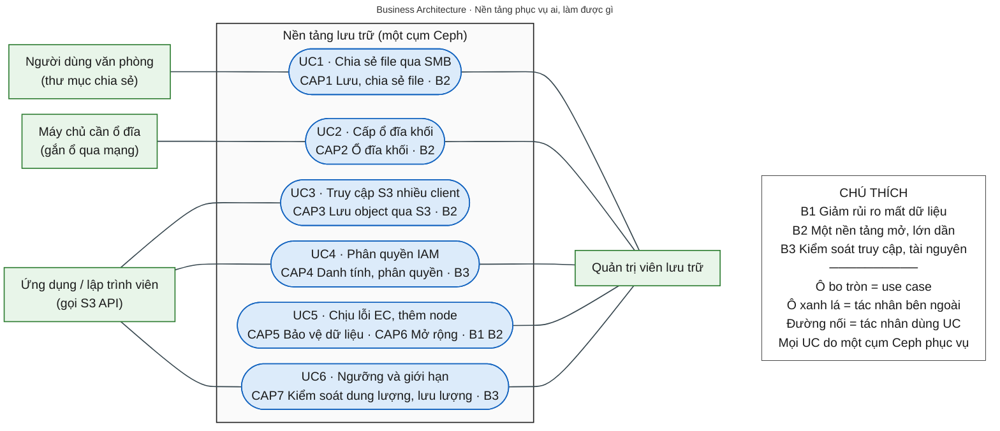
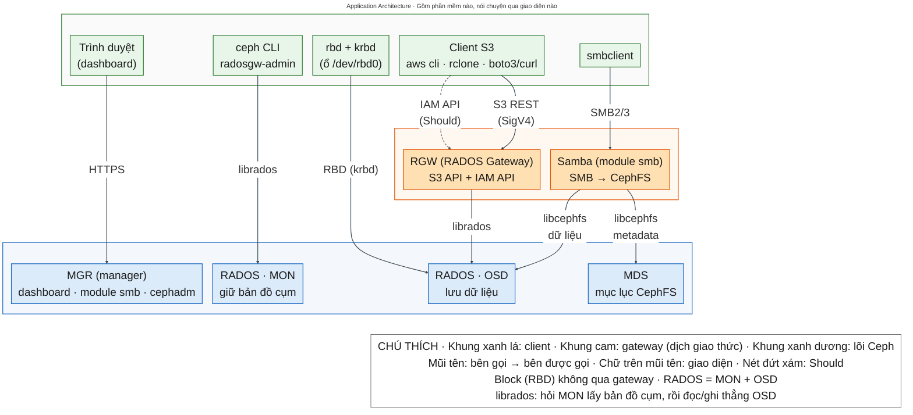
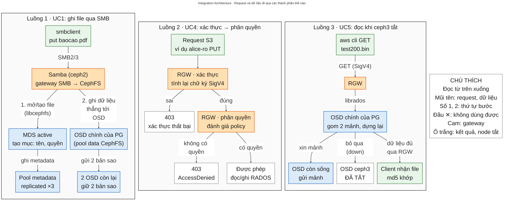
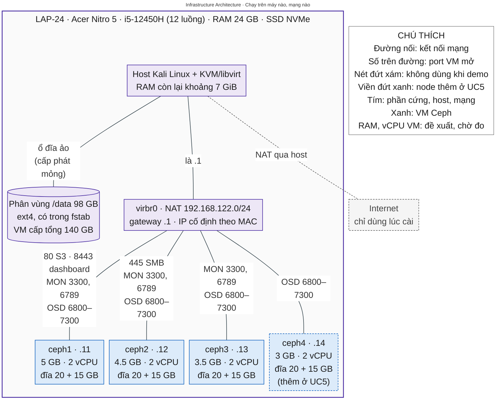
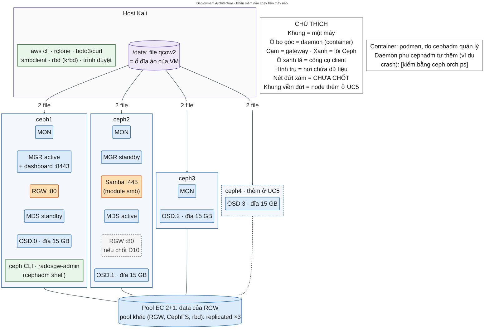

# NT132 · Project 2 (Ceph: block · file · object) · TÀI LIỆU NHÓM

> **v3.1 · 04/11/2026** (v3.1: đổi tên B1, sửa mốc MinIO; v3.0 cập nhật theo D15–D20: bỏ TrueNAS, chỉ dùng Ceph cho cả block, file, object; bản trước: v2.1 · 21/10/2026, thêm 5 sơ đồ kiến trúc vào T5). Tài liệu đầy đủ của nhóm. File ngắn để dán vào AI: `NT132-P2-AI.md`.
> File này viết lại từ "file ngữ cảnh v1.1" (18/10). Nó **chưa** được đối chiếu với `project2-ceph-nt132.md`; khi gộp, giữ một bản duy nhất cho mỗi nội dung.

---

## T0. Quy ước

- **Nhãn trạng thái:** **CHỐT** (nhóm đã quyết) · **ĐỀ XUẤT** (có phương án, chờ nhóm duyệt) · **CHƯA CHỐT** (chưa có câu trả lời; không tự điền).
- **Nhãn độ tin cậy cho lệnh và dữ kiện:** [đã chạy dd/mm] · [docs] (theo tài liệu chính thức) · [dự kiến] (chưa chạy) · [?] (chưa kiểm chứng). Tới 04/11/2026 **chưa có lệnh nào của lab [đã chạy]**; chỉ có lệnh kiểm phần cứng LAP-24 (file AI mục 3.1).
- **Mỗi thứ chỉ có một nguồn:**
  - Quyết định hiện hành, trạng thái, câu hỏi mở, gotchas → file AI (mục 2, 4, 5). Đổi ở đó trước, rồi thêm một dòng vào T12 của file này.
  - Đặc tả, runbook, kiến trúc, nội dung thuyết trình → file này.
- **Mã tham chiếu dùng chung với file AI:** D1–D20 (quyết định; D5, D6, D9, D12 đã HỦY), Q1–Q10 (câu hỏi mở), F/S/R/E/H/M/K/N (gotchas; CS1–CS6 đã bỏ cùng TrueNAS).
- **Số UC (từ 03/11, D16):** UC1 file · UC2 block · UC3 object · UC4 IAM · UC5 EC + node chết + thêm node · UC6 Thresholds & Limits. Bảng đối chiếu với số cũ: file AI mục 1.
- **Số capability (từ 04/11):** CAP1–CAP7 ở T2.1; bảng đối chiếu với số cũ ở ngay dưới bảng đó.
- **Placeholder:** `<user-smb>`, `<ACCESS_KEY>`, `<SECRET_KEY>`… là chỗ nhóm tự điền. Không ghi key thật vào tài liệu.

---

## T1. Ngữ cảnh, Scope, Objectives, Benefits (BẢN NHÁP · CHƯA CHỐT)

> Dùng cho slide 1–3. Theo ghi chú của thầy: objectives tối thiểu 3, mỗi cái một câu ngắn, giải quyết pain point thật, liền mạch với nhau; benefits là "triển khai thì được gì"; phải dựa trên thực tế, không hư cấu; viết xong phải quay lại cập nhật khi làm ra tính năng mới. Thầy dặn dành 20–40% thời gian cho phần này.
> **Viết lại 04/11 theo D15 (bỏ TrueNAS, chỉ dùng Ceph).** Toàn bộ T1 vẫn là bản nháp; nhóm duyệt ở Q8.

### T1.1 Ngữ cảnh

**Ghi chú của nhóm hỏi:** "phần này giống như bối cảnh thực tế đúng không?"
→ Đúng một nửa. Slide 1 gồm **ngữ cảnh** (bối cảnh thực tế: ai đang gặp vấn đề, trong hoàn cảnh nào) **và phạm vi** (ranh giới: nhóm nói về cái gì, không nói về cái gì, như ví dụ "xe Dream" của thầy). Thiếu phạm vi thì mỗi người nghe tự hình dung một kiểu.

**Bản nháp ngữ cảnh (viết lại 04/11):**
> Một tổ chức quy mô nhỏ [loại tổ chức và quy mô: CHƯA CHỐT; chọn một kịch bản minh họa và nói rõ là giả định] đang dùng nhiều kho lưu trữ rời nhau: một NAS cho thư mục chia sẻ (file, SMB), ổ đĩa gắn riêng cho từng máy chủ (block), và bắt đầu cần kho theo chuẩn S3 cho ứng dụng và công cụ sao lưu (object). Mỗi kho quản trị riêng, mở rộng riêng; NAS chỉ mở rộng được tới giới hạn của một máy, và máy đó hỏng thì mất truy cập dữ liệu file. Tổ chức cần: (1) một nền tảng phục vụ được cả ba kiểu lưu trữ; (2) vẫn chạy khi hỏng một máy và lớn dần được bằng cách thêm máy; (3) kiểm soát ai được đọc/ghi và mỗi người được dùng bao nhiêu. Tổ chức không muốn phụ thuộc cloud công cộng trả phí, và giải pháp mã nguồn mở quen thuộc (MinIO gateway) không còn dùng được.

### T1.2 Scope

**Trong phạm vi** (theo các quyết định CHỐT D1–D4, D7, D15, D16, D18):
- Nền tảng: **một cụm Ceph Tentacle 20.2.x**, cài bằng cephadm; 3 node (MON, MGR, OSD), thêm node thứ 4 (`ceph4`) ở UC5.
- File: CephFS, chia sẻ qua SMB2/3 bằng Samba do module `smb` của Ceph triển khai (thay vai trò NAS của TrueNAS).
- Block: RBD, 1 image map vào host Kali (mức ngắn).
- Object và gateway: RGW (S3 API, IAM API).
- Tính năng được chứng minh: một cụm phục vụ cả block, file, object; S3 với nhiều client; IAM (user, bucket policy, IAM Accounts); erasure coding 2+1, chịu mất 1 node, thêm node (backfill); quota, rate limit, ngưỡng đầy của cluster.
- Môi trường: 1 laptop, host Kali + KVM, quy mô lab, demo trực tiếp.

**Ngoài phạm vi:**
- TrueNAS, ZFS, Cloud Sync (bỏ theo D15). Cầu nối file↔object, gồm cả NFS export bucket RGW (D9 đã hủy).
- RBD làm ổ đĩa cho máy ảo / Proxmox (phần của Project 1). Gateway cho block (NVMe-oF, iSCSI).
- Gỡ node có kế hoạch (drain) (D18). SMB clustered (CTDB).
- Cloud công cộng (AWS S3), trừ khi thầy yêu cầu (Q2).
- Multisite / sao chép giữa nhiều site. HA phần cứng thật (mọi "host" nằm trên cùng 1 laptop).
- Đo hiệu năng / benchmark. Vận hành production (monitoring stack, tính toán dung lượng thật).

**CHƯA CHỐT:** RGW 2 instance (D10) · versioning, TLS, Object Lock (D14) · Cloud Transition / Cloud Restore.

**Câu chốt phạm vi (kiểu "xe Dream"), bản nháp:**
> "Trong bài này, nền tảng lưu trữ là **một cụm Ceph** phục vụ cả ba kiểu: block (RBD), file (CephFS, chia sẻ qua SMB) và object (S3 qua RGW). *Storage gateway* là thành phần dịch giao thức của client sang kho Ceph: RGW cho S3, Samba cho SMB. Chúng tôi không trình bày TrueNAS, MinIO gateway hay AWS Storage Gateway."

### T1.3 Pain points (vấn đề nan giải)

| # | Pain point | Bằng chứng đã có | Cần bổ sung |
|---|---|---|---|
| PP1 | Giải pháp gateway/S3 mã nguồn mở quen thuộc không còn dùng an toàn được: MinIO đã gỡ gateway (2022) và bản cộng đồng ngừng bảo trì. Dùng S3 của cloud công cộng thì phụ thuộc Internet và tốn phí. | MinIO blog (deprecation of the MinIO gateway); MinIO docs (migrate-fs-gateway); README chính thức của kho `minio/minio`: "THIS REPOSITORY IS NO LONGER MAINTAINED" (đọc 04/11); vonng.com, itsfoss.com (các mốc trước đó). Xem T13.1. | Tự mở github.com/minio/minio xác nhận banner "archived by the owner on Apr 25, 2026" (hiện chỉ thấy qua nguồn trích lại). |
| PP2 | **(viết lại 04/11)** Mỗi kiểu dữ liệu nằm ở một kho riêng (NAS cho file, ổ riêng cho máy chủ, kho S3 cho ứng dụng): mỗi kho phải quản trị, sao lưu, mở rộng riêng. NAS truyền thống mở rộng kiểu scale-up (thêm ổ vào cùng một máy) nên chạm giới hạn của máy đó; máy chứa NAS hỏng là mất truy cập toàn bộ dữ liệu file. | Chưa có. | **[CẦN NGUỒN]**: tài liệu định nghĩa unified storage, scale-up và scale-out (ví dụ tài liệu kiến trúc của Ceph, hoặc thuật ngữ của SNIA); báo cáo về mất dữ liệu do hỏng thiết bị. Không tự đặt số liệu. |
| PP3 | Kho dùng chung cho nhiều người và ứng dụng: dễ cấp quyền quá rộng; một client có thể chiếm hết dung lượng hoặc băng thông; muốn chịu lỗi bằng 3 bản sao thì tốn gấp 3 dung lượng. | "3 bản sao → dùng được 1/3 dung lượng" là phép tính, không cần nguồn. | **[CẦN NGUỒN]**: nguyên tắc least privilege (ví dụ tài liệu IAM của AWS hoặc một chuẩn bảo mật). |

### T1.4 Objectives (viết lại 04/11)

| # | Objective (một câu) | Giải quyết | Trả lời "tại sao làm việc này" |
|---|---|---|---|
| O1 | Dựng một nền tảng lưu trữ tự vận hành bằng Ceph, phục vụ cả block, file (SMB) và object (S3), thay vai trò của TrueNAS và MinIO gateway. | PP1, PP2 | Một nền tảng mở, còn được phát triển, chạy trên hạ tầng của chính mình, thay cho nhiều kho rời nhau. |
| O2 | Làm cho dữ liệu không mất khi hỏng một máy và cho nền tảng lớn dần bằng cách thêm máy, không phải dừng dịch vụ. | PP2, PP3 | Dữ liệu không phụ thuộc một máy; erasure coding chịu lỗi mà tốn ít dung lượng hơn 3 bản sao; dung lượng tăng theo số máy. |
| O3 | Kiểm soát kho dùng chung: phân quyền bằng IAM, giới hạn bằng quota và rate limit. | PP3 | Kho dùng chung chỉ an toàn khi đúng người đúng quyền và không ai chiếm hết tài nguyên. |

**Mạch liền:** O1 dựng một nền tảng cho cả ba kiểu → O2 làm cho nền tảng bền (chịu hỏng máy) và lớn dần được (thêm máy) → O3 làm cho nền tảng an toàn khi nhiều người cùng dùng.

### T1.5 Benefits (viết lại 04/11)

| # | Benefit | Chứng minh bằng | Khi demo nhìn thấy gì | Không được nói (tránh "chém gió") |
|---|---|---|---|---|
| B1 | **Giảm rủi ro mất dữ liệu** (đổi tên 04/11, xem T12.1). Dữ liệu được chia mảnh trên nhiều máy; mất 1 node vẫn đọc/ghi được và tự phục hồi khi node quay lại; tốn ít dung lượng hơn 3 bản sao. | UC5 | `ceph -s` báo degraded nhưng md5 của file tải về vẫn khớp; bật lại node → HEALTH_OK. `ceph df` cho thấy USED/STORED của pool EC (lý thuyết 1.5×; replica 3 là 3×) — số thật đo khi chạy. | Không nói "không bao giờ mất dữ liệu": cả cụm nằm trên 1 laptop, và EC 2+1 mất 2 node là mất dữ liệu. |
| B2 | **Một nền tảng mở cho mọi kiểu dữ liệu, lớn dần theo nhu cầu.** Cùng một cụm phục vụ thư mục chia sẻ (SMB), ổ đĩa (RBD) và S3 cho nhiều công cụ có sẵn (aws cli, rclone, boto3), không cần cloud trả phí; thêm máy là thêm dung lượng mà không dừng dịch vụ. | UC1, UC2, UC3, UC5 (phần thêm node) | Cùng một cụm, ba cách truy cập: file qua `smbclient`, ổ `/dev/rbd0` trên Kali, bucket qua aws cli và rclone. Thêm ceph4: `ceph osd df` thấy dữ liệu dàn sang OSD mới, `ceph df` thấy tổng dung lượng tăng. | Không nói "tương thích 100% với AWS S3" hay "mở rộng vô hạn"; chỉ nói về những gì đã demo. Không nói "thay được NAS thương mại về mọi mặt": module `smb` của Tentacle còn đang phát triển (F1). |
| B3 | **Kiểm soát truy cập và tài nguyên.** Mỗi người hoặc ứng dụng chỉ làm đúng việc được cấp; không ai chiếm hết dung lượng hay làm quá tải dịch vụ. | UC4, UC6 | 403 AccessDenied khi user chỉ-đọc ghi dữ liệu; ghi bị từ chối khi vượt quota (mã lỗi: kiểm khi chạy); 503 khi vượt rate limit. | Không nói "chống được DoS": rate limit chỉ giới hạn theo user/bucket, trên từng RGW. |

### T1.6 Việc cần làm để chốt T1

- [ ] Chọn kịch bản ngữ cảnh minh họa (loại tổ chức, quy mô) và ghi rõ là giả định.
- [ ] Tìm nguồn thật cho PP2 và PP3; xác nhận lại nguồn của PP1.
- [ ] Duyệt O1–O3 và B1–B3 bản viết lại 04/11 (Q8).
- [ ] Sau khi lab chạy: thay "lý thuyết" ở B1 bằng số đo thật; quay lại sửa T1 nếu kết quả khác (vòng lặp thầy dặn).
- [ ] Mỗi lần sửa benefit, đọc lại cột "Không được nói".

---

## T2. Business capabilities & bảng truy vết

> Theo ghi chú của thầy: Business Architecture nói về business capability (nền tảng làm được những chức năng nào). Use case lấy ra từ các capability đó. Mỗi UC phải chứng minh objective/benefit, và ít nhất 3 benefit phải có trong demo.

### T2.1 Business capabilities (đánh số lại 04/11)

| ID | Capability (nền tảng làm được gì) | Thành phần | Dùng ở UC |
|---|---|---|---|
| CAP1 | Lưu trữ và chia sẻ file qua mạng (SMB) | CephFS (MDS, OSD) + Samba (module `smb`) | UC1 |
| CAP2 | Cung cấp ổ đĩa khối (block) qua mạng | RBD + RADOS | UC2 |
| CAP3 | Lưu trữ object qua API chuẩn S3 | Ceph RGW + RADOS | UC3; UC4–UC6 dùng S3 để thao tác |
| CAP4 | Quản lý danh tính và phân quyền | RGW user, bucket policy, IAM Accounts | UC4 |
| CAP5 | Bảo vệ dữ liệu khi hỏng phần cứng, tiết kiệm dung lượng | RADOS: erasure coding, CRUSH, recovery | UC5 |
| CAP6 | Mở rộng dung lượng bằng cách thêm máy (scale-out) | RADOS: CRUSH, backfill; cephadm thêm host | UC5 |
| CAP7 | Kiểm soát dung lượng và lưu lượng | RGW quota, rate limit; ngưỡng đầy của RADOS | UC6 |

**Đối chiếu số cũ (trước 04/11):** CAP1 cũ (file SMB, do TrueNAS) → CAP1 (nay do Ceph) · CAP2 cũ (object) → CAP3 · CAP3 cũ (sao lưu file ↔ object bằng Cloud Sync) → **bỏ** (D15) · CAP4, CAP5 giữ số · CAP6 cũ (quota, rate limit) → CAP7 · CAP7 cũ (NFS export bucket) → **bỏ** (D9). Mới: CAP2 (block), CAP6 (scale-out).

**Tác nhân (actor) cho sơ đồ use case (ĐỀ XUẤT, chốt khi vẽ lại slide 6):** Người dùng văn phòng (client SMB) · Máy chủ cần ổ đĩa (client RBD) · Ứng dụng / lập trình viên (client S3) · Quản trị viên lưu trữ.

### T2.2 Bảng truy vết: Benefit → Capability → Use case → bước demo

Mã bước (UC1-D1…) là **ĐỀ XUẤT 04/11**; T6 khi viết lại phải dùng đúng các mã này. "Live" = làm trực tiếp; "Video" = chiếu video quay từ lab thật. Các bước của UC3, UC4, UC6 giữ nội dung cũ, chỉ đổi số UC (UC2-D… cũ → UC3-D…, v.v.). **UC5 đánh số lại 04/11 theo thứ tự chạy** (thêm ceph4 trước, node chết sau; T6): D1–D2 như cũ · thêm ceph4 = D3→D4 · node chết = D5→D8.

| Benefit | Objective | Capability | UC | Bước demo | Live / Video | Bằng chứng trên màn hình |
|---|---|---|---|---|---|---|
| B1 | O2 | CAP5 | UC5 | UC5-D5→D7: tắt ceph3 → `ceph -s` → tải file về, so md5 | Live | HEALTH_WARN + md5 trùng nhau |
| B1 | O2 | CAP5 | UC5 | UC5-D2: `ceph df`, xem USED/STORED của pool EC | Live (hoặc ảnh chụp) | Tỉ lệ đo được so với lý thuyết 1.5× |
| B1 | O2 | CAP5 | UC5 | UC5-D8: bật ceph3 → recovery → HEALTH_OK | Chạy nền, xem lại cuối UC6; có video dự phòng | `ceph -s` HEALTH_OK |
| B1 | O2 | CAP3 | UC3 | UC3-S1 (Should): ghi đè object → lấy lại bản cũ nhờ versioning (chống ghi đè, xóa nhầm) | CHƯA CHỐT (D14) | `list-object-versions` có 2 phiên bản |
| B2 | O1 | CAP1 | UC1 | UC1-D1→D2: `smbclient` ghi file vào share, đọc lại, so md5 | Live | File có trên share; md5 khớp |
| B2 | O1 | CAP1 | UC1 | UC1-D3: `ceph fs status`, `ceph df` | Live | MDS active; pool data của CephFS tăng |
| B2 | O1 | CAP2 | UC2 | UC2-D1→D2: `rbd map` image trên Kali, mount, ghi file | Live | `/dev/rbd0` mount được, ghi được file |
| B2 | O1 | CAP3 | UC3 | UC3-D1→D2: cùng bucket bằng aws cli và rclone | Live | Hai danh sách giống nhau |
| B2 | O1 | CAP3 | UC3 | UC3-D3: presigned URL tải được bằng curl, hết hạn thì 403 | Live | HTTP 200, sau đó 403 |
| B2 | O2 | CAP6 | UC5 | UC5-D3→D4: thêm ceph4 (host + OSD) → backfill | Live, làm trước phần node chết (CHỐT 04/11, T6); backfill lâu thì chiếu video UC5-V2 (đo khi tập, N3) | `ceph osd df`: OSD mới có dữ liệu; `ceph df`: tổng dung lượng tăng |
| B3 | O3 | CAP4 | UC4 | UC4-D1→D2: user chỉ-đọc liệt kê được, PUT bị 403 | Live | AccessDenied |
| B3 | O3 | CAP7 | UC6 | UC6-D1: PUT vượt quota bị từ chối | Live | Mã lỗi (kiểm khi chạy) |
| B3 | O3 | CAP7 | UC6 | UC6-D2: vòng lặp PUT vượt rate limit | Live | Các dòng FAIL / 503 |
| B3 | O3 | CAP7 | UC6 | UC6-V1: hạ ngưỡng full → ghi bị chặn → khôi phục | Video | Cảnh báo full trong `ceph health detail` |

### T2.3 Đối chiếu với yêu cầu của thầy

| Yêu cầu | Kết quả |
|---|---|
| Mỗi UC chứng minh ít nhất 1 objective/benefit | UC1 (O1; B2) · UC2 (O1; B2) · UC3 (O1; B2) · UC4 (O3; B3) · UC5 (O2; B1, B2) · UC6 (O3; B3) → đạt |
| Ít nhất 3 benefit có trong demo | B1 (UC5 live) · B2 (UC1, UC2, UC3 live) · B3 (UC4, UC6 live) → đạt, kể cả khi không chiếu phần video |
| Chỗ yếu | **B1 nay chỉ dựa vào UC5** (bản cũ còn có UC1 cũ, tức Cloud Sync), mà UC5 là UC rủi ro cao nhất khi live (T8.1). UC5 hỏng thì B1 chỉ còn video dự phòng. B2 dựa vào 3 UC nên chắc, nhưng UC1 phụ thuộc module `smb` còn đang phát triển (F1). |

---

## T3. Khung thuyết trình 17 slide (Q9 CHỐT 04/11)

| Slide | Nội dung | Lấy từ | Trạng thái |
|---|---|---|---|
| 1 | Ngữ cảnh + Scope | T1.1, T1.2 | Bản nháp (viết lại 04/11) |
| 2 | Objectives (O1–O3, gắn PP1–PP3) | T1.3, T1.4 | Bản nháp (viết lại 04/11) |
| 3 | Benefits (B1–B3) | T1.5 | Bản nháp (viết lại 04/11) |
| 4 | Tổng quan (What): 3 kiểu lưu trữ (block, file, object), S3, Ceph (RADOS, RBD, CephFS, RGW), SDS | T9, file AI mục 6 | CHƯA LÀM |
| 5 | Cách hoạt động (How): RADOS, CRUSH/PG, erasure coding, đường đi của một request (ghi file qua SMB, S3 PUT), thêm node → backfill | T5.3 | CHƯA LÀM |
| 6 | Business Architecture | T5.1 | Sơ đồ và file giải thích viết lại 04/11; chưa dựng slide |
| 7 | Application Architecture | T5.2 | Sơ đồ và file giải thích viết lại 04/11; chưa dựng slide |
| 8 | Integration Architecture | T5.3 | Sơ đồ và file giải thích viết lại 04/11; chưa dựng slide |
| 9 | Infrastructure Architecture | T5.4 | Sơ đồ và file giải thích viết lại 04/11; chưa dựng slide |
| 10 | Deployment Architecture | T5.5 | Sơ đồ và file giải thích viết lại 04/11; chưa dựng slide (thầy xác nhận bắt buộc 20/10, Q3 CHỐT) |
| 11 | UC1 – File (SMB trên CephFS) | T6, T8 | CHƯA LÀM |
| 12 | UC2 – Block (RBD) | T6, T8 | CHƯA LÀM |
| 13 | UC3 – Object (S3 với nhiều client) | T6, T8 | CHƯA LÀM |
| 14 | UC4 – IAM | T6, T8 | CHƯA LÀM |
| 15 | UC5 – Erasure coding, node chết, thêm node | T6, T8 | CHƯA LÀM |
| 16 | UC6 – Thresholds & Limits | T6, T8 | CHƯA LÀM |
| 17 | Kết luận, giới hạn, hướng phát triển | T5.6 | CHƯA CHỐT (ghi chú của thầy không nói slide kết là gì) |

- **Thời lượng:** tối thiểu 2 phút/slide → khoảng 34 phút cho 17 slide, sát trần 30–35 phút → **gần như không còn dự phòng**. Nhóm chọn giữ 17 slide (Q9, 04/11). Cách bù: nói nhanh slide 4–5 (What/How); UC2 chỉ làm mức ngắn. Slide 11–16 (6 UC) được khoảng 12 phút (T8.1, ĐỀ XUẤT 04/11).
- **Chỗ đặt Deployment (CHỐT 20/10, Q3):** slide riêng (slide 10), ngay sau Infrastructure; thầy xác nhận bắt buộc làm. Phần kiến trúc gồm 5 slide (6–10). Tổng số slide tăng 15 → 16 khi thêm Deployment (20/10), rồi 16 → 17 khi có UC thứ 6 (D16, Q9). (Không chọn: gộp 2 sơ đồ vào slide 9, hay vẽ daemon chồng lên sơ đồ máy chủ — vì Infrastructure và Deployment trả lời 2 câu khác nhau, T5.5.)
- **Lưu ý của thầy:** không đọc slide; trình bày cho cả lớp, không chỉ cho thầy; dành khoảng 30% thời gian đồ án cho báo cáo; người nghe đọc phần đầu và phần kết trước, nên slide 1–3 và slide 17 (kết) phải mạnh nhất.

---

## T4. Bối cảnh môn & đề gốc

### T4.1 Môn học

- **NT132 – Quản trị mạng và hệ thống (System and Network Administration)**, Trường ĐH Công nghệ Thông tin (UIT). Giảng viên: ThS. Duy Nguyễn (duyn@uit.edu.vn).
- Thầy chỉ cung cấp slide buổi đầu (ghi ngày "25.01.02") và ghi chú hướng dẫn thuyết trình (`format-ghichu.md`); **không có file đặc tả riêng** cho Project 2, chưa có rubric chính thức.
- **Mục tiêu môn:** (1) Switching, Routing, ACL, NAT; (2) môi trường Windows: User, Policy, Storage, Backup; (3) dịch vụ mới: Cloud Networking, Cloud Server & Storage, Container; (4) học qua bài tập.
- **Các chương:** 1 IPv4 · 2 Router & Routing Protocols · 3 RIPv1, RIPv2, OSPF · 4 Switching & VLAN · 5 ACL & NAT · 6 DNS & DHCP · 7 Domain Controller · **8 RAID & File System** · 9 Group Policy · **10 Backup & Recovery Sites** · 11 Cloud Networking · **12 Cloud Server & Storage** · **13 Container & Kubernetes** · 14 Report 1 · 15 Report 2.
- **Các lab:** 1 VLSM & Static Routing · 2 VLAN & Dynamic Routing · 3 NAT & ACL · 4 Linux Services (Ubuntu, Apache, MySQL, LEMP) · 5 Windows Services (Domain Controller, Group Policy, File System) · 6 Container & Kubernetes.
- **10 đề tài:** 1 Proxmox (có Ceph) · **2 Storage Services & Gateway (nhóm này)** · 3 MS SQL HA · 4 MongoDB HA · 5 Monitoring với ELK · 6 OpenStack · 7 DevOps (Jenkins) · 8 Kubernetes (Rancher, Istio) · 9 API Platform · 10 Centralized IAM.
- **Trùng với Project 1:** Project 1 cũng dùng Ceph nhưng làm block storage (RBD) cho máy ảo → nhóm này chỉ làm block ở mức ngắn (UC2) để chứng minh một cụm đủ cả 3 kiểu; trọng tâm là object (RGW), file qua SMB, IAM, EC, thêm node.
- **Liên hệ chương ↔ đồ án:** chương 8 ↔ erasure coding (giống RAID 5), CephFS (filesystem) · chương 10 ↔ chịu mất node, recovery (và versioning nếu làm, D14) · chương 12 ↔ block / file / object, S3 · chương 13 ↔ cephadm chạy daemon Ceph trong container (podman).

### T4.2 Đề gốc trên slide (nguyên văn, chỉ để tham chiếu)

```
Project 2 - Building up Storage Services and Storage Gateway
Project Objective
 - Learning Network Attach Storage (TrueNAS) and Object Storage (S3)
 - Learning Storage Gateway (MinIO)
Project Outcomes
 - Building up a Storage System: NAS(TrueNAS), Object Storage(S3) & Storage Gateway (MinIO)
 - Testing Features:
   + Use-case 1: Connect TrueNAS through MinIO by SMB/CIFS protocols
   + Use-case 2: Connect S3 through MinIO by S3
   + Use-case 3: Testing IAM feature
   + Use-case 4: Testing Erasure Coding
   + Use-case 5: Testing Thresholds and Limits
Ref - Link MinIO
```

- **Cách hiểu đề gốc:** UC1 gốc dùng MinIO **NAS gateway mode** (máy chạy MinIO mount share SMB của TrueNAS rồi mở cổng S3; object upload bằng S3 trở thành file trên NAS). UC2 gốc dùng MinIO **S3 gateway mode** (MinIO làm proxy đứng trước AWS S3). Tên UC5 gốc (nay là UC6) trùng với tên trang tài liệu "Thresholds and Limits" của MinIO.
- **Ghi chú của thầy trên slide:** "software define storage" (chủ đề lớn là SDS, Ceph là ví dụ tiêu biểu); "tập trung nghiên cứu giải pháp" (phải giải thích vì sao chọn giải pháp, kiến trúc, so sánh và giới hạn); "MinIO đã loại bỏ tính năng gateway → sử dụng Ceph thay thế".
- **Góp ý miệng của thầy ngày 28/10** (Dũng hỏi riêng; ghi chép tay, thầy nói nhanh): "chỉ cần ceph thôi không cần truenas nữa"; phần demo: "block / file / object", "thêm 1 node xem nó expand như thế nào", "xóa 1 node thì như thế nào". Nhóm áp dụng ở D15, D16, D18.
- **Lỗi gõ trên slide** (đừng chép vào báo cáo): "SBM" → SMB; "Network Attach Storage" → Network Attached Storage; "Promox" → Proxmox.

### T4.3 Đề tài nhóm thực hiện (bản Ceph, viết lại 04/11 · ĐỀ XUẤT)

| Mục | Nội dung |
|---|---|
| Objective 1 (của đề) | Learning Software-Defined Storage with Ceph: block (RBD), file (CephFS shared over SMB) and S3-compatible object storage (Ceph RGW) |
| Objective 2 (của đề) | Learning Storage Gateways: Ceph RGW (S3) and Samba (SMB) |
| Outcome | Building up a unified storage system on one Ceph cluster: file storage (NAS role, replacing TrueNAS), block storage and object storage, with storage gateways |
| UC1 | Share files over SMB/CIFS from CephFS |
| UC2 | Provide a block device (RBD) from the same cluster |
| UC3 | Access Ceph RGW by S3 API from multiple S3 clients |
| UC4 | Testing IAM feature |
| UC5 | Testing Erasure Coding: node failure and adding a node |
| UC6 | Testing Thresholds and Limits |

> "Objective" của đề là mục tiêu học. O1–O3 ở T1 là objective của bài thuyết trình (giải quyết pain point). Đừng trộn hai loại này trên slide 2.

### T4.4 Ánh xạ yêu cầu gốc → giải pháp của nhóm

| Vai trò trong đề | Thiết kế gốc | Thiết kế nhóm dùng |
|---|---|---|
| NAS | TrueNAS | CephFS + share SMB2/3 (Samba do module `smb` của Ceph triển khai); thay TrueNAS (D15) |
| Object Storage (S3) | AWS S3 / MinIO | Ceph RGW |
| Storage Gateway | MinIO gateway | RGW (S3 → RADOS) + Samba (SMB → CephFS → RADOS) (D17, ĐỀ XUẤT) |
| (không có trong đề) | — | Block: RBD (UC2, theo góp ý 28/10) |
| IAM | MinIO IAM | User RGW + bucket policy + IAM Accounts |
| Erasure Coding | MinIO EC | Pool EC của Ceph; UC5 có thêm phần mất node và thêm node (D18) |
| Thresholds & Limits | Trang tài liệu MinIO | Giới hạn của RGW + quota + rate limit + ngưỡng đầy cluster |

---

## T5. Kiến trúc: 5 sơ đồ (VẼ LẠI 04/11 theo D15–D18)

> 4 loại đầu theo ghi chú của thầy (slide 6–9). Deployment là slide 10 (thầy xác nhận bắt buộc 20/10, Q3 CHỐT). Bản 21/10 vẽ cho thiết kế cũ (TrueNAS + Ceph); bản này vẽ lại cho **một cụm Ceph** (D15), 6 UC (D16), thêm ceph4 (D18). File nằm trong thư mục `NT132-P2-kien-truc/`.
> Mỗi mục dưới đây gồm: câu hỏi sơ đồ trả lời, sơ đồ (hiển thị trực tiếp trong Markdown), cách đọc, điểm chính, việc còn phải kiểm. **Lời nói mẫu, 3 câu hỏi vấn đáp và danh sách "Không được nói" của từng sơ đồ** nằm trong file giải thích tương ứng (bảng T5.0), không chép lại ở đây.

### T5.0 Tệp, quy ước chung, cách xem sơ đồ

| Slide | Loại | Mã Mermaid (nguồn) | Ảnh xem trước | Giải thích đầy đủ |
|---|---|---|---|---|
| 6 | Business | [slide06-business.mmd](NT132-P2-kien-truc/slide06-business.mmd) | [PNG](NT132-P2-kien-truc/slide06-business-preview.png) | [bussiness-explain.md](NT132-P2-kien-truc/bussiness-explain.md) |
| 7 | Application | [slide07-application.mmd](NT132-P2-kien-truc/slide07-application.mmd) | [PNG](NT132-P2-kien-truc/slide07-application-preview.png) | [application-explain.md](NT132-P2-kien-truc/application-explain.md) |
| 8 | Integration | [slide08-integration.mmd](NT132-P2-kien-truc/slide08-integration.mmd) | [PNG](NT132-P2-kien-truc/slide08-integration-preview.png) | [intergration-explain.md](NT132-P2-kien-truc/intergration-explain.md) |
| 9 | Infrastructure | [slide09-infrastructure.mmd](NT132-P2-kien-truc/slide09-infrastructure.mmd) | [PNG](NT132-P2-kien-truc/slide09-infrastructure-preview.png) | [infragstructure-explain.md](NT132-P2-kien-truc/infragstructure-explain.md) |
| 10 | Deployment | [slide10-deployment.mmd](NT132-P2-kien-truc/slide10-deployment.mmd) | [PNG](NT132-P2-kien-truc/slide10-deployment-preview.png) | [deployment-explain.md](NT132-P2-kien-truc/deployment-explain.md) |

- **Nguồn của sơ đồ (ĐỀ XUẤT):** file `.mmd` là bản gốc. Khối `mermaid` trong T5 là bản chép nguyên văn để xem ngay trong tài liệu. Khi sửa sơ đồ: sửa `.mmd` → chép đè vào khối tương ứng ở T5 → xuất lại PNG cho slide.
- **Đã kiểm hiển thị [đã chạy 04/11 trong phiên AI; chưa chạy lại trên LAP-24]:** vẽ cả 5 file `.mmd` bằng **hai bản**: mermaid-cli 11.4.2 (thực chất chạy Mermaid 11.17.2) và mermaid-cli 12.2.0 (Mermaid 12.3.0), Chromium headless. Hai bản cho cùng bố cục. Ảnh xem trước xuất bằng bản 11, độ rộng 2000 px. Máy vẽ không có font Arial nên chữ trên ảnh là font thay thế; trên LAP-24 chữ có thể rộng hơn một chút.
- **Vì sao đầu mỗi file có khối `config:` với `layout: dagre` (sửa 04/11):** Mermaid 12 đổi engine bố cục mặc định. Không ghi rõ thì đường nối thành đoạn gấp khúc vuông góc (bỏ qua `curve: basis`), vị trí và thứ tự ô thay đổi (ở slide 6: UC3 lệch trái, UC5 và UC6 đổi chỗ). Ghi `layout: dagre` (engine Mermaid 11 dùng) thì hai bản vẽ giống nhau. Cấu hình cũng chuyển từ dòng `%%{init}%%` sang khối `config:` nằm trong phần `---` đầu file; cả hai bản đều nhận (đã thử). Khối `---` (title + config) phải nằm ngay dòng đầu của khối mermaid. Nếu trình xem (VS Code, GitHub) vẽ khác ảnh xem trước, kiểm bản Mermaid của trình xem đó trước.
- **Xem trong VS Code:** khung preview Markdown mặc định của VS Code **không** vẽ Mermaid (chỉ hiện code). Cài extension *Markdown Preview Mermaid Support* (`bierner.markdown-mermaid`), rồi mở preview (`Ctrl+Shift+V`). GitHub và GitLab vẽ sẵn, không cần cài gì. Xuất PDF bằng extension *Markdown PDF* (yzane, đang cài trên LAP-24): [?] chưa thử với 5 sơ đồ này.
- **Chữ to (24–32 px) là cố ý** để chiếu slide. Trong Markdown, sơ đồ tự thu nhỏ cho vừa khung xem.
- **Bảng màu chung cho cả 5 sơ đồ (v3, 04/11):** lớp màu `truenas` cũ đổi tên thành `gateway`, giữ màu cam.

| Màu | Nghĩa |
|---|---|
| Xanh lá | Client, tác nhân bên ngoài, công cụ client |
| Cam | **Gateway**: thành phần dịch giao thức client sang Ceph (RGW, Samba) |
| Xanh dương | Lõi Ceph (MON, MGR, OSD, MDS, pool) và VM Ceph |
| Xanh dương, viền đứt | Node chỉ tham gia cụm ở UC5 (ceph4), slide 9–10 |
| Tím | Phần cứng, host, mạng (slide 9, 10) |
| Xám nét đứt | Should / CHƯA CHỐT / không dùng khi demo |
| Trắng | Chú thích, kết quả, máy đã tắt |

- **Đường nối mang nghĩa khác nhau ở mỗi slide** (nhắc người nghe khi chuyển slide):

| Slide | Đường nối / mũi tên nghĩa là | Chữ trên đường |
|---|---|---|
| 6 | Tác nhân tham gia use case (không mũi tên, **không** phải luồng dữ liệu) | — |
| 7 | Bên gọi → bên được gọi | Giao diện (SMB, S3 REST, libcephfs, librados, RBD…) |
| 8 | Chiều request hoặc dữ liệu đi | Giao diện, thứ tự bước, hoặc điều kiện rẽ nhánh |
| 9 | Kết nối mạng | Port VM mở |
| 10 | File qcow2 → ổ đĩa của VM; máy → pool | Số file qcow2 |

- **Ẩn dụ chung (dùng khi mở đầu phần kiến trúc):** 5 slide như mô tả một nhà hàng. Business = thực đơn và khách; Application = các bộ phận (bếp, quầy, thu ngân); Integration = đường đi của một order; Infrastructure = tòa nhà, điện, nước; Deployment = ai đứng ở bếp nào.

### T5.1 Business Architecture (slide 6) · VẼ LẠI 04/11

- **Trả lời:** nền tảng có những business capability nào, phục vụ ai, phục vụ việc gì. Không có VM, IP, port.



- **Cách đọc:** khung xám ở giữa là ranh giới nền tảng (system boundary), ghi rõ "một cụm Ceph". Bên trái là 3 nhóm dùng nền tảng, bên phải là quản trị viên. Mỗi ô bo tròn: dòng 1 là *việc gì*, dòng 2 là *capability* và *benefit* (B1–B3 tra ở chú thích). Đường nối không có mũi tên = "tác nhân tham gia use case".
- **Khác với bản 21/10:**
  - 6 UC thay cho 5 (D16); số capability theo T2.1 (CAP1–CAP7).
  - Thêm tác nhân **"Máy chủ cần ổ đĩa"** cho UC2 (block).
  - Quản trị viên nối với UC1, UC2, UC4, UC5, UC6: tạo share và user SMB, tạo image RBD và cấp quyền, tạo user/policy, vận hành cụm (tắt/thêm node), đặt quota và rate limit. Không nối UC3: ứng dụng tự dùng S3 bằng key đã được cấp.
  - Mọi UC cùng một màu xanh: cả 6 do **một cụm Ceph** phục vụ. Bản cũ dùng màu cam cho UC1 vì do TrueNAS làm.
  - UC5 ghi 2 capability (CAP5 bảo vệ dữ liệu, CAP6 mở rộng), vì "thêm node" là góp ý trực tiếp của thầy (28/10).
- **Không vẽ:** bản đồ capability riêng; quy trình swimlane (đã sang slide 8).
- **Đã sửa lỗi của bản cũ:** đường từ quản trị viên không còn chạy xuyên ô chú thích.
- **Sửa 04/11 sau khi nhóm xem:** UC3 bị lệch trái khi xem bằng Mermaid 12. Nguyên nhân là engine bố cục (T5.0); đã ghim `layout: dagre`. Đo lại trên ảnh: tâm 6 ô UC trùng nhau trên cả hai bản Mermaid.

### T5.2 Application Architecture (slide 7) · VẼ LẠI 04/11

- **Trả lời:** gồm những thành phần phần mềm nào, nói chuyện với nhau qua giao diện nào. Không đặt component vào VM (việc của slide 10).



- **Cách đọc:** từ trên xuống theo 3 khung: **xanh lá = client** → **cam = gateway** (Samba, RGW) → **xanh dương = lõi Ceph** (MGR, RADOS · MON, RADOS · OSD, MDS). 3 khung không ghi tiêu đề (lý do ở dưới); nghĩa của từng khung ghi ở dòng đầu chú thích. Nét đứt xám = Should (IAM API, UC4 tầng 2).
- **4 con đường:**
  - **File (UC1):** smbclient → Samba → MDS (metadata) và OSD (dữ liệu).
  - **Block (UC2):** rbd/krbd trên Kali → **thẳng** OSD, không qua gateway.
  - **Object (UC3–UC6):** client S3 → RGW → OSD.
  - **Quản trị:** trình duyệt → MGR (dashboard); ceph CLI, radosgw-admin → MON (lệnh quản trị qua librados).
- **Điểm chính để trả lời vấn đáp:**
  - **Hai gateway, một kho:** Samba và RGW dịch hai giao thức khác nhau (SMB, S3) nhưng cùng ghi vào một RADOS (D17).
  - **Block không có gateway:** thư viện phía client (krbd trong kernel Kali) tự chia ổ đĩa thành object RADOS và nói thẳng với OSD.
  - **RADOS = MON + OSD.** librados (dùng trong RGW, Samba, ceph CLI…) hỏi MON lấy bản đồ cụm, rồi tự tính vị trí và đọc/ghi thẳng OSD. Vì vậy mũi tên dữ liệu trỏ vào OSD, còn mũi tên của ceph CLI trỏ vào MON.
  - **MDS chỉ giữ metadata** (tên file, thư mục, quyền). Dữ liệu file đi thẳng từ Samba (qua libcephfs) tới OSD, không đi qua MDS.
  - **Module `smb` nằm trong MGR:** nó chỉ *triển khai và cấu hình* container Samba (qua cephadm), không nằm trên đường đi của dữ liệu.
  - **ceph CLI / radosgw-admin đi thẳng vào RADOS qua librados**, không qua S3, nên không bị kiểm SigV4 hay bucket policy; chỉ dùng được trên máy có keyring admin.
  - **MGR không nằm trên đường đi của dữ liệu.**
  - **SigV4 là ký, không phải mã hóa:** nội dung object vẫn đi dạng rõ qua HTTP (liên quan D14, TLS).
- **Bố cục sửa 04/11** (góp ý của nhóm: rối mắt, đường gấp khúc, lõi Ceph ở xa, chú thích lệch). Đã thử khoảng 10 phương án, so trên cả Mermaid 11 và 12:
  - Lõi Ceph chỉ còn **1 hàng**, ngay dưới gateway. Bỏ 2 mũi tên nội bộ MDS → RADOS và MGR → RADOS (MDS, MGR tự lưu trạng thái vào RADOS), vì 2 mũi tên này đẩy lõi Ceph xuống thêm một tầng.
  - Mũi tên trỏ thẳng vào ô **OSD** (dữ liệu) hoặc **MON** (lệnh quản trị), thay vì vào viền khung RADOS; bỏ khung lồng RADOS và MGR (MGR gộp thành 1 ô liệt kê dashboard, module smb, cephadm).
  - 3 client S3 (aws cli, rclone, boto3/curl) gộp vào một ô; mũi tên IAM API (Should) đi từ ô đó.
  - **3 khung không ghi tiêu đề là cố ý:** Mermaid luôn đặt tiêu đề khung ở giữa, mà đường RBD và đường S3 đi qua đúng chỗ đó. Đã thử dời, rút gọn tiêu đề và đổi thứ tự ô, nhưng không cách nào tránh được.
  - Chú thích 4 dòng nằm ngang, đặt dưới khung lõi Ceph (nhờ một liên kết ẩn).
  - Thứ tự khai báo client là cố ý: mỗi client đứng gần ngay trên đích của nó, nên đường nối gần như thẳng đứng.
- **Không vẽ (cố ý):** các đường "cấu hình" (module smb → Samba, cephadm → daemon); MDS → RADOS, MGR → RADOS.

### T5.3 Integration Architecture (slide 8, và một phần slide 5) · VẼ LẠI 04/11

- **Trả lời:** request và dữ liệu đi qua các thành phần như thế nào, qua 3 tình huống ứng với demo UC1, UC4, UC5 (nhóm chọn 04/11: giữ 3 luồng; phần thêm node → backfill để ở slide 5).



- **Cách đọc:** trái sang phải qua 3 làn, trong mỗi làn đọc từ trên xuống. Mũi tên = chiều request/dữ liệu (khác slide 7: "ai gọi ai"). Số 1, 2 trên mũi tên = thứ tự bước. Ô cam = gateway. Ô trắng = kết quả hoặc máy đã tắt. Đầu ✕ = thành phần không được dùng tới.
- **Luồng 1 · UC1 ghi file qua SMB (mới):** smbclient gửi lệnh SMB2/3 tới Samba trên ceph2 → **bước 1:** Samba (qua libcephfs) xin MDS tạo file; MDS ghi mục mới (tên, quyền) vào pool metadata → **bước 2:** Samba ghi **dữ liệu thẳng tới OSD chính** của PG trong pool data của CephFS → OSD chính gửi 2 bản sao cho 2 OSD còn lại (replicated ×3, ĐỀ XUẤT ở file AI mục 3.5) → xong thì Samba mới báo thành công cho smbclient.
  - **Khác hẳn Cloud Sync cũ:** Samba là gateway nằm **trên đường đi** của dữ liệu. Chép file xong là dữ liệu đã nằm trong Ceph, không có bước "chờ Run Now".
  - **MDS không nhận dữ liệu file**, chỉ nhận metadata.
- **Luồng 2 · UC4 (giữ ý của bản cũ, đổi số UC):** xác thực trước (tính lại chữ ký SigV4; sai → 403 với `SignatureDoesNotMatch`, `InvalidAccessKeyId` hoặc `RequestTimeTooSkewed`) → phân quyền sau (Deny tường minh luôn cấm; có Allow thì được; không có Allow thì xét ACL nên chủ bucket vẫn có quyền) → `alice-ro` PUT nhận 403 AccessDenied. Nhãn ghi "có quyền / không có quyền", không ghi "Allow / không Allow", vì lý do ACL này. RGW nay tô màu cam (gateway).
- **Luồng 3 · UC5 (giữ ý của bản cũ, đổi số UC):** OSD trên ceph3 đã bị đánh dấu down và loại khỏi acting set, nên OSD chính **không hỏi rồi chờ** nó. Cần đủ k = 2 mảnh; chỉ phải tính lại (XOR) khi mảnh mất là mảnh data.
- **Ghi chú code:** khai báo Luồng 3 → 2 → 1 là cố ý, để Mermaid xếp ra 1 → 2 → 3 từ trái sang phải. Chú thích để rời, **không nối** vào luồng nào (đã thử nối bằng liên kết ẩn: Luồng 1 bị kéo dài gấp đôi).
- **Còn phải đo:** khoảng gián đoạn trước khi OSD bị đánh dấu down (khoảng 20–30 s, gotcha E5). Chưa đo thì không nói "không có gián đoạn".

### T5.4 Infrastructure Architecture (slide 9) · VẼ LẠI 04/11

- **Trả lời:** hệ thống chạy trên phần cứng, VM, mạng nào.



- **Cách đọc:** khung tím viền đậm là laptop; chỉ Internet ở ngoài. Từ trên xuống: host Kali → 3 thứ host quản lý (`/data`, `virbr0`, đường ra Internet) → 4 VM Ceph cắm vào `virbr0`. Chữ trên đường nối VM = port VM mở. ceph4 viền đứt = chỉ tham gia cụm ở UC5. Nét đứt xám: Internet chỉ dùng lúc cài.
- **Số liệu trên sơ đồ** lấy từ file AI mục 3.1–3.4: CPU, RAM, `/data` của LAP-24 đã kiểm 04/11; RAM, vCPU của VM là ĐỀ XUẤT, chờ đo (D11). Tổng RAM VM 16 GB (13 GB khi ceph4 chưa bật), 8 vCPU trên 12 luồng thật, đĩa cấp phát 140 GB (dùng thật dự kiến 50–70 GB).
- **Câu phải nói thẳng:** 4 "máy" Ceph nằm trên cùng một SSD → failure domain thật là cái laptop. Lab mô phỏng *cơ chế* chịu lỗi, không phải *hạ tầng* chịu lỗi. Public network và cluster network dùng chung `virbr0`.
- **Phát hiện khi vẽ** (bản 21/10 và lần vẽ lại 04/11; nơi xử lý ở cột cuối):

| # | Vấn đề | Ảnh hưởng | Xử lý |
|---|---|---|---|
| 1 | Tổng 8 vCPU so với số luồng CPU thật (Q4). | Recovery, backfill (UC5) cần CPU; tranh CPU thì demo chậm. | **Đã kiểm 04/11:** i5-12450H có 12 luồng → còn khoảng 4 luồng cho host, không cần giảm vCPU (file AI mục 3.2). |
| 2 | Demo không có Internet → chrony trong VM không còn nguồn giờ; sau sleep/resume giờ có thể lệch (H4). MON cảnh báo khi lệch rất nhỏ (khoảng 0,05 s [cần kiểm: `ceph config help mon_clock_drift_allowed`]). | Health WARN khi demo; xấu nhất là 403 hàng loạt (S7). | ĐỀ XUẤT: host Kali làm máy chủ giờ cho `192.168.122.0/24`, các VM lấy giờ từ `192.168.122.1` [cần kiểm cấu hình chrony]. Đã có trong T11. |
| 3 | SSH 22 không vẽ trên sơ đồ, dù cephadm cần SSH từ ceph1 sang ceph2, ceph3, ceph4 (T7.9). | Thiếu khi bị hỏi "các máy nói chuyện qua port nào". | Đã có "SSH 22 (cephadm)" ở file AI mục 3.4. Không vẽ lên sơ đồ cho gọn. |
| 4 | Dashboard 8443 vẽ trên ceph1 vì MGR active đang ở đó; MGR chuyển node thì dashboard đi theo. | Mở `https://192.168.122.11:8443` lúc demo có thể không vào được. | Trước demo chạy `ceph mgr services` để lấy địa chỉ dashboard hiện tại [cần kiểm]. Đã có trong T11. |
| 5 | **(mới 04/11)** SMB 445 nằm ở ceph2 (vị trí Samba, ĐỀ XUẤT), không cùng IP với S3 (ceph1). | Gõ nhầm IP lúc demo; tắt ceph2 là mất SMB. | Endpoint SMB `//192.168.122.12/<share>` (file AI mục 3.4); demo UC5 chỉ tắt ceph3 (R1). |
| 6 | **(mới 04/11)** Lề RAM của host chỉ khoảng 2.5 GiB khi đủ 4 VM (đo lúc mở Chrome 6 tab). | Host chậm hoặc swap khi demo. | ĐỀ XUẤT: để ceph4 tắt tới UC5 (file AI mục 3.2, M2). |

### T5.5 Deployment Architecture (slide 10) · VẼ LẠI 04/11

- **Trả lời:** thành phần phần mềm nào chạy trên node nào.
- **Khác Infrastructure ở chỗ:** Infrastructure vẽ máy và mạng; Deployment vẽ phần mềm đặt lên máy nào.



- **Cách đọc:** trên cùng là host Kali (công cụ client + `/data`). Mũi tên từ `/data` xuống = "các file qcow2 này là ổ đĩa của máy đó": mỗi node Ceph 2 file (OS + OSD), tổng 8 file, khớp cột đĩa ở slide 9. Mỗi khung là một máy, đọc trái sang phải: ceph1 → ceph4. Ô bo góc = daemon chạy trong container (cam = gateway, xanh = lõi Ceph); ô xanh lá = công cụ client. Hình trụ dưới cùng = pool trải trên các node. Khung ceph4 viền đứt và đường nối pool nét đứt = chỉ tham gia ở UC5.
- **Điểm chính:**
  - **3 MON** (đa số 2/3; ceph4 không có MON để giữ số lẻ, gotcha N1), **2 MGR** (active ceph1, standby ceph2), **4 OSD** (mỗi node 1 ổ 15 GB; OSD.3 chỉ có từ UC5), **2 MDS** (active ceph2, standby ceph1, gotcha F3), **1 RGW** trên ceph1 (ô nét đứt trên ceph2 chỉ có nếu chốt D10), **1 Samba** trên ceph2.
  - **Hai gateway đặt ở hai node khác nhau:** RGW (object) ở ceph1, Samba (file) ở ceph2. ceph3 chỉ có MON + OSD → node an toàn để tắt khi demo UC5.
  - Mọi daemon Ceph, **kể cả Samba**, chạy trong **container podman do cephadm quản lý**; container nằm trong VM. (Bản cũ có TrueNAS chạy dịch vụ riêng, không dùng container.)
  - ceph1 gánh nhiều vai nhất → được 5 GB RAM; tắt ceph1 là mất S3 (R1). Tắt ceph2 là mất SMB.
  - Pool là khái niệm logic, không nằm trên máy nào: data RGW dùng EC 2+1; các pool khác (RGW metadata, CephFS, `rbd`) replicated ×3.
- **Việc còn phải làm:**
  - Ghim vị trí MGR (T7.9), MDS và Samba (F4), MON trước khi thêm ceph4 (N1); mặc định cephadm tự chọn host.
  - Daemon phụ cephadm tự thêm (ví dụ `crash`) và daemon phụ của module `smb`: kiểm bằng `ceph orch ps` sau khi dựng rồi bổ sung vào sơ đồ nếu cần.
- **Ghi chú code:** đường nối nối vào *khung máy*, không nối vào ô bên trong (nối vào ô làm Mermaid v11 kéo giãn cột). Bỏ ghi chú cũ về thứ tự khai báo truenas.

### T5.6 Giới hạn, SPOF, so sánh (cho slide 17 và vấn đáp)

- **SPOF:** RGW 1 instance (ceph1); Samba 1 instance, không clustered (ceph2); laptop là failure domain thật (4 "host" Ceph cùng nằm trên 1 SSD); RGW chưa có TLS (nếu D14 chưa làm).
- **Ma trận mất node (điền sau khi đo):**

| Mất | Ceph còn I/O? | S3 còn dùng được? | SMB còn dùng được? | RBD còn dùng được? | Ghi chú |
|---|---|---|---|---|---|
| ceph3 | Có (EC 2+1 và replicated 3 đều còn đủ min_size 2) [dự kiến] | Có | Có | Có | UC5 demo trường hợp này |
| ceph2 | Có [dự kiến] | Có | **Không** (Samba trên ceph2) | Có | MDS active chuyển sang standby trên ceph1 [dự kiến]; MGR standby mất |
| ceph1 | Có [dự kiến] | **Không** (RGW mất) | Có [dự kiến] | Có [dự kiến; `ceph.conf` trên Kali phải liệt kê đủ 3 MON] | MGR chuyển sang ceph2 (chỉ chắc khi đã ghim vị trí MGR, T7.9); dashboard 8443 đi theo MGR active; MDS standby mất → cảnh báo (F3) |
| ceph4 (sau khi thêm) | Có | Có | Có | Có | Chỉ có OSD; còn 3 host nên EC 2+1 vẫn đặt đủ mảnh; Ceph có thể dựng lại mảnh đã mất (N4) |
| laptop | Không | Không | Không | Không | Giới hạn của môi trường lab |

- **So sánh giải pháp (CHƯA LÀM):** TrueNAS + MinIO gateway (đề gốc) · TrueNAS + Ceph RGW (thiết kế 21/10) · một cụm Ceph cho block, file, object (nhóm chọn, D15). Nội dung: còn được phát triển không, chi phí, số hệ thống phải quản trị, mở rộng kiểu scale-up hay scale-out, gateway có nằm trên đường dữ liệu không, có cần Internet không.
- **Hai góc nhìn không có chỗ riêng trong 5 loại của thầy:** bảo mật và chịu lỗi. Bảo mật → slide UC4 và T5.3 luồng 2 (thêm: Kali dùng user Ceph riêng cho RBD, K1); chịu lỗi → slide UC5 và bảng trên.

---

## T6. Đặc tả UC1–UC6 (VIẾT LẠI 04/11 theo D15–D18)

> Mọi lệnh ở đây là **[dự kiến]**. Chạy thử xong thì đổi thành [đã chạy dd/mm] và sửa lại nếu khác.
> Lệnh có ghi **[docs]**: cú pháp đã đối chiếu với docs Tentacle (đọc bản nguồn của docs trên GitHub, nhánh `tentacle`, ngày 04/11, vì `docs.ceph.com` bị chặn trong phiên AI). Vẫn **chưa chạy**.
> Các lệnh `aws` giả định profile đã có `endpoint_url` (T7.13). Nếu bản aws cli không nhận cấu hình này, thêm `--endpoint-url http://192.168.122.11` vào mỗi lệnh.
> Mã bước: `UCx-Dn` = bước demo live; `UCx-Pn` = chuẩn bị trước; `UCx-Sn` = phần Should; `UCx-Vn` = phần quay video. Mã D khớp với T2.2. **Riêng UC5 đánh số lại 04/11 theo thứ tự chạy** (thêm ceph4 trước, node chết sau); T2.2 đã sửa theo.
> Thứ tự cả buổi: UC1 → UC6 (M2). Phần dựng cụm (CephFS + MDS, pool `rbd`, user `client.kali-rbd`, chuẩn bị ceph4…) nằm ở T7; T6 chỉ ghi phần riêng của từng UC.

**File mẫu dùng chung** (host Kali, chuẩn bị một lần):
- `baocao.pdf`: file mẫu bất kỳ, vài MB (đủ lớn để thấy thay đổi ở `ceph df`). Dùng ở UC1, UC2, UC3.
- `nho.txt`: `echo test > nho.txt`. Dùng ở UC4, UC5, UC6.

### UC1 – File: chia sẻ file qua SMB trên CephFS

- **Chứng minh:** O1; B2. **Capability:** CAP1. **Hạng:** Must.
- **Thiết kế (ĐỀ XUẤT, theo D15–D17):** `smbclient` trên host Kali → **Samba** (gateway SMB → CephFS, do module `smb` triển khai trên ceph2) → **CephFS** `cephfs` (MDS giữ metadata, OSD giữ dữ liệu). Không có phần file↔object (D9 đã hủy).

| Thành phần | Tên (ĐỀ XUẤT) | Ghi chú |
|---|---|---|
| CephFS volume | `cephfs` | `ceph fs volume create` tự tạo 2 pool `cephfs.cephfs.meta`, `cephfs.cephfs.data` [docs]. Dựng ở T7 cùng 2 MDS (F2, F3, F4) |
| Subvolume | `nhom2` (nhóm subvolume mặc định) | Thư mục được chia sẻ. Tạo bằng lệnh của Ceph, không cần mount CephFS lên node nào (F5) |
| Cụm SMB (khái niệm của module `smb`) | `nhom2-smb` | Xác thực kiểu `user` (Samba tự giữ danh sách user, không nối Active Directory); 1 Samba trên ceph2, không clustered |
| Share | `nhom2-share` | Tên client nhìn thấy = share_id khi không đặt tên riêng [docs] |
| User SMB | `<user-smb>` | Mật khẩu: placeholder `<mat-khau-smb>`, không ghi vào tài liệu |

**Chuẩn bị trước:**
- UC1-P1 (ceph1): kiểm CephFS và MDS đã dựng xong (T7).
  ```bash
  ceph fs status cephfs     # 1 MDS active, 1 standby; có 2 pool cephfs.cephfs.meta, cephfs.cephfs.data
  ```
- UC1-P2 (ceph1): tạo subvolume để chia sẻ [docs].
  ```bash
  ceph fs subvolume create cephfs nhom2
  ceph fs subvolume getpath cephfs nhom2    # đường dẫn thật của subvolume trong CephFS
  ```
- UC1-P3 (ceph1): bật module `smb` (nếu chưa bật) và tạo cụm SMB [docs].
  ```bash
  ceph mgr module enable smb
  ceph smb cluster create nhom2-smb user \
    --define-user-pass=<user-smb>%<mat-khau-smb> \
    --placement=ceph2 --clustering=never \
    --password-filter-out=hidden
  ```
  - `user`: chế độ xác thực bằng user cục bộ (standalone server).
  - `--define-user-pass`: dạng `<tên>%<mật khẩu>` [docs]. Mật khẩu sẽ nằm trong lịch sử shell của ceph1: chấp nhận được với lab, nhưng không dùng mật khẩu thật.
  - `--placement=ceph2`: ghim Samba vào ceph2 (F4). Giá trị theo cú pháp placement của cephadm [docs]; viết một tên host như vậy có đúng ý không: [?], kiểm ở UC1-P5.
  - `--clustering=never`: không dùng clustering của Samba (CTDB), bất kể placement [docs]. Mặc định (`default`) cũng tắt clustering khi chỉ có 1 instance; ghi rõ cho chắc.
  - `--password-filter-out=hidden`: output của lệnh thay mật khẩu bằng dấu `*` [docs].
- UC1-P4 (ceph1): tạo share. Module `smb` chỉ triển khai container Samba **sau khi cụm SMB có ít nhất 1 share** [docs].
  ```bash
  ceph smb share create nhom2-smb nhom2-share cephfs / --subvolume=nhom2
  ```
  Có `--subvolume` thì đường dẫn tính từ gốc của subvolume, nên `/` = gốc của `nhom2` [docs].
- UC1-P5 (ceph1): kiểm Samba chạy đúng chỗ.
  ```bash
  ceph smb cluster ls
  ceph smb share ls nhom2-smb
  ceph orch ls              # có service smb; cột PLACEMENT là ceph2
  ceph orch ps ceph2        # có container Samba (có thể có thêm container cephfs-proxy, xem "Cần kiểm khi dựng")
  ```
- UC1-P6 (Kali): cài `smbclient` (`sudo apt install smbclient`), rồi liệt kê share (cách kiểm của F1):
  ```bash
  smbclient -L //192.168.122.12 -U <user-smb>     # nhập mật khẩu khi được hỏi; phải thấy nhom2-share
  ```
- UC1-P7 (ceph1): ngay trước buổi demo, chụp lại output `ceph df` để so ở UC1-D3 (cột STORED của `cephfs.cephfs.data`).

**Demo live:**
```bash
# UC1-D1 · Trên host Kali: ghi file vào share qua SMB, rồi liệt kê (nhập mật khẩu khi được hỏi)
smbclient //192.168.122.12/nhom2-share -U <user-smb> -c 'put baocao.pdf; ls'

# UC1-D2 · Trên host Kali: đọc lại file từ share với tên khác, so md5 với file gốc
smbclient //192.168.122.12/nhom2-share -U <user-smb> -c 'get baocao.pdf baocao-tai-ve.pdf'
md5sum baocao.pdf baocao-tai-ve.pdf      # 2 giá trị phải trùng nhau

# UC1-D3 · Trên ceph1: file đã nằm trong Ceph
ceph fs status cephfs     # MDS active; pool data có dữ liệu
ceph df                   # STORED của cephfs.cephfs.data tăng so với lúc UC1-P7
```

- **Đạt khi:** md5 trùng nhau; `ceph fs status` thấy MDS active; STORED của `cephfs.cephfs.data` tăng.
- **Bằng chứng cho báo cáo:** output UC1-D1→D3; `ceph orch ps ceph2` (Samba chạy trên ceph2); `ceph smb share ls nhom2-smb`.
- **Ý để nói:**
  - Samba là gateway nằm **trên đường đi** của dữ liệu (T5.3, luồng 1): `put` xong là dữ liệu đã nằm trong RADOS, không có bước đồng bộ như Cloud Sync của thiết kế cũ.
  - MDS chỉ nhận metadata (tên file, thư mục, quyền); dữ liệu file đi thẳng tới OSD.
  - Samba do Ceph quản lý chỉ nhận SMB2 và SMB3, không nhận SMB1 [docs]. SMB1 là phiên bản có lỗ hổng nổi tiếng MS17-010 (EternalBlue).
- **Nếu hỏng:** chiếu video UC1 (M3). Nếu module `smb` không chạy được (F1), phương án thay phải chốt lại D16.
- **Cần kiểm khi dựng [?]:**
  - **Quyền ghi:** subvolume mới tạo có mode `755`, chủ là uid/gid của nhóm subvolume [docs]. User SMB có ghi được vào gốc share không: [?]. Nếu `put` báo `NT_STATUS_ACCESS_DENIED`: lệnh `ceph fs subvolume create` có các tùy chọn `--mode`, `--uid`, `--gid` [docs]; thử lại với giá trị phù hợp rồi ghi lại cách đã dùng.
  - **Container phụ `cephfs-proxy`:** docs nhánh `tentacle` ghi share mặc định dùng provider `samba-vfs/proxied`; khi đó cephadm đặt thêm container `cephfs-proxy` (chạy `libcephfsd`, dùng image Ceph) cạnh Samba [docs]. Bản 20.2.x nhóm cài có tính năng này chưa: [?], kiểm bằng `ceph orch ps ceph2`. Nếu có: cộng RAM cho ceph2 (D11) và bổ sung vào sơ đồ Deployment (T5.5 đã ghi việc kiểm "daemon phụ của module `smb`").
  - **Image Samba** lấy từ dự án samba-container, **không** phải image Ceph [docs] → phải kéo về lúc còn Internet (T7).
  - **MDS nào active:** placement chỉ quyết định MDS chạy trên host nào, không quyết định MDS nào active [?]. Sơ đồ ghi active ở ceph2. Nếu `ceph fs status` thấy active ở ceph1: `ceph mds fail <tên MDS active>` để MDS standby lên thay [docs]. Không ảnh hưởng UC5 (chỉ tắt ceph3).

### UC2 – Block: cấp ổ đĩa RBD (mức ngắn)

- **Chứng minh:** O1; B2. **Capability:** CAP2. **Hạng:** Must (mức ngắn, vì Project 1 đã làm RBD cho máy ảo, T4.1).
- **Thiết kế (ĐỀ XUẤT):** image `nhom2-disk` 1 GiB (cấp phát mỏng) trong pool `rbd` (replicated ×3). Host Kali là client: driver RBD trong kernel Kali (krbd) map image thành ổ `/dev/rbd0`; Kali format ext4 rồi mount. **Không có gateway:** krbd tự nói chuyện với MON và OSD (D17). Kali dùng user riêng `client.kali-rbd`, không dùng `client.admin` (K1).
- **Cần có sẵn từ T7:** pool `rbd` (đã `rbd pool init`, `pg_num` nhỏ, E8); user `client.kali-rbd` (quyền `profile rbd` trên pool `rbd`, K1); trên Kali: gói `ceph-common`, `/etc/ceph/ceph.conf` (bản tối giản) và keyring của `client.kali-rbd` trong `/etc/ceph/`.

**Chuẩn bị trước:**
- UC2-P1 (ceph1): tạo image [docs].
  ```bash
  rbd create --size 1024 rbd/nhom2-disk     # --size tính bằng MB: 1024 = 1 GiB; cấp phát mỏng
  ```
- UC2-P2 (Kali): `sudo mkdir -p /mnt/rbd`. Khi tập, chạy thử UC2-D1→D2 một lần; nếu `rbd device map` báo lỗi feature thì làm theo K3 (tạo lại image với `--image-feature layering`).
- UC2-P3 (ceph1): image đã format khi tập thì lúc demo `mkfs.ext4` có thể hỏi xác nhận [?]. Trước buổi demo, xóa và tạo lại image để UC2-D1 bắt đầu từ ổ trống thật: `rbd rm rbd/nhom2-disk` [docs] rồi chạy lại UC2-P1.

**Demo live:**
```bash
# UC2-D1 · Trên host Kali: map image thành ổ đĩa rồi format
# (keyring của kali-rbd chỉ root đọc được nên các lệnh rbd chạy với sudo)
sudo rbd ls --id kali-rbd                           # thấy nhom2-disk (pool mặc định là rbd)
sudo rbd info rbd/nhom2-disk --id kali-rbd          # kích thước 1 GiB, các feature
sudo rbd device map rbd/nhom2-disk --id kali-rbd    # in ra /dev/rbd0 [docs]
lsblk /dev/rbd0                                     # một ổ 1G, như ổ cứng mới
sudo mkfs.ext4 /dev/rbd0

# UC2-D2 · Trên host Kali: mount, ghi file, đọc lại
sudo mount /dev/rbd0 /mnt/rbd
sudo cp baocao.pdf /mnt/rbd/ && sync
md5sum baocao.pdf /mnt/rbd/baocao.pdf               # 2 giá trị phải trùng nhau
df -h /mnt/rbd
# Trên ceph1: dữ liệu đã nằm trong Ceph
ceph df                                             # pool rbd có STORED > 0 (mkfs + file vừa ghi)
```

**Ngay sau UC2 (ĐỀ XUẤT, theo K2):** gỡ ổ trước khi sang UC3, để lệnh trên host không bị treo nếu cụm có sự cố ở các UC sau.
```bash
# Trên host Kali
sudo umount /mnt/rbd
sudo rbd device unmap /dev/rbd/rbd/nhom2-disk    # [docs]
sudo rbd device list                             # không còn dòng nào
```
- Docs Tentacle viết `rbd device map`, `rbd device list`, `rbd device unmap`. Tên ngắn `rbd map`, `rbd showmapped`, `rbd unmap` (đang dùng ở K2, K3) còn chạy được không: [?], kiểm khi cài `ceph-common`.
- **Đạt khi:** `/dev/rbd0` xuất hiện; format, mount, ghi file được; md5 trùng; `ceph df` thấy pool `rbd` có dữ liệu.
- **Bằng chứng cho báo cáo:** output UC2-D1→D2.
- **Ý để nói:** cùng một cụm vừa phục vụ thư mục chia sẻ (UC1), vừa phục vụ ổ đĩa (UC2), vừa phục vụ S3 (UC3). Ổ RBD thực chất là nhiều object RADOS (kích thước mỗi object xem ở `rbd info`). Kali chỉ có quyền trên pool `rbd`, không có keyring admin (K1, nối sang chủ đề UC4).
- **Không được nói:** "md5 khớp chứng minh dữ liệu đã nằm trên Ceph": ngay sau khi ghi, kernel có thể đọc lại từ cache trong RAM; bằng chứng là `ceph df`. Không nói "UC2 thay được ổ đĩa của máy ảo" (phần của Project 1).
- **Nếu hỏng:** chiếu video UC2 (M3).

### UC3 – Object: Ceph RGW là cổng S3 cho nhiều client (UC2 cũ)

- **Chứng minh:** O1; B2. **Capability:** CAP3. **Hạng:** Must.

**Chuẩn bị trước:**
- UC3-P1 (ceph1): `radosgw-admin user create --uid=nhom2-owner --display-name="Nhom 2 owner"`.
- UC3-P2 (Kali): profile `nhom2-owner`; `aws s3 mb s3://nhom2-data --profile nhom2-owner`.
- UC3-P3 (Kali): cấu hình rclone `~/.config/rclone/rclone.conf`:
  ```ini
  [ceph]
  type = s3
  provider = Ceph
  endpoint = http://192.168.122.11
  access_key_id = <ACCESS_KEY>
  secret_access_key = <SECRET_KEY>
  ```
- UC3-P4 (Kali): môi trường Python có boto3; file `presign.py`:
  ```python
  import boto3
  from botocore.config import Config

  s3 = boto3.client(
      "s3",
      endpoint_url="http://192.168.122.11",
      aws_access_key_id="<ACCESS_KEY>",
      aws_secret_access_key="<SECRET_KEY>",
      region_name="us-east-1",
      config=Config(
          signature_version="s3v4",
          s3={"addressing_style": "path"},
          request_checksum_calculation="when_required",   # gotcha S1
          response_checksum_validation="when_required",
      ),
  )
  # URL chỉ có hiệu lực 60 giây (gotcha S5)
  print(s3.generate_presigned_url(
      "get_object", Params={"Bucket": "nhom2-data", "Key": "baocao.pdf"}, ExpiresIn=60))
  ```
- UC3-P5 (Kali): tạo file 100 MB cho phần multipart: `dd if=/dev/urandom of=file100.bin bs=1M count=100`. (`baocao.pdf`, `nho.txt`: phần file mẫu dùng chung ở đầu T6.)

**Demo live:**
```bash
# UC3-D1 · Trên host Kali: aws cli
aws s3 cp baocao.pdf s3://nhom2-data/ --profile nhom2-owner
aws s3 ls s3://nhom2-data/ --profile nhom2-owner

# UC3-D2 · Trên host Kali: client thứ hai, cùng endpoint, cùng bucket
rclone ls ceph:nhom2-data

# UC3-D3 · Trên host Kali: presigned URL
URL=$(python3 presign.py)
curl -s -o /dev/null -w '%{http_code}\n' "$URL"     # mong đợi 200
# chạy lại lệnh curl sau 60 giây (ví dụ ở cuối UC4) → mong đợi 403

# UC3-D4 · Trên host Kali: multipart upload (aws cli tự chia part khi file lớn)
aws s3 cp file100.bin s3://nhom2-data/ --profile nhom2-owner
aws s3api head-object --bucket nhom2-data --key file100.bin --profile nhom2-owner
# ETag có hậu tố "-N" nghĩa là object được upload thành N part (gotcha S3)
```
- **Đạt khi:** hai client thấy cùng nội dung; presigned URL trả 200 rồi 403 sau khi hết hạn; ETag của `file100.bin` có hậu tố `-N`.
- **UC3-S1 (Should, D14 CHƯA CHỐT): versioning, chống ghi đè và xóa nhầm (B1).** Dùng bucket riêng `nhom2-ver` (ĐỀ XUẤT), không bật trên `nhom2-data`: bucket đã bật versioning chỉ chuyển được sang tạm dừng (Suspended), không về lại trạng thái chưa bật [?: theo mô hình AWS S3, chưa kiểm trên RGW], và các bản cũ sẽ làm lệch số liệu `ceph df` của UC5.
  ```bash
  # Trên host Kali
  aws s3 mb s3://nhom2-ver --profile nhom2-owner
  aws s3api put-bucket-versioning --bucket nhom2-ver \
    --versioning-configuration Status=Enabled --profile nhom2-owner
  echo "ban 1" > ghichu.txt && aws s3 cp ghichu.txt s3://nhom2-ver/ --profile nhom2-owner
  echo "ban 2" > ghichu.txt && aws s3 cp ghichu.txt s3://nhom2-ver/ --profile nhom2-owner   # ghi đè
  aws s3api list-object-versions --bucket nhom2-ver --prefix ghichu.txt --profile nhom2-owner
  aws s3api get-object --bucket nhom2-ver --key ghichu.txt \
    --version-id <VersionId của bản 1> ban-cu.txt --profile nhom2-owner
  cat ban-cu.txt     # mong đợi: ban 1
  ```
  Kết quả mong đợi: `list-object-versions` có 2 phiên bản; bản cũ vẫn lấy lại được dù đã bị ghi đè.
- **Could:** thêm s3cmd; viết multipart bằng boto3 một cách tường minh.

### UC4 – IAM (UC3 cũ)

- **Chứng minh:** O3; B3. **Capability:** CAP4. **Hạng:** tầng 1 là Must; tầng 2 là Should; AssumeRole là Could.

**Tầng 1: user RGW + bucket policy (Must)**
- UC4-P1 (ceph1): `radosgw-admin user create --uid=alice-ro --display-name="Alice read-only"`.
- UC4-P2 (Kali): file `policy-ro.json`. Principal dùng dạng ARN của user thường, tenant rỗng (gotcha R6):
  ```json
  {"Version":"2012-10-17","Statement":[{"Sid":"ReadOnlyAlice","Effect":"Allow",
    "Principal":{"AWS":["arn:aws:iam:::user/alice-ro"]},
    "Action":["s3:GetObject","s3:ListBucket"],
    "Resource":["arn:aws:s3:::nhom2-data","arn:aws:s3:::nhom2-data/*"]}]}
  ```
  ```bash
  aws s3api put-bucket-policy --bucket nhom2-data --policy file://policy-ro.json --profile nhom2-owner
  ```
```bash
# UC4-D1 · Trên host Kali: alice-ro được liệt kê và đọc
aws s3 ls s3://nhom2-data/ --profile alice-ro
# UC4-D2 · Trên host Kali: alice-ro ghi → mong đợi AccessDenied (403)
aws s3 cp nho.txt s3://nhom2-data/ --profile alice-ro
```
- **Đạt khi:** D1 thành công, D2 bị AccessDenied; cùng lệnh đó với `nhom2-owner` thì thành công.

**Tầng 2: IAM Accounts (Should)** [docs Squid accounts; chưa chạy]
```bash
# Trên ceph1: tạo account và root user của account
radosgw-admin account create --account-name=nhom2
radosgw-admin user create --uid=nhom2-root --display-name=nhom2-root \
  --account-id=<RGW + 17 chữ số> --account-root --gen-access-key --gen-secret
```
```bash
# Trên host Kali, bằng profile nhom2-root (IAM API đi qua cùng endpoint RGW)
aws iam create-group --group-name readonly --profile nhom2-root
aws iam put-group-policy --group-name readonly --policy-name ro \
  --policy-document file://iam-ro.json --profile nhom2-root
aws iam create-user --user-name bob --profile nhom2-root
aws iam add-user-to-group --group-name readonly --user-name bob --profile nhom2-root
aws iam create-access-key --user-name bob --profile nhom2-root
```
- `iam-ro.json` là identity policy, không có Principal: Allow `s3:GetObject`, `s3:ListBucket` trên bucket của account (tên: CHƯA CHỐT).
- Group `uploader`: như trên, thêm `s3:PutObject`.
- **Demo:** `bob` (readonly) PUT → 403; user thuộc `uploader` PUT → thành công; user ngoài account đọc → 403. Lưu ý: user của account mặc định **không có quyền nào** cho tới khi được gắn policy (gotcha R5).

**AssumeRole (Could):** cần cấu hình STS trước (gotcha R7). Chỉ làm khi mọi phần Must đã xong.

### UC5 – Erasure coding: node chết và thêm node (UC4 cũ, mở rộng 04/11)

- **Chứng minh:** O2; B1, B2. **Capability:** CAP5, CAP6. **Hạng:** Must (node chết; thêm node, phần backfill lâu thì video); `min_size 3` là Should (video).
- **Thứ tự (CHỐT 04/11, phương án (a)):** thêm ceph4 trước, chờ backfill xong, rồi mới cho ceph3 "chết". Lý do: không được thêm node khi recovery chưa xong (N3); làm ngược lại thì phải chờ recovery xong mới thêm được node, nên phần thêm node gần như chắc chắn phải chiếu video. "Xóa 1 node" của thầy = node chết đột ngột, không phải gỡ có kế hoạch (D18).
- **Dự phòng (phương án (c)):** khi tập, đo thời gian từ UC5-D3 tới khi backfill xong. Nếu vượt ngưỡng (ĐỀ XUẤT 90 giây, tính từ quỹ thời gian ở T8.1) thì bỏ UC5-D3→D4 live, chiếu video UC5-V2, làm UC5-D5→D8 với 3 node (không bật ceph4).

| Thứ tự | Mã | Việc | Số node trong cụm |
|---|---|---|---|
| 1 | UC5-D1→D2 | Object nằm ở đâu; dung lượng thật của pool EC; tổng dung lượng trước khi thêm node | 3 |
| 2 | UC5-D3→D4 | Thêm ceph4 → backfill → tổng dung lượng tăng | 3 → 4 |
| 3 | UC5-D5→D7 | ceph3 chết đột ngột → degraded → vẫn đọc/ghi, md5 khớp | 4 (1 node đang tắt) |
| 4 | UC5-D8 | Bật lại ceph3; recovery chạy nền, xem lại ở cuối UC6 | 4 |

**Chuẩn bị trước:**
- UC5-P1: pool EC đã được tạo **trước** RGW (T7.11); `ceph osd pool get default.rgw.buckets.data min_size` trả về 2.
- UC5-P2 (Kali): `dd if=/dev/urandom of=test200.bin bs=1M count=200`, rồi `md5sum test200.bin`. Ghi lại giá trị md5.
- UC5-P3 (Kali): `aws s3 cp test200.bin s3://nhom2-data/ --profile nhom2-owner`.
- UC5-P4 (ceph4, làm ở T7): ceph4 chuẩn bị như các node khác nhưng **chưa** thêm vào cụm: H9, `/etc/hosts`, khóa SSH của cụm (từ ceph1, như T7.9), image Ceph kéo sẵn (N2). Đĩa OSD 15 GB để trống.
- UC5-P5 (ceph1): trước khi thêm host, ghim placement (N1, F4). Kiểm bằng `ceph orch ls`: cột PLACEMENT của mon, mgr, mds, rgw, smb đều là tên host cụ thể; không có spec OSD `--all-available-devices`. Service có PLACEMENT `*` (ví dụ `crash`; `node-exporter` nếu cụm có monitoring stack) sẽ tự đặt lên ceph4 → image của các service đó cũng phải có sẵn trên ceph4 [?] (bổ sung cho N2, xử lý ở T7).
- UC5-P6 (Kali, để tập lại nhiều lần): snapshot cả 4 VM lúc ceph4 **chưa** vào cụm (H3). Tập xong thì revert cả 4 VM về snapshot đó. Không gỡ ceph4 khỏi cụm bằng cách khác: gỡ có kế hoạch (drain) nằm ngoài phạm vi (D18).

**Demo live:**
```bash
# Đầu UC5 · Trên host Kali: bật ceph4 (chưa vào cụm), để VM khởi động trong lúc làm UC5-D1→D2
virsh -c qemu:///system start ceph4

# UC5-D1 · Trên ceph1: object nằm ở đâu
rados -p default.rgw.buckets.data ls | head        # chọn một tên object có thật (gotcha E6)
ceph osd map default.rgw.buckets.data <tên-object>   # 3 OSD giữ 3 mảnh (2 data + 1 parity)

# UC5-D2 · Trên ceph1: dung lượng thật của pool EC
ceph df            # so USED với STORED của default.rgw.buckets.data; lý thuyết khoảng 1.5×
                   # ghi lại dòng TOTAL ở phần RAW STORAGE (tổng dung lượng thô, 3 OSD)

# UC5-D3 · Trên ceph1: thêm ceph4 vào cụm, host trước rồi OSD [docs]
ceph orch host add ceph4 192.168.122.14
ceph orch device ls ceph4                         # tên đĩa 15 GB, ví dụ /dev/vdb (như T7.10)
ceph orch daemon add osd ceph4:/dev/vdb
ceph osd tree                                     # có host ceph4 chứa osd.3, trạng thái up

# UC5-D4 · Trên ceph1: Ceph tự dời một phần dữ liệu sang OSD mới (backfill), client vẫn đọc/ghi bình thường
ceph -s            # PG backfilling, số object misplaced giảm dần (N3)
ceph osd df        # %USE của osd.3 tăng dần
ceph df            # TOTAL của RAW STORAGE tăng thêm khoảng 1 OSD (15 GB) [dự kiến]
# (tùy chọn) chạy lại lệnh ceph osd map của UC5-D1: object đó có thể đã chuyển 1 mảnh sang osd.3 [dự kiến; không chắc]
# Chờ tới khi mọi PG active+clean, không còn misplaced, rồi mới sang UC5-D5

# UC5-D5 · Trên host Kali: mô phỏng mất điện ceph3 (KHÔNG tắt ceph1, ceph2, gotcha R1)
virsh -c qemu:///system destroy ceph3

# UC5-D6 · Trên ceph1: chờ khoảng 30 giây (gotcha E5), rồi:
ceph -s            # mong đợi HEALTH_WARN, PG degraded/undersized nhưng vẫn active

# UC5-D7 · Trên host Kali: đọc lại và ghi mới khi đang thiếu 1 node
aws s3 cp s3://nhom2-data/test200.bin ./tai-ve.bin --profile nhom2-owner
md5sum tai-ve.bin  # phải trùng với md5 ở UC5-P2
aws s3 cp nho.txt s3://nhom2-data/ --profile nhom2-owner   # vẫn ghi được

# UC5-D8 · Trên host Kali: bật lại ceph3, trong vòng 10 phút kể từ UC5-D5 (N4); recovery chạy nền, quay lại xem ở cuối UC6
virsh -c qemu:///system start ceph3
# Trên ceph1, lúc quay lại:
ceph -s            # mong đợi HEALTH_OK
```
- `virsh destroy` là "rút điện" (dừng ngay). Nói rõ với người nghe đây là sự cố đột ngột, không phải tắt máy bình thường.
- **Lúc chờ backfill (UC5-D4):** giải thích "thêm node" ở file AI mục 6: CRUSH tính lại vị trí, chỉ một phần PG phải dời sang OSD mới, cụm không dừng phục vụ.
- **Vì sao vẫn cho ceph3 chết, không phải ceph4:** ceph3 có cả MON và OSD → thấy được cả hai ý: mất 1 trong 3 MON vẫn đủ quorum 2/3, và mất 1 OSD vẫn đọc/ghi được. ceph4 chỉ có OSD.
- **Khi cụm đã có 4 host (khác bản 3 node):** chỉ những PG có mảnh trên ceph3 bị degraded; PG khác không bị ảnh hưởng. Nếu ceph3 tắt lâu hơn `mon_osd_down_out_interval` (mặc định 10 phút [docs Tentacle, file khai báo tùy chọn của mon]) thì osd.2 bị đánh dấu out và Ceph tự dựng lại mảnh thiếu lên host còn lại (N4). Khi đó kịch bản "bật lại → recovery" đổi khác, nên UC5-D8 phải làm trong vòng 10 phút kể từ UC5-D5.
- **Sau UC5, ceph4 là thành viên thật của cụm:** phải chạy tới hết buổi (tắt ceph4 = thêm một node chết). Từ UC5-D3 tới hết UC6, cả 4 VM cùng chạy → lề RAM của host chỉ khoảng 2.5 GiB (file AI mục 3.2); theo dõi `free -h` trên host.
- **Đạt khi:** sau UC5-D4: osd.3 có dữ liệu (`ceph osd df`), TOTAL tăng, mọi PG `active+clean`; khi đang thiếu 1 node (UC5-D7): md5 trùng và ghi mới vẫn được; HEALTH_OK sau khi bật lại ceph3.
- **Bằng chứng cho báo cáo:** `ceph df` trước (UC5-D2) và sau (UC5-D4) khi thêm ceph4; `ceph osd df` (UC5-D4); `ceph -s` lúc degraded (UC5-D6); md5 ở UC5-D7; `ceph -s` HEALTH_OK cuối buổi.
- **UC5-V1 (Should, video):** khi ceph3 đang tắt, chạy `ceph osd pool set default.rgw.buckets.data min_size 3` → PG không còn active, I/O treo (gotcha E4) → đặt lại `min_size 2`. Ý chính: đánh đổi giữa tính sẵn sàng và an toàn dữ liệu. Quay khi ceph3 tắt chưa tới 10 phút (N4).
- **UC5-V2 (video dự phòng cho UC5-D3→D4, phương án (c)):** quay từ lab thật cả đoạn thêm ceph4 tới khi backfill xong. Dùng khi thời gian backfill đo được vượt ngưỡng, hoặc khi UC5-D3 lỗi lúc demo.
- **UC5-S1 (Should):** so sánh với một pool replicated thử nghiệm (pg_num nhỏ, gotcha E8) chứa cùng file 200 MB: USED khoảng 3× so với khoảng 1.5×.
- **Không làm ngưỡng đầy (UC6-V1) khi recovery hoặc backfill chưa xong** (gotcha E9).

### UC6 – Thresholds and Limits (UC5 cũ)

- **Chứng minh:** O3; B3. **Capability:** CAP7. **Hạng:** quota, rate limit, ngưỡng đầy (video) là Must; `rgw_max_put_size` là Should.

**Chuẩn bị trước:**
```bash
# Trên ceph1 · Quota: mỗi bucket của quota-user tối đa 3 object
radosgw-admin user create --uid=quota-user --display-name="Quota demo"
radosgw-admin quota set --quota-scope=bucket --uid=quota-user --max-objects=3
radosgw-admin quota enable --quota-scope=bucket --uid=quota-user

# Trên ceph1 · Rate limit: rl-user tối đa 5 thao tác ghi mỗi phút (trên mỗi RGW)
radosgw-admin user create --uid=rl-user --display-name="Rate limit demo"
radosgw-admin ratelimit set --ratelimit-scope=user --uid=rl-user --max-write-ops=5
radosgw-admin ratelimit enable --ratelimit-scope=user --uid=rl-user
```
- Trên Kali: profile `quota-user`, `rl-user`; tạo bucket `quota-test` (của quota-user) và `rl-test` (của rl-user).

**Demo live:**
```bash
# UC6-D1 · Trên host Kali: object thứ 4 phải bị từ chối
for i in 1 2 3 4; do
  aws s3 cp nho.txt s3://quota-test/k$i.txt --profile quota-user && echo "$i OK" || echo "$i BỊ TỪ CHỐI"
done

# UC6-D2 · Trên host Kali: vượt 5 lần ghi/phút → 503 (tắt retry, gotcha S6)
export AWS_MAX_ATTEMPTS=1
for i in $(seq 1 10); do
  aws s3api put-object --bucket rl-test --key k$i --body nho.txt --profile rl-user >/dev/null 2>&1 \
    && echo "$i OK" || echo "$i FAIL"
done
```
- **Đạt khi:** lần 4 của D1 bị từ chối; D2 có các dòng FAIL sau khoảng 5 dòng OK. Mã lỗi cụ thể (QuotaExceeded, SlowDown/503): kiểm khi chạy bằng `--debug`.
- **UC6-V1 (Must, quay video): ngưỡng đầy cluster** (gotcha E9)
  ```bash
  # Trên ceph1
  ceph osd df                          # đọc %USE hiện tại, ví dụ khoảng X%
  ceph osd set-nearfull-ratio <a>      # giữ thứ tự a < b < c, cả 3 chỉ cao hơn X một chút
  ceph osd set-backfillfull-ratio <b>
  ceph osd set-full-ratio <c>
  # Trên host Kali: upload vài trăm MB cho tới khi bị chặn
  # Trên ceph1:
  ceph health detail                   # thấy cảnh báo full
  # KHÔI PHỤC NGAY về mặc định:
  ceph osd set-nearfull-ratio 0.85
  ceph osd set-backfillfull-ratio 0.90
  ceph osd set-full-ratio 0.95
  ```
- **UC6-S1 (Should): `rgw_max_put_size`.**
  ```bash
  # Trên ceph1: hạ giới hạn PUT đơn lẻ xuống 100 MiB
  ceph config set client.rgw rgw_max_put_size 104857600
  ceph config show <tên daemon rgw> rgw_max_put_size     # kiểm giá trị đang chạy (gotcha R4)
  # Trên host Kali: tạo file 150 MB
  dd if=/dev/urandom of=big150.bin bs=1M count=150
  aws s3api put-object --bucket nhom2-data --key big150.bin --body big150.bin --profile nhom2-owner  # mong đợi bị từ chối
  aws s3 cp big150.bin s3://nhom2-data/ --profile nhom2-owner     # multipart, mong đợi thành công
  ```
- **Bảng giới hạn S3 API để nói** (không cần demo hết): tối đa 10.000 part; part tối thiểu 5 MiB; `rgw_max_put_size`; số bucket mỗi user; tên bucket 3–63 ký tự. Xem giá trị thật bằng `ceph config help <tên tùy chọn>`.

---

## T7. Runbook dựng lab (toàn bộ [dự kiến]; VIẾT LẠI 04/11 theo D15–D19)

> **Cài bằng CLI, quan sát bằng dashboard** (nhóm thống nhất 04/11). Mọi bước cấu hình viết bằng lệnh để chép, chạy lại và đối chiếu docs được. Dashboard của Ceph mở ngay sau bootstrap (T7.8) để theo dõi cụm thay đổi trong lúc cài; dòng **"Dashboard:"** ở mỗi bước chỉ trang nên xem. Tên trang lấy theo danh sách tính năng trong docs dashboard (Hosts, Monitors, OSDs, Pools, CephFS, Object Gateway, RBD); vị trí menu chính xác chưa kiểm [?].
> **Lệnh `ceph`, `radosgw-admin`, `rbd` trên ceph1** cần quyền root để đọc keyring admin: chạy trong `sudo ./cephadm shell` (trong đó đã là root), hoặc thêm `sudo` phía trước nếu dùng `ceph-common` cài trên host (T7.8). Tài liệu viết không có `sudo` cho gọn, giống T6. Lệnh ghi **[docs]**: cú pháp đã đối chiếu docs Tentacle (bản nguồn trên GitHub, nhánh `tentacle`, 04/11); vẫn chưa chạy.
> **Phạm vi:** dựng cụm 3 node (ceph1–ceph3) đủ cho UC1–UC6; ceph4 chỉ **chuẩn bị** (T7.17), thêm vào cụm lúc demo UC5 (UC5-D3). Phần riêng của từng UC (user, bucket, share, image) nằm ở mục chuẩn bị (P) của UC đó trong T6.

| Thứ tự | Mục | Việc | Làm ở đâu |
|---|---|---|---|
| 1 | T7.1–T7.4 | Kiểm máy, `/data`, KVM, storage pool | Host Kali |
| 2 | T7.5–T7.7 | IP cố định, tạo 4 VM, chuẩn bị OS (cả ceph4) | Host Kali, 4 VM |
| 3 | T7.8 | Cài cephadm, bootstrap, **mở dashboard** | ceph1, trình duyệt trên Kali |
| 4 | T7.9–T7.10 | Thêm ceph2, ceph3; ghim MGR, MON; tạo 3 OSD | ceph1 |
| 5 | T7.11–T7.13 | Pool EC → RGW → profile aws cli | ceph1, Kali |
| 6 | T7.14–T7.16 | CephFS + MDS → module `smb` → RBD (pool, user, phía Kali) | ceph1, Kali |
| 7 | T7.17 | Chuẩn bị ceph4 rồi tắt | ceph4, ceph1 |
| 8 | T7.18–T7.20 | Tắt/bật mỗi buổi, snapshot, dọn `/data` | Host Kali, ceph1 |
| — | T7.21 | Phương án B: không dựng (D20), giữ để tham khảo | — |

- **Thứ tự thực tế (D20, lộ trình T10.4):** làm T7.14, T7.15 và UC1-P2..P6 ngay sau T7.10 để thử module `smb` sớm (F1), rồi mới tới T7.11–T7.13, T7.16, T7.17.

### T7.1 Kiểm phần cứng (cả 3 máy) — Q4

```bash
# Trên host Kali của từng máy
lscpu                                   # model CPU, số core/thread
grep -Ec '(vmx|svm)' /proc/cpuinfo      # > 0 là có VT-x/AMD-V; = 0 thì bật trong BIOS
free -h                                 # RAM thật mà Kali thấy (thường ít hơn 24 GB một chút)
```
- LAP-24 đã kiểm 04/11 (file AI mục 3.1). LAP-16A, LAP-16B không cần kiểm (không dựng phương án B, D20).

### T7.2 Phân vùng `/data` (LAP-24) — Q5

```bash
# Trên host Kali
df -hT /data            # cột Type phải là ext4, Size khoảng 100G
findmnt /data           # có kết quả = đang mount
grep /data /etc/fstab   # có dòng = tự mount khi khởi động
```
- LAP-24 đã kiểm 04/11: ext4 98 GB, có trong fstab (Q5 CHỐT). Nhóm coi như `/data` trống khi dựng lab (Q10): dọn 26 GB đang có trước khi tạo VM (T7.20, gotcha H2).
- Nếu chưa có trong fstab: `sudo blkid` lấy UUID của phân vùng, thêm dòng `UUID=<uuid> /data ext4 defaults 0 2` vào `/etc/fstab`, chạy `sudo mount -a` để kiểm, rồi khởi động lại máy một lần để chắc chắn.
- 2 máy 16 GB: không cần chia phân vùng nữa (không dựng phương án B, D20).

### T7.3 Cài KVM/libvirt

```bash
# Trên host Kali
sudo apt update
sudo apt install -y qemu-system-x86 libvirt-daemon-system libvirt-clients virt-manager
sudo usermod -aG libvirt,kvm $USER          # đăng xuất rồi đăng nhập lại
sudo systemctl enable --now libvirtd
sudo virsh net-autostart default && sudo virsh net-start default
# Kali dùng zsh mặc định: luôn nối vào libvirt hệ thống (gotcha H6)
echo 'export LIBVIRT_DEFAULT_URI=qemu:///system' >> ~/.zshrc
```

### T7.4 Storage pool cho ổ ảo

```bash
# Trên host Kali
sudo mkdir -p /data/libvirt/images
sudo virsh pool-define-as data-pool dir --target /data/libvirt/images
sudo virsh pool-build data-pool
sudo virsh pool-start data-pool
sudo virsh pool-autostart data-pool
```
- File ISO: **ĐỀ XUẤT** để trên phân vùng root (ví dụ `~/iso`) cho đỡ tốn chỗ của `/data` (gotcha H2).

### T7.5 Mạng: giữ IP cố định bằng DHCP reservation (gotcha H5)

```bash
# Trên host Kali: lấy MAC của từng VM sau khi tạo
virsh domiflist ceph1
# Gắn IP cố định cho MAC đó (lặp lại cho ceph1 .11, ceph2 .12, ceph3 .13, ceph4 .14)
virsh net-update default add ip-dhcp-host \
  "<host mac='52:54:00:xx:xx:xx' name='ceph1' ip='192.168.122.11'/>" --live --config
virsh net-dhcp-leases default
```
- Cách khác: đặt IP tĩnh trong VM và thu hẹp dải DHCP của mạng `default` ra ngoài .11–.14. IP .10 (truenas cũ) để trống.

### T7.6 Tạo VM

| VM | RAM (nhập trong virt-manager) | vCPU | Đĩa (qcow2, trong `data-pool`) |
|---|---|---|---|
| ceph1 | 5 GB (5120 MiB) | 2 | 20 GB OS + 15 GB OSD |
| ceph2 | 4.5 GB (4608 MiB) | 2 | 20 GB OS + 15 GB OSD |
| ceph3 | 3.5 GB (3584 MiB) | 2 | 20 GB OS + 15 GB OSD |
| ceph4 | 3 GB (3072 MiB) | 2 | 20 GB OS + 15 GB OSD |

- Số liệu theo file AI mục 3.2 (ĐỀ XUẤT, chờ đo, D11). Tạo đủ 4 VM ngay từ đầu; ceph4 cài OS xong thì chuẩn bị theo T7.17 rồi tắt.
- Đĩa dùng bus virtio, định dạng qcow2, nằm trong `data-pool`. Đĩa OSD 15 GB để trống (không phân vùng, không format).
- Bật discard để qcow2 co lại được (`virsh edit <vm>`, ở thẻ driver của đĩa): `<driver name='qemu' type='qcow2' discard='unmap'/>` [docs libvirt; chưa chạy].
- Firmware: chọn BIOS, không chọn UEFI (lý do ở T7.19).
- OS: Ubuntu Server (phiên bản: CHƯA CHỐT, đề xuất 22.04 LTS, D13), không GUI, swap 2 GB, cài `openssh-server` (để Kali SSH vào ceph1 ở T7.16) và `qemu-guest-agent`.

### T7.7 Chuẩn bị node Ceph (ceph1, ceph2, ceph3, ceph4)

```bash
# Trên từng node Ceph
sudo hostnamectl set-hostname ceph1                     # ceph2, ceph3, ceph4 tương ứng
sudo apt update && sudo apt install -y podman lvm2 chrony python3
```
- `/etc/hosts` trên cả 4 node có đủ 4 dòng: `192.168.122.11 ceph1`, `.12 ceph2`, `.13 ceph3`, `.14 ceph4`.
- cephadm trên ceph1 cần SSH bằng root sang các node kia (T7.9; riêng ceph4 ở T7.17).
- **Giờ (ĐỀ XUẤT, gotcha S7, H4; T5.4 phát hiện #2):** demo không có Internet nên các VM lấy giờ từ host Kali [dự kiến; cấu hình chrony chưa chạy thử].
  ```bash
  # Trên host Kali: cài chrony nếu chưa có, rồi thêm 2 dòng vào /etc/chrony/chrony.conf
  #   allow 192.168.122.0/24      # cho các VM hỏi giờ
  #   local stratum 10            # vẫn phát giờ khi host mất Internet
  sudo systemctl restart chrony

  # Trên từng node Ceph: trong /etc/chrony/chrony.conf, thay các dòng pool/server bằng
  #   server 192.168.122.1 iburst
  sudo systemctl restart chrony
  chronyc sources                 # nguồn giờ là 192.168.122.1
  ```
  - Cài chrony trên Kali có thể thay thế `systemd-timesyncd` [?]; kiểm `timedatectl` sau khi cài.

### T7.8 Cài cephadm Tentacle, bootstrap, mở dashboard (gotcha H8)

```bash
# Trên ceph1
CEPH_RELEASE=20.2.5      # bản vá ghim: CHỐT 04/11 (D4)
curl --silent --remote-name --location https://download.ceph.com/rpm-${CEPH_RELEASE}/el9/noarch/cephadm
chmod +x cephadm
./cephadm version                                   # phải báo 20.2.5 tentacle
sudo podman pull quay.io/ceph/ceph:v${CEPH_RELEASE}  # kiểm tag image có thật trước khi bootstrap [?]
sudo ./cephadm --image quay.io/ceph/ceph:v${CEPH_RELEASE} bootstrap \
  --mon-ip 192.168.122.11 --skip-monitoring-stack
```
- Cách tải cephadm theo docs [docs]. `--skip-monitoring-stack`: không cài Prometheus, Grafana, Alertmanager, node-exporter (D19) [docs].
- Có lệnh `ceph` ngay trên ceph1 (khỏi vào `cephadm shell` mỗi lần) [docs]:
  ```bash
  # Trên ceph1
  sudo ./cephadm add-repo --release tentacle
  sudo ./cephadm install ceph-common
  ceph versions        # mọi daemon báo 20.2.5
  ceph -s
  ```
- **Kiểu key CephX (K4):** cụm cài mới từ 20.2.4 tạo key kiểu `aes256k` [docs]. Kiểm (cần gói `jq` trên ceph1; trong `cephadm shell` có thể không có `jq` [?]):
  ```bash
  # Trên ceph1
  ceph --format=json mon dump | jq -r '.auth_preferred_cipher.name'   # mong đợi: aes256k [dự kiến: docs ghi cụm cài mới tự dùng kiểu key an toàn]
  ceph health detail                                                  # không có cảnh báo AUTH_INSECURE_...
  ```

**Mở dashboard (để quan sát các bước sau):**
- Bootstrap in ra địa chỉ dashboard, user `admin` và mật khẩu tạm. **Không dán mật khẩu vào chat AI.**
- Trên ceph1: `ceph mgr services` → địa chỉ dashboard hiện tại (đi theo MGR active).
- Trên Kali, mở trình duyệt: `https://192.168.122.11:8443`. Trình duyệt sẽ cảnh báo vì chứng chỉ tự ký (self-signed) [docs]; chấp nhận để vào.
- Đổi mật khẩu: trên giao diện, hoặc bằng lệnh [docs]:
  ```bash
  # Trên ceph1, trong sudo ./cephadm shell (file mật khẩu tạo trong shell, xóa ngay sau khi dùng)
  echo -n '<mat-khau-moi>' > /tmp/pw
  ceph dashboard ac-user-set-password admin -i /tmp/pw
  rm /tmp/pw
  ```
- Không có monitoring stack nên các biểu đồ hiệu năng trên dashboard trống hoặc không hiện: đúng như dự kiến (D19). Trạng thái cụm, Hosts, OSDs, Pools vẫn xem được.
- Chỉ mở 1 tab dashboard: trình duyệt tốn RAM của host.

### T7.9 Bộ nhớ OSD (trước khi tạo OSD — gotcha E10), thêm host, ghim MGR và MON

```bash
# Trên ceph1
ceph config set osd osd_memory_target_autotune false
ceph config set osd osd_memory_target 2147483648        # 2 GiB (phương án A)
```
```bash
# Trên ceph1, ở shell thường (KHÔNG phải trong cephadm shell): chép khóa SSH của cụm sang 2 node kia
sudo ssh-copy-id -f -i /etc/ceph/ceph.pub root@ceph2
sudo ssh-copy-id -f -i /etc/ceph/ceph.pub root@ceph3
```
- Ubuntu mặc định chặn đăng nhập root bằng mật khẩu, nên `ssh-copy-id` có thể thất bại. Khi đó chép nội dung `/etc/ceph/ceph.pub` vào `/root/.ssh/authorized_keys` trên ceph2, ceph3 bằng tay.
```bash
# Trên ceph1
ceph orch host add ceph2 192.168.122.12
ceph orch host add ceph3 192.168.122.13
ceph orch host ls
# Ghim 2 MGR vào ceph1, ceph2 cho khớp sơ đồ Deployment (T5.5); mặc định cephadm tự chọn host
ceph orch apply mgr --placement="ceph1 ceph2"
# Ghim 3 MON vào ceph1–ceph3 (N1): mặc định cephadm tự thêm MON lên host mới, tối đa 5 [docs]
ceph orch apply mon --placement="ceph1 ceph2 ceph3"
ceph orch ps --daemon-type mgr               # mong đợi: 1 mgr trên ceph1, 1 mgr trên ceph2
ceph orch ls                                 # cột PLACEMENT của mon, mgr là tên host cụ thể
```
- **Dashboard:** trang Hosts thấy ceph2, ceph3 xuất hiện; trang Monitors thấy 3 MON trong quorum.

### T7.10 OSD

```bash
# Trên ceph1
ceph orch device ls                         # xem tên đĩa 15 GB trên từng node (ví dụ /dev/vdb)
ceph orch daemon add osd ceph1:/dev/vdb
ceph orch daemon add osd ceph2:/dev/vdb
ceph orch daemon add osd ceph3:/dev/vdb
ceph osd tree
ceph config show osd.0 osd_memory_target   # phải là 2147483648; lặp cho osd.1, osd.2
```
- **Không** dùng `ceph orch apply osd --all-available-devices` (N1): có nó thì OSD trên ceph4 tự tạo ngay khi thêm host, mất bước demo UC5-D3.
- OSD tạo bằng `ceph orch daemon add osd` được gom vào spec `osd.default` [docs]. Spec này có tự tạo OSD trên đĩa trống của host mới (ceph4) không: [?], kiểm ở lần tập thêm node (T7.17).
- **Dashboard:** trang OSDs thấy osd.0–osd.2 lần lượt lên (up, in).

### T7.11 Pool EC — tạo TRƯỚC RGW (gotcha E2, E3, E8)

```bash
# Trên ceph1
ceph osd erasure-code-profile set ec21 k=2 m=1 crush-failure-domain=host
ceph osd pool create default.rgw.buckets.data 32 32 erasure ec21 --autoscale-mode=off   # [docs]
ceph osd pool application enable default.rgw.buckets.data rgw
ceph osd pool get default.rgw.buckets.data min_size        # mong đợi: 2
ceph osd pool autoscale-status                             # pool này: PG_NUM 32, AUTOSCALE off
```
- 32 PG, tắt autoscaler (E8): để UC5 thấy rõ dữ liệu dời sang ceph4, và để số PG không tự đổi giữa buổi demo.
- **Dashboard:** trang Pools thấy pool EC mới (kiểu erasure, profile `ec21`).

### T7.12 RGW

```bash
# Trên ceph1
ceph orch apply rgw nhom2 --placement="1 ceph1"     # D10 chốt 2 instance thì dùng "2 ceph1 ceph2"
ceph orch ls rgw                                      # xem port (thường là 80)
radosgw-admin zone get --rgw-zone=default             # data_pool phải là default.rgw.buckets.data
ceph osd pool ls detail                               # chỉ data pool là erasure, còn lại replicated
```
- Các pool RGW tự tạo (index, meta, log…) để autoscaler lo; với Tentacle, pool mới không ghi `pg_num` bắt đầu với 1 PG [docs] (E8).
- **Dashboard:** trang Object Gateway. Khi RGW triển khai bằng cephadm, dashboard tự được cấu hình để quản lý RGW [docs].

### T7.13 Profile aws cli trên Kali (gotcha S1, S4)

```ini
# ~/.aws/config
[profile nhom2-owner]
region = us-east-1
endpoint_url = http://192.168.122.11
request_checksum_calculation = when_required
response_checksum_validation = when_required
s3 =
    addressing_style = path
```
```ini
# ~/.aws/credentials (không chép file này vào chat AI)
[nhom2-owner]
aws_access_key_id = <ACCESS_KEY>
aws_secret_access_key = <SECRET_KEY>
```
- Lặp lại cho `alice-ro`, `nhom2-root`, `quota-user`, `rl-user` (user tạo ở mục chuẩn bị của UC3, UC4, UC6).
- `endpoint_url` trong profile cần aws cli v2 bản đủ mới [?]. Nếu không nhận, dùng `--endpoint-url` trong từng lệnh.

### T7.14 CephFS và MDS (UC1; gotcha F2, F3, F4, E8)

```bash
# Trên ceph1
ceph config set mds mds_cache_memory_limit 536870912   # 512 MiB (F2); đặt trước khi tạo MDS
ceph fs volume create cephfs "ceph1 ceph2"             # CephFS + 2 pool + 2 MDS ghim vào ceph1, ceph2 [docs]
ceph orch ls mds                                       # PLACEMENT: ceph1 ceph2 (F4)
ceph fs status cephfs                                  # 1 MDS active, 1 standby (F3)
ceph osd pool set cephfs.cephfs.data pg_autoscale_mode off   # E8: tắt autoscaler trước
ceph osd pool set cephfs.cephfs.data pg_num 16
ceph config get mds mds_cache_memory_limit             # 536870912
ceph health detail                                     # không có MDS_INSUFFICIENT_STANDBY
```
- `ceph fs volume create` tự tạo 2 pool `cephfs.cephfs.meta`, `cephfs.cephfs.data` [docs]; tham số thứ hai là placement của MDS, viết dạng chuỗi [docs].
- MDS nào active: xem UC1, mục "Cần kiểm khi dựng".
- **Dashboard:** trang CephFS thấy filesystem `cephfs`, 2 pool, MDS active/standby.

### T7.15 Module `smb` (UC1; gotcha F1, F4)

```bash
# Trên ceph1
ceph mgr module enable smb      # [docs]
ceph mgr module ls | grep smb   # module đã bật
```
- Tạo cụm SMB, share, user: làm theo **UC1-P2 đến UC1-P6** (T6), ngay trong giai đoạn dựng lab. Lý do: Samba chỉ được triển khai khi có share đầu tiên [docs], và lúc đó cephadm kéo image Samba (dự án samba-container, không phải image Ceph) [docs] → cần Internet.
- Sau UC1-P5: đo RAM của ceph2 (`free -h` trong VM, `ceph orch ps ceph2` cột MEM USE), xem có container `cephfs-proxy` không (UC1, "Cần kiểm khi dựng"); ghi số vào D11.
- Thử module `smb` sớm (F1, D20): làm T7.14, T7.15 và UC1-P2..P6 ngay sau T7.10, trước T7.11.

### T7.16 RBD: pool, user cho Kali, client trên Kali (UC2; gotcha K1, K4, E8)

```bash
# Trên ceph1
ceph osd pool create rbd 8 8 replicated            # [docs]
ceph osd pool set rbd pg_autoscale_mode off        # E8
rbd pool init rbd                                  # [docs]
ceph auth get-or-create client.kali-rbd \
  mon 'profile rbd' osd 'profile rbd pool=rbd' mgr 'profile rbd pool=rbd'   # K1 [docs]
ceph auth get client.kali-rbd                      # xem lại quyền (in ra cả key: không dán vào chat AI)
```
- Pool `rbd` replicated, size 3 theo mặc định (`osd_pool_default_size` = 3 [docs]).
- User chỉ có quyền `profile rbd` trên pool `rbd`, không phải `client.admin` (K1).

```bash
# Trên host Kali (đã kiểm 04/11: kernel 7.1.5, có module rbd; kho Kali có ceph-common 20.2.4+ds-2 → dùng được key aes256k, K4)
sudo apt install -y ceph-common
sudo mkdir -p -m 755 /etc/ceph
ssh <user-ubuntu>@192.168.122.11 "sudo ceph config generate-minimal-conf" | sudo tee /etc/ceph/ceph.conf
ssh <user-ubuntu>@192.168.122.11 "sudo ceph auth get client.kali-rbd" | sudo tee /etc/ceph/ceph.client.kali-rbd.keyring > /dev/null
sudo chmod 600 /etc/ceph/ceph.client.kali-rbd.keyring    # keyring là bí mật, chỉ root đọc
sudo rbd ls --id kali-rbd                                # chạy được (chưa có image; image tạo ở UC2-P1)
```
- Cách lấy `ceph.conf` tối giản và keyring qua SSH theo docs [docs]. `<user-ubuntu>`: user đăng nhập của Ubuntu trên ceph1. Nếu `sudo` đòi mật khẩu mà không hiện dấu nhắc, chạy `ssh <user-ubuntu>@192.168.122.11 sudo true` một lần trước (theo gợi ý trong docs), hoặc thêm `-t` vào lệnh `ssh`.
- `ceph.conf` tối giản liệt kê đủ 3 MON, nên Kali vẫn nối được cụm khi 1 MON tắt (T5.6).
- Client 20.2.4 trên Kali với cụm 20.2.5: cùng dòng Tentacle, dùng được [dự kiến].
- Kiểm quyền hạn chế (K1): lệnh quản trị cụm bằng `--id kali-rbd` phải bị từ chối [dự kiến].
- **Dashboard:** trang RBD (Block) thấy image sau khi làm UC2-P1.

### T7.17 Chuẩn bị ceph4 để thêm vào cụm lúc không có Internet (UC5; gotcha N1, N2, H9)

Làm trong giai đoạn dựng lab, **khi còn Internet**. ceph4 **chưa** được thêm vào cụm; việc thêm là bước demo UC5-D3.
- ceph4 đã làm xong T7.6, T7.7 (hostname, gói, `/etc/hosts`, chrony). Đĩa OSD 15 GB để trống.
- Chép khóa SSH của cụm sang ceph4 (như T7.9):
  ```bash
  # Trên ceph1, ở shell thường
  sudo ssh-copy-id -f -i /etc/ceph/ceph.pub root@ceph4
  ```
- Kéo sẵn image Ceph về ceph4 (N2), đúng image cụm đang dùng:
  ```bash
  # Trên ceph1: xem image và digest cụm đang dùng
  sudo podman images --digests | grep ceph
  # Trên ceph4: kéo cùng bản, rồi so digest với ceph1
  sudo podman pull quay.io/ceph/ceph:v20.2.5
  sudo podman images --digests | grep ceph
  ```
  - Không cài monitoring stack (D19) nên dự kiến chỉ cần image Ceph. Kiểm: `ceph orch ls` trên ceph1, service nào có PLACEMENT `*` (ví dụ `crash`) sẽ tự đặt lên ceph4; tất cả phải dùng image Ceph [?].
  - cephadm có kéo lại image khi thêm host dù máy đã có sẵn image không: [?] (N2).
- Ghim placement trước khi thêm host (N1, F4): `ceph orch ls` trên ceph1, cột PLACEMENT của mon, mgr, mds, rgw, smb đều là tên host cụ thể (đã làm ở T7.9, T7.12, T7.14, UC1-P3).
- Tắt ceph4 tới UC5 (giữ lề RAM của host, M2):
  ```bash
  # Trên host Kali
  virsh shutdown ceph4
  ```
- **Tập thêm node lúc ngắt Internet (N2):** chụp snapshot cả 4 VM trước (T7.19, UC5-P6) → ngắt Internet của host → làm UC5-D3→D4 → ghi lại thời gian backfill (dùng cho ngưỡng ở T8) → revert cả 4 VM.
  - Ngay sau `ceph orch host add ceph4`, chạy `ceph orch ps ceph4` và `ceph osd tree`: nếu OSD trên ceph4 đã tự được tạo (spec `osd.default`, T7.10 [?]) thì ghi lại và sửa UC5-D3.

### T7.18 Tắt / bật cụm mỗi buổi làm việc (gotcha H3, H4, K2)

```bash
# TẮT · trên host Kali: gỡ ổ RBD trước (K2)
sudo rbd device list          # phải trống; nếu còn: umount rồi unmap như cuối UC2
# TẮT · trên ceph1
ceph osd set noout
# TẮT · trên host Kali (thêm ceph4 vào đầu danh sách nếu ceph4 đã vào cụm)
for vm in ceph3 ceph2 ceph1; do virsh shutdown $vm; done
virsh list --all              # chờ tới khi tất cả "shut off"

# BẬT · trên host Kali (thêm ceph4 nếu ceph4 đã vào cụm)
for vm in ceph1 ceph2 ceph3; do virsh start $vm; done
# BẬT · trên ceph1 (chờ vài phút)
ceph -s
ceph time-sync-status         # nếu lệch giờ: chạy "sudo chronyc makestep" trên node bị lệch
ceph osd unset noout
```
- Bình thường ceph4 chưa vào cụm (tập UC5 xong thì revert snapshot, T7.19), nên không có trong 2 vòng lặp.
- **Dashboard:** trang tổng quan, chờ trạng thái về HEALTH_OK trước khi làm tiếp (M1).

### T7.19 Snapshot (chỉ khi đã tắt, cả 4 VM cùng lúc — gotcha H3)

```bash
# Trên host Kali, sau khi làm T7.18 phần TẮT và ceph4 cũng đang tắt
for vm in ceph1 ceph2 ceph3 ceph4; do virsh snapshot-create-as $vm truoc-demo; done
# Quay lại trạng thái đó (cũng khi cả 4 VM đang tắt)
for vm in ceph1 ceph2 ceph3 ceph4; do virsh snapshot-revert $vm truoc-demo; done
```
- Chụp lúc ceph4 **chưa** vào cụm (UC5-P6): mỗi lần tập UC5 xong, revert cả 4 VM là cụm về lại 3 node.
- Không snapshot lúc VM đang chạy: snapshot sẽ lưu cả RAM, tốn dung lượng và làm giờ trong VM lùi lại (gotcha H3, H4).
- Nếu VM dùng firmware UEFI, libvirt có thể không cho tạo snapshot kiểu này [?]. Vì vậy T7.6 chọn BIOS; vẫn nên chụp thử một lần ngay sau khi tạo VM.

### T7.20 Dọn `/data` (gotcha H2)

- Trước khi dựng lab: dọn 26 GB đang có trên `/data` của LAP-24 (`libvirt` 21 GB, `iso` 4.2 GB) nếu không dùng nữa (Q10).
- Xem dung lượng: `df -h /data`, `du -h /data/libvirt/images`.
- Xóa snapshot cũ: `virsh snapshot-list <vm>`, `virsh snapshot-delete <vm> <tên>`.
- Nếu đã bật discard (T7.6): chạy `sudo fstrim -av` trong VM để qcow2 co lại.

### T7.21 Phương án B (không dựng, D20; giữ để tham khảo)

> Nhóm quyết định 04/11 không dựng phương án B (D20; D12 đã HỦY): module `smb` thử ngay trên cụm A, dự phòng là video và snapshot. Mục này giữ lại phòng khi cụm A hỏng mà còn đủ thời gian.

- 1 VM `ceph-aio`: 9 GB RAM, 4 vCPU, 20 GB OS + 3×10 GB OSD; IP: CHƯA CHỐT. Không còn VM truenas (D15).
- Bootstrap: như T7.8 nhưng thêm `--single-host-defaults` (vẫn giữ `--skip-monitoring-stack`, D19). Tùy chọn này đặt replicated size mặc định = 2 và failure domain = OSD [docs].
- `osd_memory_target` = 1610612736 (1.5 GiB).
- EC profile: `ceph osd erasure-code-profile set ec21osd k=2 m=1 crush-failure-domain=osd`; tạo pool EC với `pg_num` cố định như T7.11 (E8). Cùng min_size với phương án A nên dùng chung kịch bản UC5 (thay "tắt ceph3" bằng "dừng 1 OSD", ví dụ `ceph orch daemon stop osd.2`). Mô phỏng "thêm node": gắn thêm 1 đĩa 10 GB rồi tạo OSD thứ 4 (file AI mục 3.2).
- **Module `smb` trên B (nếu phải dựng B):** T7.14 (placement MDS là `ceph-aio`; nếu chỉ chạy 1 MDS thì đặt `standby_count_wanted 0`, F3) → T7.15 → UC1-P2 đến UC1-P6 (đổi IP và `--placement` thành `ceph-aio`) → UC1-D1→D3. Không chạy được thì xem phương án thay ở F1 (phải chốt lại D16).
- Đo RAM khi đã có MDS và Samba (D11), ghi số vào file AI mục 3.2.
- Client RBD trên máy dựng B (nếu phải dựng B): kiểm `uname -r` (cần kernel ≥ 7.0) và `apt policy ceph-common` (cần ≥ 20.2.4) như LAP-24 (K4).
- Giới hạn: không demo được việc mất cả một host; MON không có quorum thật.
- Giới hạn thời gian cho việc dựng B: xem T10.4.

---

## T8. Kịch bản demo & đánh giá thời lượng (VIẾT LẠI 04/11: 6 UC, 17 slide)

### T8.1 Đánh giá thẳng: 6 UC trong khoảng 12 phút có khả thi không?

**Quỹ thời gian (ĐỀ XUẤT; mọi con số là ước lượng, phải đo bằng đồng hồ trong 2 lần tập):**

| Slide | Nội dung | Thời gian | Ghi chú |
|---|---|---|---|
| 1–3 | Ngữ cảnh, Scope, Objectives, Benefits | 7 phút | Thầy dặn dành 20–40% thời gian cho phần này (T1); 7/34 phút ≈ 20%, mức thấp nhất |
| 4–5 | What / How | 3 phút | Nói nhanh (T3) |
| 6–10 | 5 sơ đồ kiến trúc | 10 phút | Khoảng 2 phút mỗi sơ đồ |
| 11–16 | 6 UC | **12 phút** | Bảng dưới |
| 17 | Kết luận, giới hạn | 2 phút | |
| | **Tổng** | **34 phút** | Trần 35 phút → gần như không còn dự phòng (Q9, T3) |

- **Kết luận: khả thi, với 4 điều kiện:**
  1. Mọi bước chuẩn bị (`UCx-Pn`: user, bucket, policy, share, image, pool) làm xong trước buổi.
  2. Mỗi UC live tối đa vài lệnh, gõ sẵn trong lịch sử lệnh của tab terminal riêng.
  3. Phần chậm hoặc rủi ro thì chiếu video.
  4. UC2 và UC4 làm ngắn để dồn thời gian cho UC5.
- Làm cấu hình live, hoặc demo đủ mọi bước như T6, là **không khả thi**.

| UC (slide) | Tổng | Làm live | Video / chụp sẵn / chạy nền | Live (ước lượng) | Rủi ro | Lý do |
|---|---|---|---|---|---|---|
| UC1 (11) | 2:00 | D1–D3 | — | 60–75 s | **Cao** | Module `smb` của Tentacle còn đang phát triển (F1); phải gõ mật khẩu SMB 2 lần |
| UC2 (12) | 1:30 | D1–D2 | Gỡ ổ (umount, unmap) làm ngay sau, không cần chiếu | khoảng 60 s | Trung bình | Lệnh nhanh; `rbd device map` phụ thuộc kernel Kali (đã kiểm, K4) |
| UC3 (13) | 2:00 | D1–D3 (D3: lấy 200 ngay, 403 kiểm ở cuối UC4) | D4 multipart có thể chụp sẵn | khoảng 60 s | Thấp | Lệnh nhanh, ít phụ thuộc |
| UC4 (14) | 1:30 | D1–D2 | Tầng 2, AssumeRole (nếu làm) quay video | 30–45 s | Thấp | User, policy đã chuẩn bị sẵn |
| UC5 (15) | 3:30 | D1–D2 · D3–D4 (nếu đạt ngưỡng) · D5–D8 | V1 (`min_size 3`) video; **V2 thay D3–D4 nếu backfill quá ngưỡng** | D1–D2 30 s · D3–D4 ≤ 90 s · D5–D7 khoảng 60 s (gồm 30 s chờ, E5) · D8 10 s | **Cao** | 4 VM cùng chạy, lề RAM host chỉ khoảng 2.5 GiB; backfill và cephadm tạo OSD mất bao lâu: chưa đo |
| UC6 (16) | 1:30 | D1–D2 | V1 (ngưỡng đầy) video, cắt còn 20–30 s | khoảng 45 s | Trung bình | Rate limit tính theo phút: lỡ dùng `rl-user` ngay trước demo thì phải chờ |

- **Ngưỡng backfill cho UC5 (ĐỀ XUẤT, thay "CHƯA CHỐT" ở T6):** đo thời gian từ lúc bắt đầu UC5-D3 tới khi mọi PG `active+clean`, ở 2 lần tập (T7.17), lấy lần chậm hơn.
  - **≤ 90 giây** → làm UC5-D3→D4 live.
  - **> 90 giây** → phương án (c): chiếu video UC5-V2 cho phần thêm node, làm UC5-D5→D8 live với 3 node (không bật ceph4).
  - Quyết định trước buổi báo cáo, không quyết giữa chừng. Nếu đang live mà backfill chạy quá lâu: không cho ceph3 chết khi backfill chưa xong (N3); chiếu video phần node chết, rồi quay lại `ceph -s` ở cuối UC6.
  - Lý do chọn 90 giây: UC5 có 3:30 (210 s) = D1–D2 khoảng 30 s + D5–D7 khoảng 60 s (nói objective/benefit trong 30 s chờ, E5) + D8 khoảng 10 s + chuyển tab, chuyển slide khoảng 20 s → còn khoảng 90 s cho D3–D4. Lúc chờ backfill thì nói phần "thêm node" (UC5, "Lúc chờ backfill").
- **Làm sẵn trước buổi (không làm live):** mọi bước `UCx-Pn`; upload `test200.bin` (UC5-P3); tạo lại image `nhom2-disk` (UC2-P3); snapshot cả 4 VM lúc ceph4 chưa vào cụm (T7.19).
- **Thay bằng video:** UC5-V1, UC6-V1, UC5-V2 (nếu backfill quá ngưỡng), và các phần Should/Could nếu có làm.
- **Video dự phòng:** quay cho cả 6 UC từ lab thật (M3).

### T8.2 Thứ tự và mốc thời gian trong buổi báo cáo

- **T−15 phút:** bật ceph1–ceph3, ceph4 **vẫn tắt** (T7.18, phần BẬT); kiểm `ceph -s`, `ceph time-sync-status`; `ceph osd unset noout`.
- **T−5 phút:** mở sẵn 1 tab terminal cho mỗi UC (lịch sử lệnh có sẵn); **1 tab dashboard** ở trang tổng quan (T7.8, địa chỉ lấy bằng `ceph mgr services`); video dự phòng; kiểm `sudo rbd device list` trống.
- **Slide 11 – UC1:** D1–D3.
- **Slide 12 – UC2:** D1–D2; gỡ ổ ngay sau đó (umount, unmap; K2).
- **Slide 13 – UC3:** D1–D3 (presigned URL trả 200); D4 nếu còn giờ.
- **Slide 14 – UC4:** D1–D2; cuối slide, chạy lại `curl` của UC3-D3 → 403 (URL đã hết hạn).
- **Slide 15 – UC5:**
  - Đầu slide: `virsh start ceph4`. Nếu khi tập thấy ceph4 khởi động lâu hơn thời gian làm D1–D2 thì bật từ đầu slide 14 (ĐỀ XUẤT; lề RAM giảm sớm hơn, theo dõi `free -h`).
  - D1–D2 → D3–D4 (hoặc video V2) → D5–D7 → D8 (bật lại ceph3, trong vòng 10 phút kể từ D5, N4).
  - **Dashboard:** trang Hosts lúc D3 (ceph4 xuất hiện); trang OSDs lúc D4 (osd.3 lên, có dữ liệu) và lúc D6 (osd.2 down); trang tổng quan lúc D6 (HEALTH_WARN).
- **Slide 16 – UC6:** D1–D2, chiếu video V1 → quay lại `ceph -s` (hoặc trang tổng quan của dashboard) để thấy HEALTH_OK sau recovery của UC5-D8.
- **Slide 17:** kết luận.

### T8.3 Checklist

**Ngày hôm trước:**
- [ ] Lab đã đóng băng: không cài thêm gì, không `apt full-upgrade` (gotcha H7).
- [ ] Chạy thử toàn bộ kịch bản, bắt đầu từ lúc máy đang tắt; ghi thời gian backfill và chọn live hay video cho UC5-D3→D4 (T8.1).
- [ ] Revert cả 4 VM về snapshot `truoc-demo` (cụm 3 node, ceph4 chưa vào cụm; T7.19).
- [ ] Video từng UC có sẵn trong máy demo, mở được khi không có mạng.

**15 phút trước:**
- [ ] Pin sạc đầy, đã tắt chế độ sleep khi gập máy (gotcha M4).
- [ ] ceph4 đang tắt; `ceph osd tree` chỉ có 3 host.
- [ ] `ceph fs status cephfs`: MDS active, có standby; từ Kali `smbclient -L //192.168.122.12 -U <user-smb>` thấy `nhom2-share` (F1).
- [ ] `sudo rbd device list` trống; image `nhom2-disk` là image mới tạo (UC2-P3).
- [ ] Bucket `quota-test` rỗng (xóa k1–k3 của lần tập trước).
- [ ] `rl-user` không được dùng trong phút trước khi demo.
- [ ] Ngưỡng đầy đang là 0.85 / 0.90 / 0.95; `min_size` của pool EC = 2.
- [ ] `ceph -s` HEALTH_OK; giờ không lệch; dashboard mở được.
- [ ] `free -h` trên host: ghi lại lượng RAM còn trống trước khi bắt đầu.

### T8.4 Kế hoạch B

- **Một UC lỗi khi đang live:** chiếu video của UC đó rồi đi tiếp sang UC sau.
- **UC5:** backfill quá ngưỡng (đã biết từ lúc tập) → phương án (c), chiếu UC5-V2. Bật ceph4 làm host thiếu RAM rõ rệt (host chậm, swap) → không bật ceph4, chiếu UC5-V2, làm D5–D8 với 3 node.
- **Module `smb` không chạy được** (biết từ lúc dựng, F1) → chiếu video nếu đã từng chạy được; nếu chưa từng chạy được thì phải chốt lại D16 với phương án thay ở F1.
- **Cụm A hỏng từ hôm trước:** revert snapshot `truoc-demo` (T7.19). Không sửa được thì chiếu video cả 6 UC. Không có phương án B (D20).
- Không dựng phương án B sát ngày: khác máy, khác IP, không demo được mất hay thêm cả một host.

---

## T9. Ngân hàng câu hỏi vấn đáp (sửa 04/11 theo D15–D19)

> "Ý chính" là gợi ý để nhóm tự viết lại câu trả lời bằng lời của mình. Ý nào ghi [?] thì kiểm lại trước khi dùng. Số câu 1–37 giữ như bản cũ (câu nào đổi nội dung thì ghi "sửa 04/11"); câu 38–52 là câu mới.

| # | Câu hỏi | Ý chính |
|---|---|---|
| 1 | Vì sao không dùng MinIO? | Gateway bị gỡ (2022); bản cộng đồng ngừng bảo trì; thầy đề xuất Ceph; Ceph đúng tinh thần SDS |
| 2 | (Sửa 04/11) "Storage gateway" của nhóm là gì? RBD có gateway không? | Gateway = thành phần dịch giao thức client sang RADOS (D17, ĐỀ XUẤT): (a) RGW dịch S3 → RADOS; (b) Samba dịch SMB → CephFS → RADOS. Cả hai nằm **trên đường đi** của dữ liệu. RBD không có daemon gateway: krbd/librbd phía client tự chia ổ thành object RADOS. Gateway cho block (NVMe-oF, iSCSI): ngoài phạm vi |
| 3 | Vì sao không dùng AWS? | D2: demo không phụ thuộc Internet; tránh phí; chưa chắc tạo được tài khoản không cần thẻ |
| 4 | (Sửa 04/11) Hệ thống có SPOF nào? | RGW 1 instance (ceph1), Samba 1 instance (ceph2), cả laptop (T5.6). MDS có standby nên không phải SPOF [dự kiến] |
| 5 | (Sửa 04/11) MDS mặc định dùng 4 GiB cache, sao lab chỉ cho 512 MiB? | `mds_cache_memory_limit` mặc định 4 GiB [docs Tentacle]; docs khuyến nghị ≥ 8 GB RAM cho MDS ở mức đó [docs Squid]. Lab ít file nên hạ 512 MiB (F2). Đây là mục tiêu, MDS có thể vượt tạm thời. Số RAM đo được: điền sau (D11) |
| 6 | (Sửa 04/11) 4 node Ceph trên 1 laptop thì có ý nghĩa gì? | Mô phỏng failure domain để học cơ chế (CRUSH, EC, recovery, backfill). Failure domain thật là cái laptop: triển khai thật phải tách máy, ổ, nguồn điện, mạng (T5.4) |
| 7 | File khác object thế nào? | Cây thư mục + phân quyền + sửa tại chỗ, so với key + metadata + ghi cả object qua HTTP |
| 8 | (Sửa 04/11) Sao không cho share SMB và bucket S3 thấy cùng một dữ liệu? | Nhóm bỏ phần file↔object (D16; D9 đã hủy). CephFS và RGW là 2 giao diện riêng trên cùng RADOS, dữ liệu nằm ở pool khác nhau nên không tự thấy nhau. Cầu nối kiểu NFS export bucket có nhiều giới hạn (ghi tuần tự cả file, không đổi tên thư mục…): ngoài phạm vi |
| 9 | (Sửa 04/11) Vì sao bỏ TrueNAS? | Thầy xác nhận 28/10: chỉ dùng Ceph (D15). Ceph tự làm phần NAS (CephFS + SMB) → một cụm cho cả block, file, object, bớt một hệ thống phải quản trị. Đánh đổi: module `smb` của Tentacle còn "under active development" (F1) |
| 10 | (Sửa 04/11) Unified storage (một cụm cho cả 3 kiểu) có nhược điểm gì? | Cụm hỏng là mất cả 3 kiểu cùng lúc; tài nguyên dùng chung (RAM, đĩa, mạng) nên một kiểu ăn hết sẽ ảnh hưởng kiểu khác (vì vậy có UC6); vận hành Ceph phức tạp hơn một NAS |
| 11 | "S3-compatible" nghĩa là gì? | Nói cùng API S3; không có nghĩa là có mọi tính năng của AWS |
| 12 | SigV4 hoạt động thế nào (ở mức ý tưởng)? | Client dùng secret key tính HMAC trên nội dung request và thời gian; server tính lại rồi so sánh; secret không đi qua mạng; request lệch giờ quá xa bị từ chối |
| 13 | Presigned URL an toàn tới đâu? | Ai có URL cũng dùng được cho tới khi hết hạn; nên đặt hạn ngắn và dùng HTTPS |
| 14 | Multipart upload giải quyết vấn đề gì? | File lớn: tải từng phần, gửi lại phần lỗi, chạy song song; tối đa 10.000 part, part tối thiểu 5 MiB |
| 15 | Authentication khác Authorization thế nào? | Xác thực "bạn là ai" (chữ ký SigV4) khác với phân quyền "bạn được làm gì" (policy) |
| 16 | IAM policy khác bucket policy ra sao? | Identity policy gắn vào user/group/role; resource policy gắn vào bucket và có trường Principal |
| 17 | Vì sao Deny tường minh luôn thắng Allow? | Để một lệnh cấm chắc chắn có hiệu lực, dù có nhiều policy cùng cho phép |
| 18 | (Sửa 04/11) Least privilege là gì? Ví dụ trong lab? | Chỉ cấp đúng quyền cần. `alice-ro` chỉ có GetObject, ListBucket trên `nhom2-data` (UC4); host Kali dùng `client.kali-rbd`, chỉ có `profile rbd` trên pool `rbd`, không có keyring admin (K1) |
| 19 | Vì sao không dùng key của root hằng ngày? | Lộ một key là mất toàn bộ account; key root không giới hạn được bằng policy |
| 20 | k, m là gì? EC 2+1 chịu mất mấy node? | k mảnh dữ liệu, m mảnh parity; chịu mất m = 1 node |
| 21 | Vì sao EC tiết kiệm hơn replication? | Dung lượng dùng được k/(k+m): 2/3 so với 1/3 của replica 3 |
| 22 | (Sửa 04/11) min_size là gì? Ceph khuyến nghị ≥ k+1 sao lab để 2? | Số mảnh tối thiểu để PG còn nhận I/O. Với min_size = k+1 = 3: có 3 host thì mất 1 node là I/O dừng (UC5-V1); có 4 host thì I/O dừng tới khi Ceph dựng lại mảnh thiếu lên host còn lại (sau khoảng 10 phút, N4) [dự kiến]. Triển khai thật: nhiều host hơn, EC lớn hơn (ví dụ 4+2) và min_size k+1 |
| 23 | Failure domain là gì? Vì sao chọn host? | Đơn vị hỏng cùng nhau; đặt mỗi mảnh trên một host để mất 1 host chỉ mất 1 mảnh |
| 24 | EC khác RAID 5 ở điểm nào? | Mảnh nằm trên nhiều máy, CRUSH tự quyết định vị trí, recovery tự động, failure domain cấu hình được |
| 25 | (Sửa 04/11) Nếu tắt ceph1 (hoặc ceph2) thì sao? | Tắt ceph1: RADOS vẫn chạy, nhưng mất RGW nên mất S3; MGR chuyển sang ceph2. Tắt ceph2: mất SMB (Samba); MDS standby trên ceph1 lên thay. Khắc phục: RGW 2 instance + ingress (D10); Samba clustered (ngoài phạm vi). Ma trận đầy đủ ở T5.6 |
| 26 | Vì sao index pool không dùng EC? | Pool EC không hỗ trợ omap, mà index dùng omap |
| 27 | Vì sao cluster chặn ghi ở 95%? | Chừa chỗ cho recovery/rebalance; đầy hẳn thì rất khó cứu |
| 28 | Quota khác rate limit thế nào? | Quota giới hạn lượng (dung lượng, số object); rate limit giới hạn tốc độ (thao tác, byte mỗi phút) |
| 29 | Rate limit giúp gì về bảo mật? | Giới hạn sự lạm dụng của một user/bucket; không thay được việc chống DoS ở tầng mạng |
| 30 | Rate limit tính trên toàn cụm hay từng RGW? | Từng RGW instance |
| 31 | Infrastructure khác Deployment ở đâu? | Máy và mạng, so với phần mềm nào chạy trên máy nào |
| 32 | (Sửa 04/11) Một lần ghi file qua SMB đi qua những đâu? | T5.3, luồng 1: smbclient → Samba (ceph2) → MDS tạo mục (metadata) → Samba ghi dữ liệu thẳng tới OSD chính → 2 bản sao còn lại |
| 33 | (Sửa 04/11) Capability khác use case thế nào? | Capability là năng lực lâu dài, không gắn công nghệ; use case là một kịch bản dùng các năng lực đó (UC5 dùng CAP5 bảo vệ dữ liệu và CAP6 mở rộng). Xem `bussiness-explain.md` |
| 34 | Đã chạy trong VM sao còn container? | VM mô phỏng máy chủ để có nhiều "host"; container là cách cephadm đóng gói Ceph cho đồng nhất phiên bản. Triển khai thật bỏ tầng VM, vẫn giữ container. Xem `deployment-explain.md` |
| 35 | Mạng NAT thì máy khác trong lớp có vào được S3/SMB không? | Mặc định không, nếu không chuyển port [cần kiểm bằng `nmap` từ máy khác]; nhưng mọi tiến trình trên host đều với tới được. Xem `infragstructure-explain.md` |
| 36 | Khi tắt ceph3, client có bị gián đoạn không? | Có thể chờ ngắn trong khoảng 20–30 s trước khi OSD bị đánh dấu down; sau đó chạy tiếp ở trạng thái degraded. Con số thật phải đo (E5). Xem `intergration-explain.md` |
| 37 | ceph CLI / radosgw-admin có bị bucket policy chặn không? | Không: đi thẳng librados, không qua S3/SigV4; chỉ chạy được trên máy có keyring admin. Xem `application-explain.md` |
| 38 | MDS làm gì? Vì sao dữ liệu file không đi qua MDS? | MDS giữ "mục lục" của CephFS (tên file, thư mục, quyền). Samba (qua libcephfs) hỏi MDS rồi ghi dữ liệu thẳng vào OSD → MDS không thành nút cổ chai về băng thông (T5.3 luồng 1) |
| 39 | Vì sao chạy 2 MDS? | 1 active + 1 standby: active chết thì standby lên thay. Thiếu standby thì cụm cảnh báo `MDS_INSUFFICIENT_STANDBY`, không lên HEALTH_OK (F3) |
| 40 | Vì sao chỉ SMB2/3? SMB1 nguy hiểm thế nào? | Samba do Ceph quản lý không hỗ trợ SMB1 [docs]. SMB1 có lỗ hổng MS17-010 (EternalBlue), bị mã độc WannaCry khai thác năm 2017. SMB3 có hỗ trợ ký và mã hóa; lab có bật mã hóa không: [?] |
| 41 | Ổ RBD khác share SMB thế nào khi nhìn từ client? | RBD: client thấy một ổ trống, tự format, tự quản lý filesystem (ext4). Không nên mount cùng một ổ ext4 trên 2 máy cùng lúc vì ext4 không được thiết kế cho việc đó, dễ hỏng dữ liệu [kinh nghiệm]. SMB/CephFS: nhiều client cùng dùng một cây thư mục, MDS điều phối |
| 42 | krbd khác librbd ở đâu? | krbd là driver trong kernel, tạo ra `/dev/rbd0` (UC2 dùng). librbd là thư viện chạy ở user space, QEMU/Proxmox dùng để làm ổ cho máy ảo (Project 1); không cần module kernel [kinh nghiệm] |
| 43 | CVE-2025-30156 liên quan gì tới lab? | Key CephX kiểu cũ (`aes`) mã hóa bằng AES-CBC không có HMAC → có thể bị lật bit, vượt xác thực. Từ 20.2.4, cụm mới dùng key `aes256k` (AES256-CTS-HMAC-SHA384-192). Client phải đủ mới: kernel ≥ 7.0, `ceph-common` ≥ 20.2.4; LAP-24 đạt (K4). Vì vậy nhóm ghim ≥ 20.2.4, chọn 20.2.5 (D4) [docs] |
| 44 | Thêm ceph4 thì chuyện gì xảy ra? | CRUSH tính lại; chỉ một phần PG dời sang OSD mới (backfill), không phải toàn bộ; client vẫn đọc/ghi; tổng dung lượng tăng (file AI mục 6, UC5-D3→D4) |
| 45 | Vì sao ceph4 không có MON? | Giữ 3 MON (số lẻ). Quorum cần đa số: 4 MON cần 3 đồng ý nên cũng chỉ chịu mất 1 MON như 3 MON, mà tốn thêm RAM. Cephadm mặc định tự thêm MON lên host mới nên phải ghim (N1) |
| 46 | Vì sao phải chờ backfill xong mới cho ceph3 chết? | Không chồng recovery lên backfill: khó giải thích, tốn RAM và CPU (N3, E11). Đó là lý do thứ tự trong UC5 là thêm node trước, node chết sau |
| 47 | "Xóa 1 node" trong demo khác gỡ node thật thế nào? | Demo là node chết đột ngột (`virsh destroy`): degraded, tạm hết dự phòng. Gỡ có kế hoạch (drain) chép dữ liệu đi trước rồi mới gỡ, lúc nào cũng còn dự phòng; nhóm không demo phần này (D18) |
| 48 | Có 4 host mà ceph3 chết lâu thì sao? | Sau `mon_osd_down_out_interval` (mặc định 10 phút [docs]) OSD bị đánh dấu out, Ceph dựng lại mảnh thiếu lên host còn lại → hết degraded mà không cần ceph3. Khi ceph3 quay lại, một phần dữ liệu dời về (N4) |
| 49 | Vì sao đặt cố định số PG thay vì để autoscaler lo? | Pool mới bắt đầu với 1 PG; pool EC 1 PG thì thêm ceph4 có thể không dời được dữ liệu; autoscaler có thể đổi số PG giữa buổi demo. Nên 3 pool chứa dữ liệu đặt 32 / 16 / 8 PG và tắt autoscaler (E8) |
| 50 | Vì sao CephFS và RBD không dùng EC? | Pool data mặc định của CephFS nên là replicated [docs, chưa kiểm lại trên Tentacle]; RBD trên EC phải bật `allow_ec_overwrites` và vẫn cần pool replicated cho metadata. Giữ EC ở một chỗ (data của RGW) cho dễ giải thích (file AI mục 3.5) |
| 51 | Dashboard có thay được CLI không? | Dashboard (module của MGR) xem trạng thái và làm được một số thao tác. Nhóm cài bằng CLI để chép lại, chạy lại, đối chiếu docs và có bằng chứng; module `smb`, rate limit, IAM Accounts không có trong danh sách tính năng dashboard [docs]. Không cài monitoring stack nên không có biểu đồ hiệu năng (D19) |
| 52 | Cài trên Kali (bản rolling) có rủi ro gì? | Cập nhật có thể làm hỏng libvirt/QEMU nên không `apt full-upgrade` sát ngày demo (H7). Ngược lại, Kali mới nên kernel 7.1 và `ceph-common` 20.2.4 đủ cho key `aes256k` (K4) |

> Mỗi file giải thích trong `NT132-P2-kien-truc/` có thêm 3 câu hỏi vấn đáp và danh sách "Không được nói" cho từng sơ đồ; các câu 33–37 ở trên chỉ là phần chọn lọc.

---

## T10. Nhóm, phân công, hạng ưu tiên, lộ trình (VIẾT LẠI 04/11)

### T10.1 Thành viên

| Họ tên | MSSV |
|---|---|
| Phan Hoàng Dũng | 24520348 |
| Nguyễn Tiến Dũng | 24520341 |
| Huỳnh Đăng Khoa | 24520815 |

Kinh nghiệm: chưa ai dùng Ceph, S3, Samba. Ai cũng phải giải thích được toàn bộ hệ thống, vì vấn đáp có thể hỏi bất kỳ ai.

### T10.2 Phân công (vai trò viết lại 04/11 theo D15, D16)

| Vai trò | Phụ trách chính | UC | Kiến trúc (ĐỀ XUẤT) | Người |
|---|---|---|---|---|
| TV1 – Hạ tầng & Ceph core | Host KVM, 4 VM, cephadm, MON/MGR/OSD, pool, PG, EC, ceph4 (thêm node), ngưỡng đầy | UC5, UC6 (phần cụm: ngưỡng đầy) | Infrastructure, Deployment | **Phan Hoàng Dũng** (chủ LAP-24; CHỐT 04/11) |
| TV2 – Object & bảo mật | RGW, client S3, IAM, bucket policy, quota, rate limit, giới hạn S3 API; các ý bảo mật (CephX, K4; SMB1) cho vấn đáp | UC3, UC4, UC6 (phần RGW) | Integration | CHƯA CHỐT |
| TV3 – File + block & tích hợp | CephFS, MDS, module `smb`, RBD và client trên Kali, kịch bản demo (T8), tổng hợp báo cáo | UC1, UC2 | Business, Application | CHƯA CHỐT |

- Cụm A chỉ chạy trên LAP-24 nên phần live của TV2, TV3 làm trên LAP-24 (ngồi cùng TV1). Slide, T1, câu hỏi vấn đáp làm trên máy riêng (ĐỀ XUẤT).
- T1 (Scope/Objectives/Benefits): **cả nhóm** cùng viết, vì đây là phần thầy chấm nặng nhất.
- Mỗi người ghi lại lệnh đã chạy, ảnh chụp màn hình, lỗi gặp phải và cách sửa; cập nhật nhãn [đã chạy] trong T6–T7.

### T10.3 Hạng ưu tiên (ĐỀ XUẤT · giả định còn khoảng 2 tuần)

> **Giả định (nhóm chọn 04/11):** báo cáo khoảng **16/11/2026** (thứ Hai), tức còn khoảng 12 ngày tính từ 04/11. Đây là giả định để xếp hạng, **không phải ngày thật** (Q1). Biết ngày thật thì sửa lại T10.3, T10.4.
> **Theo quy tắc cũ "còn 2 tuần trở xuống thì chỉ giữ Must":** Should chỉ làm khi mọi phần Must đã xong và tập được.

| Hạng | Nội dung |
|---|---|
| **Must** | Cụm A trên LAP-24: 3 node Ceph + RGW + CephFS/SMB + RBD, ceph4 chuẩn bị sẵn (T7) · UC1 D1–D3 · UC2 D1–D2 · UC3 D1–D4 · UC4 tầng 1 (user + bucket policy) · UC5 D1–D8 (phần thêm node có thể thay bằng video V2) · UC6 D1–D2 + V1 (video) · T1 có nguồn (Q8) · 5 sơ đồ kiến trúc (đã có, T5) · bảng truy vết T2 · video dự phòng cho cả 6 UC · 17 slide · tập demo 2 lần |
| **Should** (theo thứ tự) | 1. Versioning `nhom2-ver` (UC3-S1; củng cố B1, vì B1 hiện chỉ dựa vào UC5, T2.3; rẻ) · 2. Video `min_size 3` (UC5-V1) · 3. IAM Accounts có group (UC4 tầng 2) · 4. `rgw_max_put_size` (UC6-S1) · 5. TLS cho RGW (D14) · 6. RGW 2 instance (D10) · 7. So sánh với pool replicated (UC5-S1) |
| **Could** | Object Lock · AssumeRole/STS · Cloud Transition / Cloud Restore · ingress (haproxy + keepalived) · s3cmd · monitoring stack (D19, xem lại nếu dư RAM) · script hóa việc dựng lab (hướng DevOps) |
| **Loại khỏi phạm vi** | TrueNAS, ZFS, Cloud Sync (D15) · NFS export bucket (D9) · gỡ node có kế hoạch (drain) (D18) · SMB clustered (CTDB) · RBD cho máy ảo / Proxmox, NVMe-oF, iSCSI · multisite · AWS S3 thật (trừ khi thầy yêu cầu, Q2) · phương án A-16 · benchmark |

- **Phương án B: không dựng (CHỐT 04/11, D20).** Thử module `smb` ngay trên cụm A, sau khi có OSD (T7.10 → T7.14 → T7.15 → UC1-P2..P6), trước cả RGW (F1). Dự phòng cho buổi báo cáo là video (M3) và snapshot (T7.19).

### T10.4 Lộ trình theo ngày (theo giả định ở T10.3)

| Giai đoạn | Ngày | Việc chính | Đầu ra | Ai |
|---|---|---|---|---|
| 1 | 04/11–05/11 (T4–T5) | Dọn `/data` (Q10, T7.20); T7.1–T7.7 (KVM, 4 VM, OS, chrony); nhóm duyệt T1 (Q8); tìm nguồn cho PP1–PP3 | 4 VM có OS, IP cố định; T1 duyệt xong | TV1; cả nhóm (T1) |
| 2 | 06/11–07/11 (T6–T7) | T7.8–T7.10 (bootstrap, dashboard, 3 OSD) → **thử module `smb` ngay**: T7.14, T7.15, UC1-P2..P6 → T7.11–T7.13 (pool EC, RGW, profile aws) | HEALTH_OK; biết `smb` chạy được hay không | TV1, TV3 |
| Mốc kiểm 1 | 07/11 | `smb` không chạy được → chốt phương án thay ở F1 (chốt lại D16). Cụm chưa HEALTH_OK → dồn cả nhóm vào sửa cụm | Quyết định | Cả nhóm |
| 3 | 08/11–10/11 (CN–T3) | T7.16 (RBD), T7.17 (chuẩn bị ceph4); UC1–UC4 chạy được; đo RAM (D11); quay video UC1–UC4 | UC1–UC4 mức Must chạy; có video | TV3 (UC1, UC2), TV2 (UC3, UC4) |
| 4 | 11/11–12/11 (T4–T5) | UC5: tập thêm ceph4 lúc ngắt Internet, đo thời gian backfill → chọn live hay video V2 (T8.1); UC6; quay video UC5, UC6 (gồm V1, V2) | 6 UC mức Must chạy; đủ video | TV1, TV2 |
| Mốc kiểm 2 | 12/11 | Cụm A không ổn định → demo bằng video cả 6 UC (không có phương án B, D20) | Quyết định | Cả nhóm |
| 5 | 13/11–15/11 (T6–CN) | Hoàn thiện 17 slide (làm song song từ giai đoạn 1); tập demo 2 lần từ lúc máy tắt (T8.3); đóng băng lab; snapshot `truoc-demo` | Sẵn sàng báo cáo | Cả nhóm |
| — | 16/11 (T2) | Báo cáo (giả định) | | |

- Chỉ làm Should khi mọi phần Must của giai đoạn đó đã xong.
- Thầy dặn khoảng 30% thời gian đồ án dành cho báo cáo → TV2, TV3 làm slide và T1 song song từ giai đoạn 1, không dồn tới giai đoạn 5.

---

## T11. Rủi ro (VIẾT LẠI 04/11)

> Cột "Mức" là đánh giá định tính (ĐỀ XUẤT), không phải số đo.

| Rủi ro | Mức | Phòng tránh | Gotcha |
|---|---|---|---|
| Không kịp hạn: giả định còn khoảng 12 ngày, lab chưa dựng | **Cao** | Chỉ làm Must; 2 mốc kiểm (T10.4); video dự phòng từ sớm | — |
| Module `smb` của Tentacle không chạy hoặc chạy không ổn (docs ghi "under active development") | **Cao** | Thử ngay sau khi có OSD (T10.3, mốc kiểm 1); phương án thay ở F1; video UC1 khi đã chạy được | F1 |
| Hết RAM: từ UC5 (thêm ceph4) tới hết buổi, 4 VM cùng chạy, host chỉ dư khoảng 2.5 GiB; OSD, MDS dùng vượt mục tiêu lúc backfill/recovery → VM bị OOM, OSD tự khởi động lại, host swap | **Cao** | ceph4 tắt tới UC5 (M2); 1 tab trình duyệt; đo `free -h`, `ceph orch ps` lúc backfill (D11); không bật monitoring stack (D19); nếu thiếu thì phương án (c) | E11, M2, F2 |
| Backfill sau khi thêm ceph4 lâu hơn quỹ thời gian | Trung bình | Đo khi tập; quá 90 s thì chiếu video UC5-V2 (T8.1) | N3 |
| Thêm ceph4 lúc không có Internet thất bại: cephadm đòi kéo image [?] | Trung bình | Kéo sẵn đúng image (so digest, T7.17); tập thêm node lúc ngắt Internet | N2 |
| ceph4 vừa thêm đã tự có OSD (spec `osd.default` [?]) → bước UC5-D3 lệch kịch bản | Thấp | Kiểm ở lần tập (T7.17); sửa UC5-D3 theo kết quả | N1 |
| ceph3 tắt quá 10 phút khi có 4 host → Ceph tự dựng lại mảnh, kịch bản "bật lại → recovery" đổi khác | Thấp | UC5-D8 làm trong vòng 10 phút kể từ D5 | N4 |
| Lệnh trên host treo vì ổ RBD còn map khi cụm có sự cố hoặc bị tắt | Trung bình | Gỡ ổ ngay sau UC2; checklist "rbd device list trống" | K2 |
| Client không xác thực được vì kiểu key `aes256k` | Thấp trên LAP-24 (đã kiểm 04/11) | Kernel ≥ 7.0, `ceph-common` ≥ 20.2.4 (đã đạt trên LAP-24) | K4 |
| Tag image `v20.2.5` không có trên quay.io, hoặc 20.2.5 có lỗi mới | Thấp | `podman pull` trước bootstrap (T7.8); lỗi thì lùi 20.2.4 (D4) | — |
| `/data` đầy → QEMU tạm dừng VM | Trung bình | Dọn 26 GB hiện có (Q10); giữ dưới 80%; ISO để ngoài `/data`; bật discard; chỉ snapshot khi đã tắt | H2 |
| `/data` không tự mount sau khi khởi động lại | Thấp (đã kiểm fstab 04/11) | Khởi động lại thử trước ngày demo | H1 |
| Lệch giờ → MON báo clock skew, S3 trả 403 | Trung bình | VM lấy giờ từ host Kali (T7.7, chưa chạy thử; cài chrony trên Kali có thể thay `systemd-timesyncd` [?]); `chronyc makestep` sau khi máy thức dậy; không revert snapshot có RAM | S7, H4 |
| CPU bị tranh: 4 VM × 2 vCPU = 8 vCPU | Thấp (đã kiểm 04/11: 12 luồng, còn khoảng 4 cho host) | Theo dõi lúc backfill/recovery | — |
| Dashboard 8443 không mở được vì MGR active đã chuyển node | Thấp | Ghim MGR vào ceph1, ceph2 (T7.9); trước demo chạy `ceph mgr services` (T5.4 điểm 4) | — |
| Số PG tự đổi giữa buổi demo (autoscaler) → dữ liệu dời bất ngờ | Thấp | 3 pool chứa dữ liệu đặt số PG cố định và tắt autoscaler (T7.11, T7.14, T7.16) | E8 |
| Bị hỏi "tắt ceph1 / ceph2 thì sao?" | Trung bình | Nói trước về SPOF (T5.6, T9 câu 4, 25); làm D10 nếu kịp | R1 |
| Kali cập nhật làm hỏng KVM | Thấp | Không `apt full-upgrade` sát ngày demo | H7 |
| Cài nhầm bản Ceph cũ (Squid) | Trung bình | cephadm standalone; kiểm `ceph versions` | H8 |
| SDK mới lỗi checksum với RGW | Trung bình | `when_required` | S1 |
| Quên khôi phục ngưỡng đầy, hoặc ngưỡng đầy chặn recovery/backfill | Trung bình | Quay video phần này; có trong checklist | E9 |
| Demo hỏng giữa chừng | Trung bình | Video từng UC; snapshot `truoc-demo` | M3 |
| Ceph chưa sẵn sàng khi bắt đầu demo | Trung bình | Bật VM trước 15 phút | M1 |
| Mất Internet lúc cài | Thấp | Cài xong sớm; demo không cần mạng ngoài | H9 |
| Lộ key/mật khẩu (keyring, mật khẩu SMB, dashboard) khi dán vào chat AI | Trung bình | Chỉ dùng placeholder; keyring trên Kali để quyền 600 | — |

---

## T12. Nhật ký

### T12.1 Nhật ký quyết định

| Ngày | Quyết định | Lý do |
|---|---|---|
| ≤07/10/2026 | Nhóm được giao Project 2; thầy đề xuất dùng Ceph thay MinIO | MinIO đã gỡ tính năng gateway |
| 12/10/2026 | Ceph thay MinIO hoàn toàn | Mọi yêu cầu đều có tính năng tương ứng trong Ceph; bản cộng đồng của MinIO ngừng phát triển |
| 12/10/2026 | Ceph RGW làm object storage S3, không dùng AWS | Không thẻ, không tài khoản, không muốn tốn phí (lý do được viết lại ở D2 ngày 20/10) |
| 12/10/2026 | UC1 = TrueNAS ↔ Ceph qua S3 (Cloud Sync) | RGW không dùng share SMB làm nơi chứa dữ liệu, nên đảo chiều kết nối |
| 12/10/2026 | Nhóm chốt 3 người | — |
| 12/10/2026 | 1 laptop, host Kali + KVM/libvirt, VM trong mạng NAT | Thầy yêu cầu demo trên 1 máy; Linux host nhẹ hơn Windows |
| 12/10/2026 | Ceph Tentacle (v20) và TrueNAS CE 25.10 | Bản ổn định mới nhất; Squid sắp hết hạn hỗ trợ |
| 13/10/2026 | Thầy xác nhận 2 GB/VM chỉ là gợi ý; chấm bằng demo trực tiếp | — |
| 19/10/2026 | Review file ngữ cảnh v1.1 | Phát hiện: UC1 có nguy cơ SYNC xóa dữ liệu; phương án B thiếu RAM; kiến trúc thiếu nhiều loại sơ đồ; "Cloud Transition chỉ một chiều" đã lỗi thời |
| 20/10/2026 | UC1 dùng 2 task COPY, đường dẫn tách; định nghĩa gateway gồm (a) và (b) | D5, D6 |
| 20/10/2026 | Kiến trúc theo 5 loại thầy yêu cầu | D7 |
| 20/10/2026 | Tách file ngữ cảnh thành file AI v2.0 và tài liệu nhóm v2.0 | Giảm trùng lặp và mâu thuẫn |
| 21/10/2026 | Nhóm thống nhất 5 sơ đồ kiến trúc (slide 6–10) và bảng màu chung; Business nối thêm Quản trị viên — UC1 | Admin là người tạo credential và chạy 2 task Cloud Sync (T5.1) |
| 28/10/2026 | Thầy xác nhận: chỉ dùng Ceph, bỏ TrueNAS; góp ý demo block / file / object, thêm 1 node, xóa 1 node | Dũng hỏi riêng; D15 (nhóm áp dụng 03/11); D5, D6 HỦY |
| 03/11/2026 | 6 UC: UC1 file (SMB trên CephFS), UC2 block (RBD, mức ngắn), UC3–UC6 = UC2–UC5 cũ; bỏ phần file↔object | D16; D9 HỦY |
| 03/11/2026 | "Thêm 1 node" = thêm VM ceph4; "xóa 1 node" = node chết đột ngột, không gỡ có kế hoạch (drain) | D18 |
| 03/11/2026 | Định nghĩa gateway mới: RGW (S3) + Samba của module `smb` (SMB); RBD không qua gateway | D17 (ĐỀ XUẤT, thay D6) |
| 04/11/2026 | Giữ 17 slide; `/data` là ext4 98 GB có trong fstab; coi `/data` trống khi dựng lab | Q9, Q5, Q10 |
| 04/11/2026 | Vẽ lại 5 sơ đồ: bảng màu v3 (cam = gateway), slide 8 giữ 3 luồng, mọi file `.mmd` ghim `layout: dagre` | Mermaid 12 đổi engine bố cục mặc định sang ELK (T13.2) |
| 04/11/2026 | Thứ tự trong UC5: thêm ceph4 trước, node chết sau; mã bước UC5 đánh số lại theo thứ tự chạy | D18; tránh chồng recovery lên backfill (N3) |
| 04/11/2026 | Cài bằng CLI, dùng dashboard để quan sát; không cài monitoring stack | D19; giữ lề RAM của host |
| 04/11/2026 | Ghim Ceph 20.2.5 | D4; tối thiểu 20.2.4 vì vá CVE-2025-30156 (key CephX `aes256k`, K4) |
| 04/11/2026 | 3 pool chứa dữ liệu dùng số PG cố định, tắt autoscaler (sửa E8) | Autoscaler của Tentacle bắt đầu pool mới với 1 PG |
| 04/11/2026 | Lộ trình giả định báo cáo khoảng 16/11; Phan Hoàng Dũng nhận TV1 | Q1 chưa có ngày thật; Q7 |
| 04/11/2026 | Không dựng phương án B; thử module `smb` ngay trên cụm A | D20; D12 HỦY |
| 04/11/2026 | Đổi tên B1 thành "Giảm rủi ro mất dữ liệu" (T1.5, sơ đồ Business) | "Chống mất dữ liệu" là nói quá (cả cụm nằm trên 1 laptop); chữ "data loss prevention" dễ nhầm với DLP, thuật ngữ ATTT chỉ việc chống rò rỉ dữ liệu ra ngoài |
| 04/11/2026 | Sửa mốc MinIO: README ghi "no longer maintained", kho archive 25/04/2026 (bản cũ ghi 12/02/2026) | Bản nội dung slide v2 phát hiện; kiểm lại 04/11 (T13.1) |

### T12.2 Nhật ký tiến độ

| Ngày | Ai | Đã làm | Kết quả / lỗi | Việc tiếp theo |
|---|---|---|---|---|
| 07/10/2026 | Cả nhóm | Nhận đề, hỏi thầy về MinIO gateway | Thầy đề xuất Ceph | Tìm hiểu Ceph |
| 12/10/2026 | Cả nhóm | Chốt kiến trúc, viết tài liệu nhóm | `project2-ceph-nt132.md` | Hỏi thầy về RAM, hình thức chấm |
| 13/10/2026 | Cả nhóm | Thầy trả lời | 2 GB/VM chỉ là gợi ý; chấm bằng demo trực tiếp | Chuẩn bị máy, dựng lab |
| 18/10/2026 | Chủ LAP-24 | Nâng RAM lên 24 GB; tạo phân vùng `/data` 100 GB | Xong | Kiểm ext4 + fstab; cài KVM |
| 20/10/2026 | Chủ LAP-24 | Ghi chú hướng dẫn thuyết trình của thầy; viết lại file ngữ cảnh thành 2 file | File AI v2.0, tài liệu nhóm v2.0 | Nhóm duyệt T1, T10.3; hỏi thầy Q1–Q3 |
| 21/10/2026 | Cả nhóm | Vẽ 5 sơ đồ kiến trúc (Mermaid + ảnh xem trước) và viết file giải thích cho từng sơ đồ | Thư mục `NT132-P2-kien-truc/` | Dựng slide 6–10 |
| 21/10/2026 | Dũng (LAP-24) | Đưa 5 sơ đồ vào T5 (hiển thị trực tiếp trong Markdown); cập nhật T3, T5.6, T7.9, T9, T10, T11; file AI v2.1 | Mermaid v11 vẽ được cả 5 sơ đồ, không phải sửa code | Cài extension Mermaid cho VS Code; kiểm Q4 (`lscpu`) |
| 28/10/2026 | Dũng | Hỏi riêng thầy về TrueNAS | Thầy: chỉ cần Ceph, không cần TrueNAS (D15); góp ý phần demo | Cập nhật tài liệu theo thiết kế mới |
| 03/11–04/11/2026 | Phan Hoàng Dũng (LAP-24), cùng trợ lý AI | Cập nhật 2 file lên v3.0 theo D15–D20 (chia 9 task, duyệt từng task); vẽ lại 5 sơ đồ, kiểm trên Mermaid 11 và 12; viết lại 5 file giải thích | File AI v3.0, tài liệu nhóm v3.0 | Dọn `/data`, dựng cụm A (T10.4) |
| 04/11/2026 | Phan Hoàng Dũng (LAP-24) | Kiểm LAP-24: `lscpu`, `free -h`, `/data`; `uname -r`, `apt policy ceph-common`, `modinfo rbd` | i5-12450H 12 luồng, VT-x, Kali thấy 23 GiB; `/data` ext4 98 GB, có fstab; kernel 7.1.5, `ceph-common` 20.2.4+ds-2, có module `rbd` (K4) | — |
| … | | | | |

---

## T13. Tham khảo & dòng thời gian

### T13.1 Dòng thời gian MinIO và AWS (dùng cho PP1 và D2)

- **MinIO gateway:** đóng băng 07/2020; công bố ngừng hỗ trợ 02/2022; gỡ hẳn từ `RELEASE.2022-10-29T06-21-33Z`. Lý do: proxy không trạng thái nên không hỗ trợ được versioning, replication, object lock, mã hóa, nén. (min.io blog; MinIO docs migrate-fs-gateway)
- **MinIO bản cộng đồng:** 05/2025 gỡ phần lớn chức năng quản trị trên console (kể cả LDAP/OIDC); 10/2025 ngừng phát hành binary/Docker image; 03/12/2025 chuyển sang maintenance mode (vonng.com; itsfoss.com — nguồn thứ cấp, kiểm 13/10/2026). README của kho `minio/minio` ghi "THIS REPOSITORY IS NO LONGER MAINTAINED" (nguồn chính thức, đọc 04/11/2026; README đổi khoảng 12/02/2026 theo nguồn thứ cấp). Kho bị archive ngày **25/04/2026** theo banner GitHub "archived by the owner on Apr 25, 2026" (sửa 04/11: bản cũ ghi archive 12/02/2026; banner chỉ đọc được qua nguồn trích lại như pinggy.io, devtake.pages.dev vì github.com bị chặn trong phiên AI → nhóm tự mở trang để xác nhận).
- **AWS:** từ 07/2025 tài khoản mới chọn gói Free hoặc Paid, có credit 100–200 USD; gói Free hết sau 6 tháng hoặc khi hết credit; đăng ký kiểu truyền thống bắt buộc có thẻ (kiểm 13/10/2026). Từ 16/09/2026 AWS triển khai dần cách đăng ký mới: "For most new customers, no credit card is required", có 100 USD credit (kiểm 19/10/2026).

### T13.2 Tài liệu

- Ceph docs: https://docs.ceph.com/en/latest/
- Ceph releases: https://docs.ceph.com/en/latest/releases/
- Ceph Tentacle release notes: https://docs.ceph.com/en/latest/releases/tentacle
- Ceph OS recommendations (Tentacle): https://docs.ceph.com/en/tentacle/_sources/start/os-recommendations.rst.txt
- cephadm install: https://docs.ceph.com/en/latest/cephadm/install/
- Erasure code (Tentacle): https://docs.ceph.com/en/tentacle/rados/operations/erasure-code/
- Pool/PG config (Tentacle): https://docs.ceph.com/en/tentacle/rados/configuration/pool-pg-config-ref/
- RGW User Accounts (IAM): https://docs.ceph.com/en/squid/radosgw/account/
- RGW NFS: https://docs.ceph.com/en/squid/radosgw/nfs/
- RGW Cloud Transition: https://docs.ceph.com/en/latest/radosgw/cloud-transition/
- RGW Cloud Restore: https://docs.ceph.com/en/latest/radosgw/cloud-restore/
- RGW rate limiting: https://ceph.io/en/news/blog/2025/rgw-rate-limiting/
- Ceph hardware recommendations: https://docs.ceph.com/en/squid/start/hardware-recommendations/
- Ubuntu – supported Ceph versions: https://ubuntu.com/ceph/docs/supported-ceph-versions
- Red Hat – OSD memory autotune: https://docs.redhat.com/ko/documentation/red_hat_ceph_storage/8/html/operations_guide/automatically-tuning-osd-memory_ops
- Proxmox docs patch (EC min_size): https://lists.proxmox.com/pipermail/pve-devel/2022-April/052848.html
- OpenStack spec (boto3 checksum): https://specs.openstack.org/openstack/glance-specs/specs/2026.1/approved/glance_store/s3-boto3-checksum-improvements.html
- AWS SDK data integrity: https://docs.aws.amazon.com/sdkref/latest/guide/feature-dataintegrity.html
- rclone serve s3: https://rclone.org/commands/rclone_serve_s3
- MinIO GitHub repository (README "no longer maintained"; banner archived 25/04/2026): https://github.com/minio/minio
- MinIO gateway deprecation: https://www.min.io/blog/deprecation-of-the-minio-gateway
- MinIO migrate from gateway: https://min.io/docs/minio/linux/operations/install-deploy-manage/migrate-fs-gateway.html
- MinIO Thresholds and Limits: https://min.io/docs/minio/linux/operations/concepts/thresholds.html
- MinIO timeline: https://vonng.com/en/db/minio-resurrect/
- AWS new sign-up (09/2026): https://aws.amazon.com/blogs/aws/aws-reimagines-the-getting-started-experience/

**Bổ sung 04/11 (thiết kế một cụm Ceph).** `docs.ceph.com` bị chặn trong phiên AI nên đã đọc bản nguồn của docs trên GitHub, nhánh `tentacle` (nội dung giống docs.ceph.com/en/tentacle, có thể mới hơn bản đã phát hành):

- Ceph mgr `smb` (File System Shares Over SMB): https://docs.ceph.com/en/tentacle/mgr/smb/ · nguồn: https://github.com/ceph/ceph/blob/tentacle/doc/mgr/smb.rst
- cephadm SMB service: https://github.com/ceph/ceph/blob/tentacle/doc/cephadm/services/smb.rst
- CephFS volumes và subvolumes: https://docs.ceph.com/en/tentacle/cephfs/fs-volumes/ · nguồn: https://github.com/ceph/ceph/blob/tentacle/doc/cephfs/fs-volumes.rst
- CephFS standby MDS: https://github.com/ceph/ceph/blob/tentacle/doc/cephfs/standby.rst · health messages (`MDS_INSUFFICIENT_STANDBY`): https://github.com/ceph/ceph/blob/tentacle/doc/cephfs/health-messages.rst
- CephFS client (`ceph.conf` tối giản, keyring): https://github.com/ceph/ceph/blob/tentacle/doc/cephfs/mount-prerequisites.rst
- RBD basic commands: https://github.com/ceph/ceph/blob/tentacle/doc/rbd/rados-rbd-cmds.rst · RBD kernel module: https://github.com/ceph/ceph/blob/tentacle/doc/rbd/rbd-ko.rst · man `rbd`: https://github.com/ceph/ceph/blob/tentacle/doc/man/8/rbd.rst
- cephadm: host management https://github.com/ceph/ceph/blob/tentacle/doc/cephadm/host-management.rst · MON https://github.com/ceph/ceph/blob/tentacle/doc/cephadm/services/mon.rst · OSD https://github.com/ceph/ceph/blob/tentacle/doc/cephadm/services/osd.rst · monitoring stack https://github.com/ceph/ceph/blob/tentacle/doc/cephadm/services/monitoring.rst · install https://github.com/ceph/ceph/blob/tentacle/doc/cephadm/install.rst · Podman compatibility https://github.com/ceph/ceph/blob/tentacle/doc/cephadm/compatibility.rst
- Ceph dashboard: https://github.com/ceph/ceph/blob/tentacle/doc/mgr/dashboard.rst
- Pools: https://github.com/ceph/ceph/blob/tentacle/doc/rados/operations/pools.rst · Placement groups (autoscaler, `noautoscale`, `bulk`): https://github.com/ceph/ceph/blob/tentacle/doc/rados/operations/placement-groups.rst
- CephX: kiểu key `aes256k`: https://github.com/ceph/ceph/blob/tentacle/doc/rados/configuration/auth-config-ref.rst
- Giá trị mặc định (`mon_max_pg_per_osd`, `osd_pool_default_pg_autoscale_mode`, `mon_osd_down_out_interval`, `mds_cache_memory_limit`, `mon_target_pg_per_osd`): https://github.com/ceph/ceph/blob/tentacle/src/common/options/ (`global.yaml.in`, `mon.yaml.in`, `mds.yaml.in`, `mgr.yaml.in`)
- Tentacle release notes (20.2.5, 20.2.4): https://github.com/ceph/ceph/blob/main/doc/releases/tentacle.rst
- CVE-2025-30156 (CephX AES-CBC): https://github.com/ceph/ceph/blob/main/doc/security/CVE-2025-30156.rst
- Mermaid CHANGELOG (bản 12.0.0: ELK được đóng gói sẵn và thành engine bố cục mặc định, PR #8155): https://github.com/mermaid-js/mermaid/blob/develop/packages/mermaid/CHANGELOG.md
