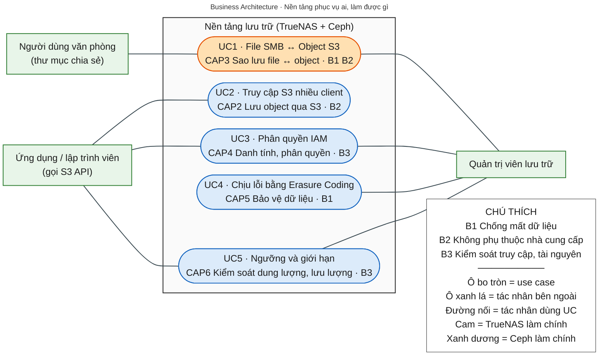
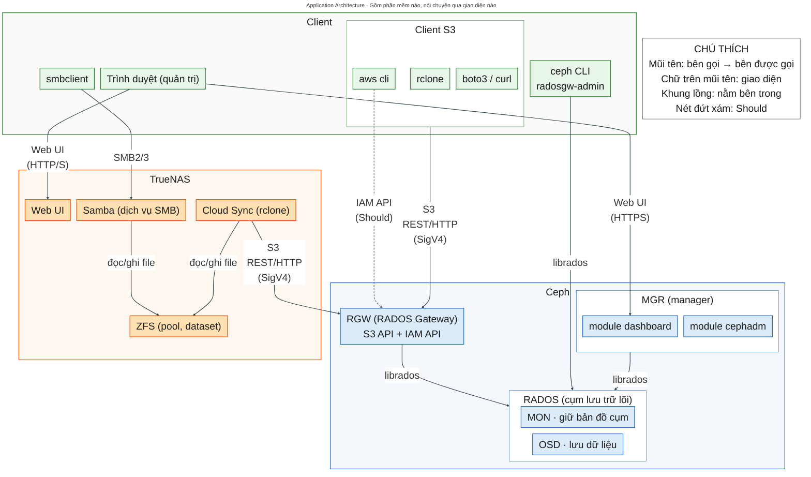
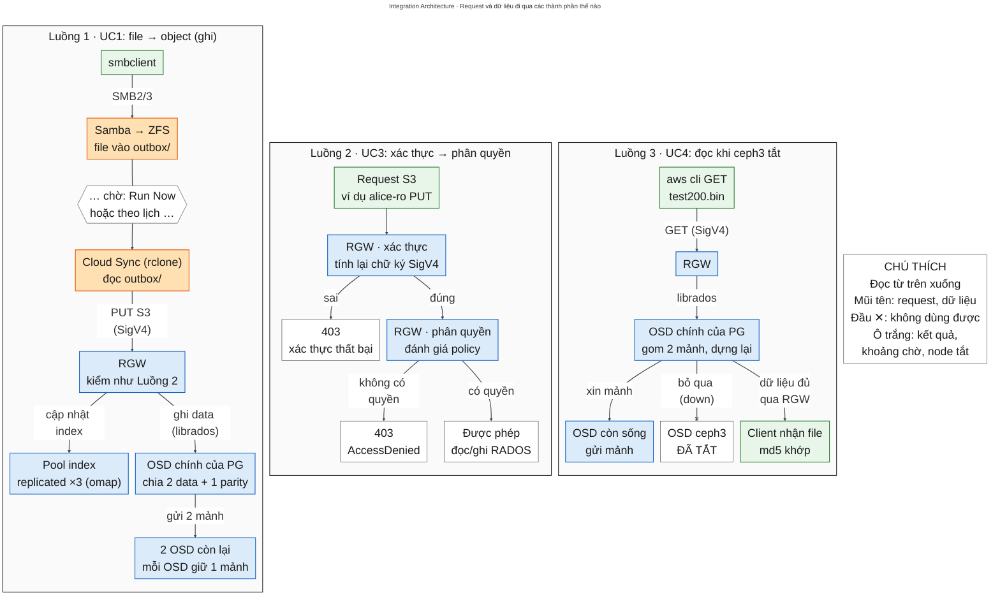
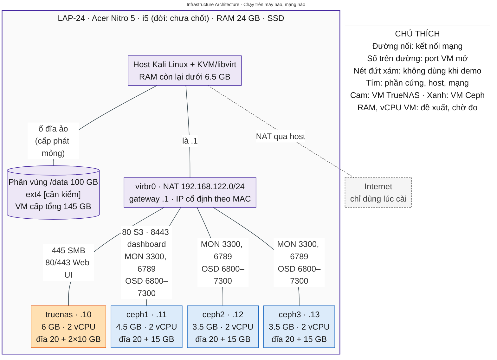
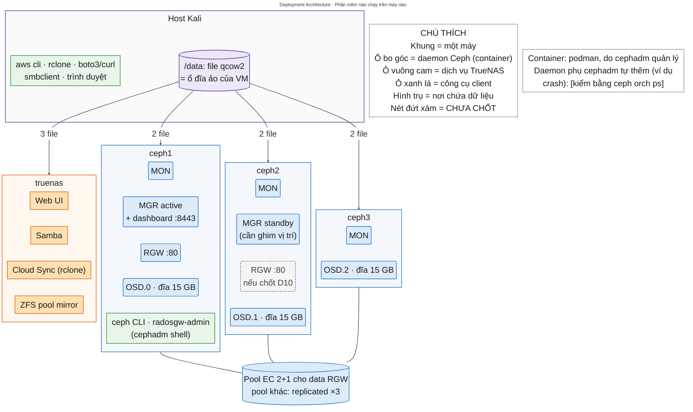

# NT132 · Project 2 (TrueNAS + Ceph) · TÀI LIỆU NHÓM

> **v2.1 · 21/10/2026** (thêm 5 sơ đồ kiến trúc vào T5). Tài liệu đầy đủ của nhóm. File ngắn để dán vào AI: `NT132-P2-AI.md`.
> File này viết lại từ "file ngữ cảnh v1.1" (18/10). Nó **chưa** được đối chiếu với `project2-ceph-nt132.md`; khi gộp, giữ một bản duy nhất cho mỗi nội dung.

---

## T0. Quy ước

- **Nhãn trạng thái:** **CHỐT** (nhóm đã quyết) · **ĐỀ XUẤT** (có phương án, chờ nhóm duyệt) · **CHƯA CHỐT** (chưa có câu trả lời; không tự điền).
- **Nhãn độ tin cậy cho lệnh và dữ kiện:** [đã chạy dd/mm] · [docs] (theo tài liệu chính thức) · [dự kiến] (chưa chạy) · [?] (chưa kiểm chứng). Tới 20/10/2026 **chưa có lệnh nào [đã chạy]**.
- **Mỗi thứ chỉ có một nguồn:**
  - Quyết định hiện hành, trạng thái, câu hỏi mở, gotchas → file AI (mục 2, 4, 5). Đổi ở đó trước, rồi thêm một dòng vào T12 của file này.
  - Đặc tả, runbook, kiến trúc, nội dung thuyết trình → file này.
- **Mã tham chiếu dùng chung với file AI:** D1–D14 (quyết định), Q1–Q8 (câu hỏi mở), CS/S/R/E/H/M (gotchas).
- **Placeholder:** `<pool>`, `<user-smb>`, `<ACCESS_KEY>`… là chỗ nhóm tự điền. Không ghi key thật vào tài liệu.

---

## T1. Ngữ cảnh, Scope, Objectives, Benefits (BẢN NHÁP · CHƯA CHỐT)

> Dùng cho slide 1–3. Theo ghi chú của thầy: objectives tối thiểu 3, mỗi cái một câu ngắn, giải quyết pain point thật, liền mạch với nhau; benefits là "triển khai thì được gì"; phải dựa trên thực tế, không hư cấu; viết xong phải quay lại cập nhật khi làm ra tính năng mới. Thầy dặn dành 20–40% thời gian cho phần này.

### T1.1 Ngữ cảnh

**Ghi chú của nhóm hỏi:** "phần này giống như bối cảnh thực tế đúng không?"
→ Đúng một nửa. Slide 1 gồm **ngữ cảnh** (bối cảnh thực tế: ai đang gặp vấn đề, trong hoàn cảnh nào) **và phạm vi** (ranh giới: nhóm nói về cái gì, không nói về cái gì, như ví dụ "xe Dream" của thầy). Thiếu phạm vi thì mỗi người nghe tự hình dung một kiểu.

**Bản nháp ngữ cảnh:**
> Một tổ chức quy mô nhỏ [loại tổ chức và quy mô: CHƯA CHỐT; chọn một kịch bản minh họa và nói rõ là giả định] đang lưu tài liệu trên một NAS, chia sẻ qua SMB. Tổ chức cần: (1) một bản sao dữ liệu nằm ngoài NAS; (2) một kho lưu trữ theo chuẩn S3 cho ứng dụng nội bộ và công cụ sao lưu; (3) kiểm soát ai được đọc/ghi và mỗi người được dùng bao nhiêu. Tổ chức không muốn phụ thuộc cloud công cộng trả phí, và giải pháp mã nguồn mở quen thuộc (MinIO gateway) không còn dùng được.

### T1.2 Scope

**Trong phạm vi** (theo các quyết định CHỐT D1–D7):
- NAS: TrueNAS CE 25.10.x, 1 VM, ZFS mirror, share SMB2/3.
- Object storage và gateway: Ceph Tentacle 20.2.x, 3 node (MON, MGR, OSD) + RGW (S3 API, IAM API).
- Cầu nối file↔object: Cloud Sync của TrueNAS, gồm 2 task COPY.
- Tính năng được chứng minh: S3 với nhiều client; IAM (user, bucket policy, IAM Accounts); erasure coding 2+1; quota, rate limit, ngưỡng đầy của cluster.
- Môi trường: 1 laptop, host Kali + KVM, quy mô lab, demo trực tiếp.

**Ngoài phạm vi:**
- Block storage (RBD), là phần của Project 1. CephFS và module SMB của Ceph.
- Cloud công cộng (AWS S3), trừ khi thầy yêu cầu (Q2).
- Multisite / sao chép giữa nhiều site. HA phần cứng thật (mọi "host" nằm trên cùng 1 laptop).
- Đo hiệu năng / benchmark. Vận hành production (monitoring stack, tính toán dung lượng thật).

**CHƯA CHỐT:** NFS export bucket RGW (D9) · RGW 2 instance (D10) · versioning, TLS, Object Lock (D14) · Cloud Transition / Cloud Restore.

**Câu chốt phạm vi (kiểu "xe Dream"), bản nháp:**
> "Trong bài này, *storage gateway* là RGW, cổng S3 đứng trước kho Ceph, và Cloud Sync là cầu nối đồng bộ giữa NAS với kho đó. Chúng tôi không trình bày AWS Storage Gateway hay MinIO gateway."

### T1.3 Pain points (vấn đề nan giải)

| # | Pain point | Bằng chứng đã có | Cần bổ sung |
|---|---|---|---|
| PP1 | Giải pháp gateway/S3 mã nguồn mở quen thuộc không còn dùng an toàn được: MinIO đã gỡ gateway (2022) và bản cộng đồng ngừng bảo trì. Dùng S3 của cloud công cộng thì phụ thuộc Internet và tốn phí. | MinIO blog (deprecation of the MinIO gateway); MinIO docs (migrate-fs-gateway); vonng.com, itsfoss.com (bản cộng đồng). Xem T13. | Tìm nguồn chính thức cho mốc 12/2025 và 02/2026 (hiện chỉ có nguồn thứ cấp). |
| PP2 | Dữ liệu file nằm trên một NAS duy nhất: hỏng máy, xóa nhầm hay ransomware là mất. Ứng dụng mới lại dùng S3, nên dữ liệu file và dữ liệu object bị tách rời. | Chưa có. | **[CẦN NGUỒN]**: khuyến nghị sao lưu ra ngoài thiết bị gốc (ví dụ nguyên tắc 3-2-1 từ một nguồn uy tín), báo cáo về ransomware hoặc mất dữ liệu. Không tự đặt số liệu. |
| PP3 | Kho dùng chung cho nhiều người và ứng dụng: dễ cấp quyền quá rộng; một client có thể chiếm hết dung lượng hoặc băng thông; muốn chịu lỗi bằng 3 bản sao thì tốn gấp 3 dung lượng. | "3 bản sao → dùng được 1/3 dung lượng" là phép tính, không cần nguồn. | **[CẦN NGUỒN]**: nguyên tắc least privilege (ví dụ tài liệu IAM của AWS hoặc một chuẩn bảo mật). |

### T1.4 Objectives

| # | Objective (một câu) | Giải quyết | Trả lời "tại sao làm việc này" |
|---|---|---|---|
| O1 | Dựng kho object chuẩn S3 tự vận hành bằng Ceph RGW, thay vai trò của MinIO gateway. | PP1 | Cần một nền tảng mở, còn được phát triển, chạy được trên hạ tầng của chính mình. |
| O2 | Nối NAS (TrueNAS) với kho object để dữ liệu file có bản sao ngoài NAS và dùng được qua S3. | PP2 | Dữ liệu không còn nằm ở một chỗ; ứng dụng S3 đọc được dữ liệu đến từ NAS. |
| O3 | Bảo vệ và kiểm soát kho dùng chung: chịu lỗi bằng erasure coding, phân quyền bằng IAM, giới hạn bằng quota và rate limit. | PP3 | Kho dùng chung chỉ an toàn khi chịu được hỏng phần cứng, đúng người đúng quyền, và không ai chiếm hết tài nguyên. |

**Mạch liền:** O1 dựng kho → O2 đưa dữ liệu NAS vào kho → O3 làm cho kho an toàn để nhiều người cùng dùng.

### T1.5 Benefits

| # | Benefit | Chứng minh bằng | Khi demo nhìn thấy gì | Không được nói (tránh "chém gió") |
|---|---|---|---|---|
| B1 | **Chống mất dữ liệu (data loss prevention).** Dữ liệu NAS có bản sao trên một kho độc lập; kho vẫn đọc/ghi được khi mất 1 node và tự phục hồi khi node quay lại; tốn ít dung lượng hơn 3 bản sao. | UC1, UC4 | Object xuất hiện trong bucket sau khi PUSH. `ceph -s` báo degraded nhưng md5 của file tải về vẫn khớp. `ceph df` cho thấy USED/STORED của pool EC (lý thuyết 1.5×; replica 3 là 3×) — số thật đo khi chạy. | Không nói "không bao giờ mất dữ liệu": cả cụm nằm trên 1 laptop, và EC 2+1 mất 2 node là mất dữ liệu. |
| B2 | **Không phụ thuộc nhà cung cấp, dùng lại công cụ có sẵn.** Một endpoint S3 dùng được cho aws cli, rclone, boto3 và TrueNAS mà không cần cloud trả phí. | UC2, UC1 | Cùng một bucket thao tác được bằng 2–3 client; TrueNAS dùng credential "Amazon S3" nhưng trỏ về RGW. | Không nói "tương thích 100% với AWS S3"; chỉ nói về những API đã demo. |
| B3 | **Kiểm soát truy cập và tài nguyên.** Mỗi người hoặc ứng dụng chỉ làm đúng việc được cấp; không ai chiếm hết dung lượng hay làm quá tải dịch vụ. | UC3, UC5 | 403 AccessDenied khi user chỉ-đọc ghi dữ liệu; ghi bị từ chối khi vượt quota (mã lỗi: kiểm khi chạy); 503 khi vượt rate limit. | Không nói "chống được DoS": rate limit chỉ giới hạn theo user/bucket, trên từng RGW. |

### T1.6 Việc cần làm để chốt T1

- [ ] Chọn kịch bản ngữ cảnh minh họa (loại tổ chức, quy mô) và ghi rõ là giả định.
- [ ] Tìm nguồn thật cho PP2 và PP3; xác nhận lại nguồn của PP1.
- [ ] Duyệt O1–O3 và B1–B3 (Q8).
- [ ] Sau khi lab chạy: thay "lý thuyết" ở B1 bằng số đo thật; quay lại sửa T1 nếu kết quả khác (vòng lặp thầy dặn).
- [ ] Mỗi lần sửa benefit, đọc lại cột "Không được nói".

---

## T2. Business capabilities & bảng truy vết

> Theo ghi chú của thầy: Business Architecture nói về business capability (nền tảng làm được những chức năng nào). Use case lấy ra từ các capability đó. Mỗi UC phải chứng minh objective/benefit, và ít nhất 3 benefit phải có trong demo.

### T2.1 Business capabilities

| ID | Capability (nền tảng làm được gì) | Thành phần | Dùng ở UC |
|---|---|---|---|
| CAP1 | Lưu trữ và chia sẻ file qua mạng (SMB) | TrueNAS (Samba, ZFS) | UC1 |
| CAP2 | Lưu trữ object qua API chuẩn S3 | Ceph RGW + RADOS | UC1–UC5 |
| CAP3 | Sao lưu / trao đổi dữ liệu file ↔ object | TrueNAS Cloud Sync (rclone) | UC1 |
| CAP4 | Quản lý danh tính và phân quyền | RGW user, bucket policy, IAM Accounts | UC3 |
| CAP5 | Bảo vệ dữ liệu khi hỏng phần cứng, tiết kiệm dung lượng | RADOS: erasure coding, CRUSH, recovery | UC4 |
| CAP6 | Kiểm soát dung lượng và lưu lượng | RGW quota, rate limit; ngưỡng đầy của RADOS | UC5 |
| CAP7 | Truy cập object bằng giao thức file (NFS) | NFS-Ganesha + RGW | CHƯA CHỐT (D9) |

**Tác nhân (actor) cho sơ đồ use case:** Người dùng văn phòng (client SMB) · Ứng dụng / lập trình viên (client S3) · Quản trị viên lưu trữ.

### T2.2 Bảng truy vết: Benefit → Capability → Use case → bước demo

Mã bước (UC1-D1…) khớp với T6. "Live" = làm trực tiếp; "Video" = chiếu video quay từ lab thật.

| Benefit | Objective | Capability | UC | Bước demo | Live / Video | Bằng chứng trên màn hình |
|---|---|---|---|---|---|---|
| B1 | O2 | CAP1, CAP3 | UC1 | UC1-D1→D3: đưa file vào `outbox/` → Run Now task A → `aws s3 ls` | Live | Object `from-nas/baocao.pdf` |
| B1 | O3 | CAP5 | UC4 | UC4-D3→D5: tắt ceph3 → `ceph -s` → tải file về, so md5 | Live | HEALTH_WARN + md5 trùng nhau |
| B1 | O3 | CAP5 | UC4 | UC4-D2: `ceph df`, xem USED/STORED của pool EC | Live (hoặc ảnh chụp) | Tỉ lệ đo được so với lý thuyết 1.5× |
| B1 | O3 | CAP5 | UC4 | UC4-D6: bật ceph3 → recovery → HEALTH_OK | Chạy nền, xem lại cuối UC5; có video dự phòng | `ceph -s` HEALTH_OK |
| B1 | O2 | CAP3 | UC1 | UC1-S1 (Should): ghi đè file → lấy lại bản cũ nhờ versioning | CHƯA CHỐT (D14) | `list-object-versions` có 2 phiên bản |
| B2 | O1 | CAP2 | UC2 | UC2-D1→D2: cùng bucket bằng aws cli và rclone | Live | Hai danh sách giống nhau |
| B2 | O1 | CAP2 | UC2 | UC2-D3: presigned URL tải được bằng curl, hết hạn thì 403 | Live | HTTP 200, sau đó 403 |
| B2 | O2 | CAP2, CAP3 | UC1 | Credential "Amazon S3" của TrueNAS trỏ Endpoint URL về RGW | Live (màn hình cấu hình đã mở sẵn) | Trang credential |
| B3 | O3 | CAP4 | UC3 | UC3-D1→D2: user chỉ-đọc liệt kê được, PUT bị 403 | Live | AccessDenied |
| B3 | O3 | CAP6 | UC5 | UC5-D1: PUT vượt quota bị từ chối | Live | Mã lỗi (kiểm khi chạy) |
| B3 | O3 | CAP6 | UC5 | UC5-D2: vòng lặp PUT vượt rate limit | Live | Các dòng FAIL / 503 |
| B3 | O3 | CAP6 | UC5 | UC5-V1: hạ ngưỡng full → ghi bị chặn → khôi phục | Video | Cảnh báo full trong `ceph health detail` |

### T2.3 Đối chiếu với yêu cầu của thầy

| Yêu cầu | Kết quả |
|---|---|
| Mỗi UC chứng minh ít nhất 1 objective/benefit | UC1 (O2; B1, B2) · UC2 (O1; B2) · UC3 (O3; B3) · UC4 (O3; B1) · UC5 (O3; B3) → đạt |
| Ít nhất 3 benefit có trong demo | B1 (UC1, UC4 live) · B2 (UC2 live) · B3 (UC3, UC5 live) → đạt, kể cả khi không chiếu phần video |
| Chỗ yếu | B2 dựa chủ yếu vào UC2. Nếu UC2 hỏng lúc live, còn UC1 (TrueNAS nói S3 với RGW) làm bằng chứng phụ. O1 chỉ được chứng minh gián tiếp qua mọi UC: nên nói rõ điều này ở slide UC2. |

---

## T3. Khung thuyết trình 16 slide

| Slide | Nội dung | Lấy từ | Trạng thái |
|---|---|---|---|
| 1 | Ngữ cảnh + Scope | T1.1, T1.2 | Bản nháp |
| 2 | Objectives (O1–O3, gắn PP1–PP3) | T1.3, T1.4 | Bản nháp |
| 3 | Benefits (B1–B3) | T1.5 | Bản nháp |
| 4 | Tổng quan (What): NAS/TrueNAS, object storage/S3, Ceph/RGW, SDS | T9, file AI mục 6 | CHƯA LÀM |
| 5 | Cách hoạt động (How): RADOS, CRUSH/PG, erasure coding, đường đi của một S3 PUT, Cloud Sync (rclone) | T5.3 | CHƯA LÀM |
| 6 | Business Architecture | T5.1 | Sơ đồ + lời nói mẫu xong (21/10); chưa dựng slide |
| 7 | Application Architecture | T5.2 | Sơ đồ + lời nói mẫu xong (21/10); chưa dựng slide |
| 8 | Integration Architecture | T5.3 | Sơ đồ + lời nói mẫu xong (21/10); chưa dựng slide |
| 9 | Infrastructure Architecture | T5.4 | Sơ đồ + lời nói mẫu xong (21/10); chưa dựng slide |
| 10 | Deployment Architecture | T5.5 | Sơ đồ + lời nói mẫu xong (21/10); chưa dựng slide (thầy xác nhận bắt buộc 20/10, Q3 CHỐT) |
| 11–15 | UC1 → UC5 | T6, T8 | CHƯA LÀM |
| 16 | Kết luận, giới hạn, hướng phát triển | T5.6 | CHƯA CHỐT (ghi chú của thầy không nói slide kết là gì) |

- **Thời lượng:** tối thiểu 2 phút/slide → khoảng 32 phút cho 16 slide, sát trần 30–35 phút → gần như không còn dự phòng. Cách bù: gộp slide 4–5 (What/How) nói nhanh, hoặc nói 5 UC trong đúng 10–15 phút như T8.1. Slide 11–15 có tổng cộng 10–15 phút (đánh giá ở T8.1).
- **Chỗ đặt Deployment (CHỐT 20/10, Q3):** slide riêng (slide 10), ngay sau Infrastructure; thầy xác nhận bắt buộc làm. Phần kiến trúc tăng từ 4 → 5 slide (6–10), tổng slide 15 → 16. (Không chọn: gộp 2 sơ đồ vào slide 9, hay vẽ daemon chồng lên sơ đồ máy chủ — vì Infrastructure và Deployment trả lời 2 câu khác nhau, T5.5.)
- **Lưu ý của thầy:** không đọc slide; trình bày cho cả lớp, không chỉ cho thầy; dành khoảng 30% thời gian đồ án cho báo cáo; người nghe đọc phần đầu và phần kết trước, nên slide 1–3 và slide 16 (kết) phải mạnh nhất.

---

## T4. Bối cảnh môn & đề gốc

### T4.1 Môn học

- **NT132 – Quản trị mạng và hệ thống (System and Network Administration)**, Trường ĐH Công nghệ Thông tin (UIT). Giảng viên: ThS. Duy Nguyễn (duyn@uit.edu.vn).
- Thầy chỉ cung cấp slide buổi đầu (ghi ngày "25.01.02") và ghi chú hướng dẫn thuyết trình (`format-ghichu.md`); **không có file đặc tả riêng** cho Project 2, chưa có rubric chính thức.
- **Mục tiêu môn:** (1) Switching, Routing, ACL, NAT; (2) môi trường Windows: User, Policy, Storage, Backup; (3) dịch vụ mới: Cloud Networking, Cloud Server & Storage, Container; (4) học qua bài tập.
- **Các chương:** 1 IPv4 · 2 Router & Routing Protocols · 3 RIPv1, RIPv2, OSPF · 4 Switching & VLAN · 5 ACL & NAT · 6 DNS & DHCP · 7 Domain Controller · **8 RAID & File System** · 9 Group Policy · **10 Backup & Recovery Sites** · 11 Cloud Networking · **12 Cloud Server & Storage** · 13 Container & Kubernetes · 14 Report 1 · 15 Report 2.
- **Các lab:** 1 VLSM & Static Routing · 2 VLAN & Dynamic Routing · 3 NAT & ACL · 4 Linux Services (Ubuntu, Apache, MySQL, LEMP) · 5 Windows Services (Domain Controller, Group Policy, File System) · 6 Container & Kubernetes.
- **10 đề tài:** 1 Proxmox (có Ceph) · **2 Storage Services & Gateway (nhóm này)** · 3 MS SQL HA · 4 MongoDB HA · 5 Monitoring với ELK · 6 OpenStack · 7 DevOps (Jenkins) · 8 Kubernetes (Rancher, Istio) · 9 API Platform · 10 Centralized IAM.
- **Trùng với Project 1:** Project 1 cũng dùng Ceph nhưng làm block storage (RBD) cho máy ảo → nhóm này nhấn vào object storage (RGW), file↔object, IAM, EC cho object.
- **Liên hệ chương ↔ đồ án:** chương 8 ↔ ZFS mirror, erasure coding (giống RAID 5) · chương 10 ↔ Cloud Sync, sao lưu sang object storage · chương 12 ↔ object storage, S3.

### T4.2 Đề gốc trên slide (nguyên văn, chỉ để tham chiếu)

```
Project 2 - Building up Storage Services and Storage Gateway
Project Objective
 - Learning Network Attach Storage (TrueNAS) and Object Storage (S3)
 - Learning Storage Gateway (MinIO)
Project Outcomes
 - Building up a Storage System: NAS(TrueNAS), Object Storage(S3) & Storage Gateway (MinIO)
 - Testing Features:
   + Use-case 1: Connect TrueNAS through MinIO by SMB/CIFS protocols
   + Use-case 2: Connect S3 through MinIO by S3
   + Use-case 3: Testing IAM feature
   + Use-case 4: Testing Erasure Coding
   + Use-case 5: Testing Thresholds and Limits
Ref - Link MinIO
```

- **Cách hiểu đề gốc:** UC1 gốc dùng MinIO **NAS gateway mode** (máy chạy MinIO mount share SMB của TrueNAS rồi mở cổng S3; object upload bằng S3 trở thành file trên NAS). UC2 gốc dùng MinIO **S3 gateway mode** (MinIO làm proxy đứng trước AWS S3). Tên UC5 trùng với tên trang tài liệu "Thresholds and Limits" của MinIO.
- **Ghi chú của thầy trên slide:** "software define storage" (chủ đề lớn là SDS, Ceph là ví dụ tiêu biểu); "tập trung nghiên cứu giải pháp" (phải giải thích vì sao chọn giải pháp, kiến trúc, so sánh và giới hạn); "MinIO đã loại bỏ tính năng gateway → sử dụng Ceph thay thế".
- **Lỗi gõ trên slide** (đừng chép vào báo cáo): "SBM" → SMB; "Network Attach Storage" → Network Attached Storage; "Promox" → Proxmox.

### T4.3 Đề tài nhóm thực hiện (bản Ceph)

| Mục | Nội dung |
|---|---|
| Objective 1 (của đề) | Learning Network Attached Storage (TrueNAS) and S3-compatible Object Storage (Ceph RGW) |
| Objective 2 (của đề) | Learning Storage Gateway (Ceph RGW) and Software-Defined Storage (Ceph) |
| Outcome | Building up a Storage System: NAS (TrueNAS), Object Storage & Storage Gateway (Ceph RGW) on a Ceph cluster |
| UC1 | Connect TrueNAS to Ceph RGW by S3 (Cloud Sync Task) |
| UC2 | Access Ceph RGW by S3 API from multiple S3 clients |
| UC3 | Testing IAM feature |
| UC4 | Testing Erasure Coding |
| UC5 | Testing Thresholds and Limits |

> "Objective" của đề là mục tiêu học. O1–O3 ở T1 là objective của bài thuyết trình (giải quyết pain point). Đừng trộn hai loại này trên slide 2.

### T4.4 Ánh xạ yêu cầu gốc → giải pháp của nhóm

| Vai trò trong đề | Thiết kế gốc | Thiết kế nhóm dùng |
|---|---|---|
| NAS | TrueNAS | TrueNAS CE (ZFS mirror, share SMB) |
| Object Storage (S3) | AWS S3 / MinIO | Ceph RGW |
| Storage Gateway | MinIO gateway | RGW (protocol gateway S3 → RADOS) + Cloud Sync (cầu nối file↔object); NFS export bucket: CHƯA CHỐT |
| IAM | MinIO IAM | User RGW + bucket policy + IAM Accounts |
| Erasure Coding | MinIO EC | Pool EC của Ceph |
| Thresholds & Limits | Trang tài liệu MinIO | Giới hạn của RGW + quota + rate limit + ngưỡng đầy cluster |

---

## T5. Kiến trúc: 5 sơ đồ (ĐÃ VẼ, ghi nhận 21/10)

> 4 loại đầu theo ghi chú của thầy (slide 6–9). Deployment là slide 10 (thầy xác nhận bắt buộc 20/10, Q3 CHỐT). Nhóm đã vẽ xong cả 5 sơ đồ; file nằm trong thư mục `NT132-P2-kien-truc/`.
> Mỗi mục dưới đây gồm: câu hỏi sơ đồ trả lời, sơ đồ (hiển thị trực tiếp trong Markdown), cách đọc, điểm chính, việc còn phải kiểm. **Lời nói mẫu, 3 câu hỏi vấn đáp và danh sách "Không được nói" của từng sơ đồ** nằm trong file giải thích tương ứng (bảng T5.0), không chép lại ở đây.

### T5.0 Tệp, quy ước chung, cách xem sơ đồ

| Slide | Loại | Mã Mermaid (nguồn) | Ảnh xem trước | Giải thích đầy đủ |
|---|---|---|---|---|
| 6 | Business | [slide06-business.mmd](NT132-P2-kien-truc/slide06-business.mmd) | [PNG](NT132-P2-kien-truc/slide06-business-preview.png) | [bussiness-explain.md](NT132-P2-kien-truc/bussiness-explain.md) |
| 7 | Application | [slide07-application.mmd](NT132-P2-kien-truc/slide07-application.mmd) | [PNG](NT132-P2-kien-truc/slide07-application-preview.png) | [application-explain.md](NT132-P2-kien-truc/application-explain.md) |
| 8 | Integration | [slide08-integration.mmd](NT132-P2-kien-truc/slide08-integration.mmd) | [PNG](NT132-P2-kien-truc/slide08-integration-preview.png) | [intergration-explain.md](NT132-P2-kien-truc/intergration-explain.md) |
| 9 | Infrastructure | [slide09-infrastructure.mmd](NT132-P2-kien-truc/slide09-infrastructure.mmd) | [PNG](NT132-P2-kien-truc/slide09-infrastructure-preview.png) | [infragstructure-explain.md](NT132-P2-kien-truc/infragstructure-explain.md) |
| 10 | Deployment | [slide10-deployment.mmd](NT132-P2-kien-truc/slide10-deployment.mmd) | [PNG](NT132-P2-kien-truc/slide10-deployment-preview.png) | [deployment-explain.md](NT132-P2-kien-truc/deployment-explain.md) |

- **Nguồn của sơ đồ (ĐỀ XUẤT):** file `.mmd` là bản gốc. Khối `mermaid` trong T5 là bản chép nguyên văn để xem ngay trong tài liệu. Khi sửa sơ đồ: sửa `.mmd` → chép đè vào khối tương ứng ở T5 → xuất lại PNG cho slide.
- **Đã kiểm hiển thị [đã chạy 21/10]:** chép nguyên 5 file `.mmd` vào khối code `mermaid`, vẽ bằng mermaid-cli 11.4.2 (Mermaid v11): cả 5 sơ đồ hiển thị, bố cục giống ảnh xem trước. **Không phải sửa dòng code nào.** Phần `---title---` và `%%{init}%%` ở đầu được giữ lại; chúng phải nằm ngay dòng đầu của khối.
- **Xem trong VS Code:** khung preview Markdown mặc định của VS Code **không** vẽ Mermaid (chỉ hiện code). Cài extension *Markdown Preview Mermaid Support* (`bierner.markdown-mermaid`), rồi mở preview (`Ctrl+Shift+V`). GitHub và GitLab vẽ sẵn, không cần cài gì. Xuất PDF bằng extension *Markdown PDF* (yzane, đang cài trên LAP-24): [?] chưa thử với 5 sơ đồ này.
- **Chữ to (24–32 px) là cố ý** để chiếu slide. Trong Markdown, sơ đồ tự thu nhỏ cho vừa khung xem.
- **Bảng màu chung cho cả 5 sơ đồ:**

| Màu | Nghĩa |
|---|---|
| Xanh lá | Client, tác nhân bên ngoài, công cụ client |
| Cam | TrueNAS |
| Xanh dương | Ceph |
| Tím | Phần cứng, host, mạng (slide 9, 10) |
| Xám nét đứt | Should / CHƯA CHỐT / không dùng khi demo |
| Trắng | Chú thích, kết quả, khoảng chờ, máy đã tắt |

- **Đường nối mang nghĩa khác nhau ở mỗi slide** (nhắc người nghe khi chuyển slide):

| Slide | Đường nối / mũi tên nghĩa là | Chữ trên đường |
|---|---|---|
| 6 | Tác nhân tham gia use case (không mũi tên, **không** phải luồng dữ liệu) | — |
| 7 | Bên gọi → bên được gọi | Giao diện (SMB, S3 REST, librados…) |
| 8 | Chiều request hoặc dữ liệu đi | Giao diện hoặc điều kiện rẽ nhánh |
| 9 | Kết nối mạng | Port VM mở |
| 10 | File qcow2 → ổ đĩa của VM; máy → pool | Số file qcow2 |

- **Ẩn dụ chung (dùng khi mở đầu phần kiến trúc):** 5 slide như mô tả một nhà hàng. Business = thực đơn và khách; Application = các bộ phận (bếp, quầy, thu ngân); Integration = đường đi của một order; Infrastructure = tòa nhà, điện, nước; Deployment = ai đứng ở bếp nào.

### T5.1 Business Architecture (slide 6) · ĐÃ VẼ

- **Trả lời:** nền tảng có những business capability nào, phục vụ ai, phục vụ việc gì. Không có VM, IP, port.



- **Cách đọc:** khung xám ở giữa là ranh giới nền tảng (system boundary). Bên trái là người dùng chính, bên phải là quản trị viên. Mỗi ô bo tròn: dòng 1 là *việc gì*, dòng 2 là *capability* và *benefit* (B1–B3 tra ở chú thích). Đường nối không có mũi tên = "tác nhân tham gia use case".
- **Khác với khung 20/10:**
  - Thêm đường **Quản trị viên — UC1**: quản trị viên tạo credential và 2 task Cloud Sync, chạy theo lịch hoặc Run Now; người dùng văn phòng chỉ thả file vào `outbox/`, không chạm vào S3.
  - Mỗi UC chỉ ghi **một** capability chính cho gọn (UC1 ghi CAP3; đủ CAP1, CAP2, CAP3 ở T2.1).
  - Màu cam (UC1, TrueNAS làm chính) / xanh dương (Ceph làm chính) là gợi ý công nghệ **duy nhất** trên slide.
- **Không vẽ:** CAP7 / NFS (D9 chưa chốt); bản đồ capability riêng; quy trình swimlane (đã sang slide 8).
- **Cần xem lại khi dựng slide:** đường UC5 — Quản trị viên chạy xuyên qua ô chú thích (thấy cả trên ảnh xem trước lẫn khi vẽ lại bằng Mermaid v11).

### T5.2 Application Architecture (slide 7) · ĐÃ VẼ

- **Trả lời:** gồm những thành phần phần mềm nào, nói chuyện với nhau qua giao diện nào. Không đặt component vào VM (việc của slide 10).



- **Cách đọc:** từ trên xuống theo 3 tầng: client (xanh lá) → dịch vụ (TrueNAS cam bên trái, Ceph xanh bên phải) → nơi dữ liệu nằm (ZFS, RADOS). Khung lồng = nằm bên trong (dashboard nằm trong MGR). Nét đứt xám = Should (IAM API, UC3 tầng 2).
- **4 con đường:** File: smbclient → Samba → ZFS · Object: client S3 → RGW → RADOS · Cầu nối: Cloud Sync đọc/ghi ZFS và gọi RGW · Quản trị: trình duyệt, ceph CLI.
- **Điểm chính để trả lời vấn đáp:**
  - **rclone xuất hiện 2 lần:** công cụ trên máy client (UC2) và bên trong Cloud Sync. Cùng phần mềm, hai vai; Cloud Sync đóng vai *một client S3* của RGW.
  - **boto3 chỉ tính presigned URL ngay trên máy client**, không gửi gì tới RGW; curl mới gửi GET.
  - **ceph CLI / radosgw-admin đi thẳng vào RADOS qua librados**, không qua S3, nên không bị kiểm SigV4 hay bucket policy; chỉ dùng được trên máy có keyring admin.
  - **MGR và MON không nằm trên đường đi của dữ liệu.** librados lấy bản đồ cụm từ MON rồi tự tính vị trí và nói thẳng với OSD.
  - **SigV4 là ký, không phải mã hóa:** nội dung file vẫn đi dạng rõ qua HTTP (liên quan D14, TLS).
- **Không vẽ (cố ý):** các đường "cấu hình" từ middleware của TrueNAS tới các dịch vụ khác.

### T5.3 Integration Architecture (slide 8, và một phần slide 5) · ĐÃ VẼ

- **Trả lời:** request và dữ liệu đi qua các thành phần như thế nào, qua 3 tình huống ứng với demo UC1, UC3, UC4.



- **Cách đọc:** trái sang phải qua 3 làn, trong mỗi làn đọc từ trên xuống. Mũi tên = chiều request/dữ liệu (khác slide 7: "ai gọi ai"). Ô trắng = kết quả, khoảng chờ (lục giác) hoặc máy đã tắt. Đầu ✕ = thành phần không được dùng tới.
- **Luồng 1 · UC1 PUSH:** smbclient → Samba → ZFS (lúc này file **chưa** có trong Ceph) → *chờ Run Now hoặc lịch* (bằng chứng cho D6: Cloud Sync không nằm trên đường dữ liệu; RGW hỏng thì chép qua SMB vẫn thành công) → Cloud Sync PUT S3 ký SigV4 → RGW kiểm như Luồng 2 → cập nhật index (pool replicated ×3, omap) và ghi data tới **OSD chính** của PG → OSD chính chia 2 data + 1 parity, giữ 1, gửi 2 → báo xong thì RGW mới trả 200. **RGW không gửi thẳng 3 mảnh.**
- **Luồng 2 · UC3:** xác thực trước (tính lại chữ ký SigV4; sai → 403 với `SignatureDoesNotMatch`, `InvalidAccessKeyId` hoặc `RequestTimeTooSkewed`) → phân quyền sau (Deny tường minh luôn cấm; có Allow thì được; không có Allow thì xét ACL nên chủ bucket vẫn có quyền) → `alice-ro` PUT nhận 403 AccessDenied. Nhãn ghi "có quyền / không có quyền", không ghi "Allow / không Allow", vì lý do ACL này.
- **Luồng 3 · UC4:** OSD trên ceph3 đã bị đánh dấu down và loại khỏi acting set, nên OSD chính **không hỏi rồi chờ** nó. Cần đủ k = 2 mảnh; chỉ phải tính lại (XOR) khi mảnh mất là mảnh data.
- **Ghi chú code:** khai báo Luồng 3 → 2 → 1 là cố ý, để Mermaid xếp ra 1 → 2 → 3 từ trái sang phải. Chú thích để rời, không nối vào luồng nào.
- **Còn phải đo:** khoảng gián đoạn trước khi OSD bị đánh dấu down (khoảng 20–30 s, gotcha E5). Chưa đo thì không nói "không có gián đoạn".

### T5.4 Infrastructure Architecture (slide 9) · ĐÃ VẼ

- **Trả lời:** hệ thống chạy trên phần cứng, VM, mạng nào.



- **Cách đọc:** khung tím viền đậm là laptop; chỉ Internet ở ngoài. Từ trên xuống: host Kali → 3 thứ host quản lý (`/data`, `virbr0`, đường ra Internet) → 4 VM cắm vào `virbr0`. Chữ trên đường nối VM = port VM mở. Nét đứt xám: Internet chỉ dùng lúc cài.
- **Số liệu trên sơ đồ** lấy từ file AI mục 3.1–3.4: tổng RAM VM 17,5 GB, 8 vCPU, đĩa cấp phát 145 GB (dùng thật dự kiến 50–70 GB). Vẫn là ĐỀ XUẤT, chờ đo (D11); chú thích trên sơ đồ đã ghi rõ.
- **Câu phải nói thẳng:** 3 "máy" Ceph nằm trên cùng một SSD → failure domain thật là cái laptop. Lab mô phỏng *cơ chế* chịu lỗi, không phải *hạ tầng* chịu lỗi. Public network và cluster network dùng chung `virbr0`.
- **Phát hiện thêm khi vẽ** (nhóm ghi trong file giải thích; nơi xử lý ở cột cuối):

| # | Vấn đề | Ảnh hưởng | Xử lý |
|---|---|---|---|
| 1 | Tổng 8 vCPU so với số luồng CPU thật chưa biết (Q4). Nhiều i5 dòng H có 4 nhân 8 luồng. | Recovery (UC4) cần CPU tính lại mảnh EC; tranh CPU thì demo chậm, OSD có thể báo chậm. | Kiểm `lscpu` (T7.1). Nếu chỉ 8 luồng: ĐỀ XUẤT giảm truenas xuống 1 vCPU. Đã thêm vào T11. |
| 2 | Demo không có Internet → chrony trong VM không còn nguồn giờ; sau sleep/resume giờ có thể lệch (H4). MON cảnh báo khi lệch rất nhỏ (khoảng 0,05 s [cần kiểm: `ceph config help mon_clock_drift_allowed`]). | Health WARN khi demo; xấu nhất là 403 hàng loạt (S7). | ĐỀ XUẤT: host Kali làm máy chủ giờ cho `192.168.122.0/24`, các VM lấy giờ từ `192.168.122.1` [cần kiểm cấu hình chrony]. Đã thêm vào T11. |
| 3 | SSH 22 không có trong danh sách port, dù cephadm cần SSH từ ceph1 sang ceph2, ceph3 (T7.9). | Thiếu khi bị hỏi "các máy nói chuyện qua port nào". | Đã thêm "SSH 22 (cephadm)" vào file AI mục 3.4. Không vẽ lên sơ đồ cho gọn. |
| 4 | Dashboard 8443 vẽ trên ceph1 vì MGR active đang ở đó; MGR chuyển node thì dashboard đi theo. | Mở `https://192.168.122.11:8443` lúc demo có thể không vào được. | Trước demo chạy `ceph mgr services` để lấy địa chỉ dashboard hiện tại [cần kiểm]. Đã thêm vào T11. |

### T5.5 Deployment Architecture (slide 10) · ĐÃ VẼ

- **Trả lời:** thành phần phần mềm nào chạy trên node nào.
- **Khác Infrastructure ở chỗ:** Infrastructure vẽ máy và mạng; Deployment vẽ phần mềm đặt lên máy nào.



- **Cách đọc:** trên cùng là host Kali (công cụ client + `/data`). Mũi tên từ `/data` xuống = "các file qcow2 này là ổ đĩa của máy đó": truenas 3 file (boot + 2 ổ ZFS), mỗi node Ceph 2 file (OS + OSD), tổng 9 file, khớp cột đĩa ở slide 9. Mỗi khung là một máy, đọc trái sang phải. Ô bo góc xanh dương = daemon Ceph trong container; ô vuông cam = dịch vụ có sẵn của TrueNAS; ô xanh lá = công cụ client. Hình trụ dưới cùng = pool trải trên cả 3 node.
- **Điểm chính:**
  - **3 MON** (đa số 2/3), **2 MGR** (active ceph1, standby ceph2), **3 OSD** (mỗi node 1 ổ 15 GB), **1 RGW** trên ceph1 (ô nét đứt trên ceph2 chỉ có nếu chốt D10).
  - Daemon Ceph chạy trong **container podman do cephadm quản lý**; container nằm trong VM. TrueNAS **không** dùng container của cephadm.
  - ceph1 gánh nhiều vai nhất → được 4,5 GB RAM, và tắt ceph1 là mất S3 (R1). ceph3 chỉ có MON + OSD → node an toàn để tắt khi demo UC4.
  - Pool là khái niệm logic, không nằm trên máy nào: data RGW dùng EC 2+1, các pool khác replicated ×3.
- **Việc còn phải làm:**
  - "MGR standby trên ceph2" chỉ đúng khi đã **ghim vị trí MGR**; mặc định cephadm tự chọn host. Đã thêm lệnh [dự kiến] vào T7.9.
  - Daemon phụ cephadm tự thêm (ví dụ `crash`): kiểm bằng `ceph orch ps` sau khi dựng rồi bổ sung vào sơ đồ nếu cần.
- **Ghi chú code:** khai báo truenas *sau* 3 node Ceph là cố ý để truenas nằm bên trái. Đường nối nối vào *khung máy*, không nối vào ô bên trong (nối vào ô làm Mermaid v11 kéo giãn cột).

### T5.6 Giới hạn, SPOF, so sánh (cho slide 16 và vấn đáp)

- **SPOF:** RGW 1 instance (ceph1); TrueNAS 1 VM; laptop là failure domain thật (3 "host" Ceph và ZFS mirror cùng nằm trên 1 SSD); RGW chưa có TLS (nếu D14 chưa làm).
- **Ma trận mất node (điền sau khi đo):**

| Mất | Ceph còn I/O? | S3 còn dùng được? | SMB còn dùng được? | Ghi chú |
|---|---|---|---|---|
| ceph3 | Có (EC 2+1, min_size 2) [dự kiến] | Có | Có | UC4 demo trường hợp này |
| ceph2 | Có [dự kiến] | Có | Có | MGR standby mất, MGR active vẫn ở ceph1 |
| ceph1 | Có [dự kiến] | **Không** (RGW mất) | Có | MGR chuyển sang ceph2 [dự kiến; chỉ chắc khi đã ghim vị trí MGR, T7.9]; dashboard 8443 đi theo MGR active (T5.4 điểm 4) |
| truenas | — | Có | **Không** | |
| laptop | Không | Không | Không | Giới hạn của môi trường lab |

- **So sánh giải pháp (CHƯA LÀM):** MinIO gateway (đề gốc) · Ceph RGW (nhóm chọn) · mô hình AWS Storage Gateway / File Gateway (file trước, S3 phía sau). Nội dung: còn được phát triển không, chi phí, có phải gateway nằm trên đường dữ liệu không, có cần Internet không.
- **Hai góc nhìn không có chỗ riêng trong 5 loại của thầy:** bảo mật và chịu lỗi. Bảo mật → slide UC3 và T5.3 luồng 2; chịu lỗi → slide UC4 và bảng trên.

---

## T6. Đặc tả UC1–UC5

> Mọi lệnh ở đây là **[dự kiến]**. Chạy thử xong thì đổi thành [đã chạy dd/mm] và sửa lại nếu khác.
> Các lệnh `aws` giả định profile đã có `endpoint_url` (T7.13). Nếu bản aws cli không nhận cấu hình này, thêm `--endpoint-url http://192.168.122.11` vào mỗi lệnh.
> Mã bước: `UCx-Dn` = bước demo live; `UCx-Pn` = chuẩn bị trước; `UCx-Sn` = phần Should; `UCx-Vn` = phần quay video.

### UC1 – TrueNAS ↔ Ceph RGW qua S3 (file ↔ object)

- **Chứng minh:** O2; B1, B2. **Capability:** CAP1, CAP3, CAP2. **Hạng:** Must.
- **Thiết kế (CHỐT 20/10):** 2 task Cloud Sync, chế độ COPY, đường dẫn không giao nhau. Đây **không phải** đồng bộ 2 chiều.

| Task | Direction | Transfer Mode | Nguồn | Đích |
|---|---|---|---|---|
| A | PUSH | COPY | `/mnt/<pool>/smbshare/outbox` | bucket `nas-backup`, thư mục `from-nas/` |
| B | PULL | COPY | bucket `nas-backup`, thư mục `to-nas/` | `/mnt/<pool>/smbshare/inbox` |

**Chuẩn bị trước:**
- UC1-P1 (ceph1): tạo user RGW cho TrueNAS. Lưu access/secret key ở chỗ an toàn, không dán vào chat AI.
  ```bash
  radosgw-admin user create --uid=truenas-sync --display-name="TrueNAS Cloud Sync"
  ```
- UC1-P2 (Kali): tạo profile `truenas-sync` (T7.13), rồi tạo bucket bằng chính user đó để bucket thuộc về user này:
  ```bash
  aws s3 mb s3://nas-backup --profile truenas-sync
  ```
- UC1-P3 (TrueNAS UI): tạo pool `<pool>` mirror từ 2 đĩa 10 GB → dataset `smbshare` → share SMB (SMB1 tắt) → user `<user-smb>` → tạo 2 thư mục `outbox/`, `inbox/`.
- UC1-P4 (TrueNAS UI): Credentials → Backup Credentials → Cloud Credentials → Add [docs; đường dẫn menu kiểm lại trên 25.10]: provider **Amazon S3**, access/secret key của `truenas-sync`, Advanced Settings → **Endpoint URL** `http://192.168.122.11` → Verify Credential (gotcha CS4).
- UC1-P5, UC1-P6 (TrueNAS UI): tạo task A và B theo bảng trên. Chọn Direction tường minh vì mặc định là PULL (CS2). Không đặt lịch chạy dày; khi demo chỉ bấm Run Now.
- UC1-P7 (Kali): đặt sẵn một object ở `to-nas/`:
  ```bash
  aws s3 cp ketqua.csv s3://nas-backup/to-nas/ --profile truenas-sync
  ```

**Demo live:**
```bash
# UC1-D1 · Trên host Kali: đưa file vào thư mục outbox của share SMB
smbclient //192.168.122.10/smbshare -U <user-smb> -c 'cd outbox; put baocao.pdf'
```
- UC1-D2 (TrueNAS UI): task A → Run Now → chờ trạng thái SUCCESS.
```bash
# UC1-D3 · Trên host Kali: file đã thành object
aws s3 ls s3://nas-backup/from-nas/ --profile truenas-sync
```
- UC1-D4 (TrueNAS UI): task B → Run Now.
```bash
# UC1-D5 · Trên host Kali: object đã thành file trong inbox
smbclient //192.168.122.10/smbshare -U <user-smb> -c 'cd inbox; ls'
```

- **Đạt khi:** `baocao.pdf` có trong `from-nas/`; `ketqua.csv` có trong `inbox/`; không có file nào trong `outbox/` hay `to-nas/` bị xóa.
- **Bằng chứng cho báo cáo:** ảnh 2 task (thấy rõ Direction và Transfer Mode), log của task, output của D3 và D5.
- **Nếu hỏng:** chiếu video UC1.
- **UC1-S1 (Should, D14): versioning.**
  ```bash
  # Trên host Kali
  aws s3api put-bucket-versioning --bucket nas-backup \
    --versioning-configuration Status=Enabled --profile truenas-sync
  # Sửa baocao.pdf trong outbox, chạy lại task A, rồi:
  aws s3api list-object-versions --bucket nas-backup --prefix from-nas/baocao.pdf --profile truenas-sync
  ```
  Kết quả mong đợi: có 2 phiên bản. Bản cũ tải được bằng `aws s3api get-object … --version-id <id>`. Ý nghĩa cho B1: COPY ghi đè file cùng tên, nhưng versioning vẫn giữ bản cũ.
- **UC1-S2 (Should, D9): NFS export bucket RGW.** Export `nas-backup` qua NFS-Ganesha, mount từ Kali với `-o sync`, chép file vào thì thấy object ngay qua S3. Giới hạn: chỉ ghi tuần tự cả file, không đổi tên thư mục, không có link, client Windows không upload được. Lệnh: tra docs `mgr/nfs` của Tentacle khi chốt.

### UC2 – Ceph RGW là cổng S3 cho nhiều client

- **Chứng minh:** O1; B2. **Capability:** CAP2. **Hạng:** Must.

**Chuẩn bị trước:**
- UC2-P1 (ceph1): `radosgw-admin user create --uid=nhom2-owner --display-name="Nhom 2 owner"`.
- UC2-P2 (Kali): profile `nhom2-owner`; `aws s3 mb s3://nhom2-data --profile nhom2-owner`.
- UC2-P3 (Kali): cấu hình rclone `~/.config/rclone/rclone.conf`:
  ```ini
  [ceph]
  type = s3
  provider = Ceph
  endpoint = http://192.168.122.11
  access_key_id = <ACCESS_KEY>
  secret_access_key = <SECRET_KEY>
  ```
- UC2-P4 (Kali): môi trường Python có boto3; file `presign.py`:
  ```python
  import boto3
  from botocore.config import Config

  s3 = boto3.client(
      "s3",
      endpoint_url="http://192.168.122.11",
      aws_access_key_id="<ACCESS_KEY>",
      aws_secret_access_key="<SECRET_KEY>",
      region_name="us-east-1",
      config=Config(
          signature_version="s3v4",
          s3={"addressing_style": "path"},
          request_checksum_calculation="when_required",   # gotcha S1
          response_checksum_validation="when_required",
      ),
  )
  # URL chỉ có hiệu lực 60 giây (gotcha S5)
  print(s3.generate_presigned_url(
      "get_object", Params={"Bucket": "nhom2-data", "Key": "baocao.pdf"}, ExpiresIn=60))
  ```
- UC2-P5 (Kali): tạo file 100 MB cho phần multipart: `dd if=/dev/urandom of=file100.bin bs=1M count=100`; tạo file nhỏ dùng chung cho UC3–UC5: `echo test > nho.txt`; chuẩn bị sẵn `baocao.pdf`, `ketqua.csv` (file mẫu bất kỳ).

**Demo live:**
```bash
# UC2-D1 · Trên host Kali: aws cli
aws s3 cp baocao.pdf s3://nhom2-data/ --profile nhom2-owner
aws s3 ls s3://nhom2-data/ --profile nhom2-owner

# UC2-D2 · Trên host Kali: client thứ hai, cùng endpoint, cùng bucket
rclone ls ceph:nhom2-data

# UC2-D3 · Trên host Kali: presigned URL
URL=$(python3 presign.py)
curl -s -o /dev/null -w '%{http_code}\n' "$URL"     # mong đợi 200
# chạy lại lệnh curl sau 60 giây (ví dụ ở cuối UC3) → mong đợi 403

# UC2-D4 · Trên host Kali: multipart upload (aws cli tự chia part khi file lớn)
aws s3 cp file100.bin s3://nhom2-data/ --profile nhom2-owner
aws s3api head-object --bucket nhom2-data --key file100.bin --profile nhom2-owner
# ETag có hậu tố "-N" nghĩa là object được upload thành N part (gotcha S3)
```
- **Đạt khi:** hai client thấy cùng nội dung; presigned URL trả 200 rồi 403 sau khi hết hạn; ETag của `file100.bin` có hậu tố `-N`.
- **Could:** thêm s3cmd; viết multipart bằng boto3 một cách tường minh.

### UC3 – IAM

- **Chứng minh:** O3; B3. **Capability:** CAP4. **Hạng:** tầng 1 là Must; tầng 2 là Should; AssumeRole là Could.

**Tầng 1: user RGW + bucket policy (Must)**
- UC3-P1 (ceph1): `radosgw-admin user create --uid=alice-ro --display-name="Alice read-only"`.
- UC3-P2 (Kali): file `policy-ro.json`. Principal dùng dạng ARN của user thường, tenant rỗng (gotcha R6):
  ```json
  {"Version":"2012-10-17","Statement":[{"Sid":"ReadOnlyAlice","Effect":"Allow",
    "Principal":{"AWS":["arn:aws:iam:::user/alice-ro"]},
    "Action":["s3:GetObject","s3:ListBucket"],
    "Resource":["arn:aws:s3:::nhom2-data","arn:aws:s3:::nhom2-data/*"]}]}
  ```
  ```bash
  aws s3api put-bucket-policy --bucket nhom2-data --policy file://policy-ro.json --profile nhom2-owner
  ```
```bash
# UC3-D1 · Trên host Kali: alice-ro được liệt kê và đọc
aws s3 ls s3://nhom2-data/ --profile alice-ro
# UC3-D2 · Trên host Kali: alice-ro ghi → mong đợi AccessDenied (403)
aws s3 cp nho.txt s3://nhom2-data/ --profile alice-ro
```
- **Đạt khi:** D1 thành công, D2 bị AccessDenied; cùng lệnh đó với `nhom2-owner` thì thành công.

**Tầng 2: IAM Accounts (Should)** [docs Squid accounts; chưa chạy]
```bash
# Trên ceph1: tạo account và root user của account
radosgw-admin account create --account-name=nhom2
radosgw-admin user create --uid=nhom2-root --display-name=nhom2-root \
  --account-id=<RGW + 17 chữ số> --account-root --gen-access-key --gen-secret
```
```bash
# Trên host Kali, bằng profile nhom2-root (IAM API đi qua cùng endpoint RGW)
aws iam create-group --group-name readonly --profile nhom2-root
aws iam put-group-policy --group-name readonly --policy-name ro \
  --policy-document file://iam-ro.json --profile nhom2-root
aws iam create-user --user-name bob --profile nhom2-root
aws iam add-user-to-group --group-name readonly --user-name bob --profile nhom2-root
aws iam create-access-key --user-name bob --profile nhom2-root
```
- `iam-ro.json` là identity policy, không có Principal: Allow `s3:GetObject`, `s3:ListBucket` trên bucket của account (tên: CHƯA CHỐT).
- Group `uploader`: như trên, thêm `s3:PutObject`.
- **Demo:** `bob` (readonly) PUT → 403; user thuộc `uploader` PUT → thành công; user ngoài account đọc → 403. Lưu ý: user của account mặc định **không có quyền nào** cho tới khi được gắn policy (gotcha R5).

**AssumeRole (Could):** cần cấu hình STS trước (gotcha R7). Chỉ làm khi mọi phần Must đã xong.

### UC4 – Erasure Coding

- **Chứng minh:** O3; B1. **Capability:** CAP5. **Hạng:** Must; phần `min_size 3` là Should (video).
- **Chuẩn bị trước:**
  - UC4-P1: pool EC đã được tạo **trước** RGW (T7.11); `ceph osd pool get default.rgw.buckets.data min_size` trả về 2.
  - UC4-P2 (Kali): `dd if=/dev/urandom of=test200.bin bs=1M count=200`, rồi `md5sum test200.bin`. Ghi lại giá trị md5.
  - UC4-P3 (Kali): `aws s3 cp test200.bin s3://nhom2-data/ --profile nhom2-owner`.

**Demo live:**
```bash
# UC4-D1 · Trên ceph1: object nằm ở đâu
rados -p default.rgw.buckets.data ls | head        # chọn một tên object có thật (gotcha E6)
ceph osd map default.rgw.buckets.data <tên-object>   # 3 OSD giữ 3 mảnh (2 data + 1 parity)

# UC4-D2 · Trên ceph1: dung lượng thật của pool EC
ceph df            # so USED với STORED của default.rgw.buckets.data; lý thuyết khoảng 1.5×

# UC4-D3 · Trên host Kali: mô phỏng mất điện ceph3 (KHÔNG tắt ceph1, gotcha R1)
virsh -c qemu:///system destroy ceph3

# UC4-D4 · Trên ceph1: chờ khoảng 30 giây (gotcha E5), rồi:
ceph -s            # mong đợi HEALTH_WARN, PG degraded/undersized nhưng vẫn active

# UC4-D5 · Trên host Kali: đọc lại và ghi mới khi đang thiếu 1 node
aws s3 cp s3://nhom2-data/test200.bin ./tai-ve.bin --profile nhom2-owner
md5sum tai-ve.bin  # phải trùng với md5 ở UC4-P2
aws s3 cp nho.txt s3://nhom2-data/ --profile nhom2-owner   # vẫn ghi được

# UC4-D6 · Trên host Kali: bật lại ceph3; recovery chạy nền, quay lại xem ở cuối UC5
virsh -c qemu:///system start ceph3
# Trên ceph1, lúc quay lại:
ceph -s            # mong đợi HEALTH_OK
```
- `virsh destroy` là "rút điện" (dừng ngay). Nói rõ với người nghe đây là sự cố đột ngột, không phải tắt máy bình thường.
- **Đạt khi:** md5 trùng khi đang thiếu 1 node; ghi mới vẫn được; HEALTH_OK sau khi bật lại.
- **UC4-V1 (Should, video):** khi ceph3 đang tắt, chạy `ceph osd pool set default.rgw.buckets.data min_size 3` → PG không còn active, I/O treo (gotcha E4) → đặt lại `min_size 2`. Ý chính: đánh đổi giữa tính sẵn sàng và an toàn dữ liệu.
- **UC4-S1 (Should):** so sánh với một pool replicated thử nghiệm (pg_num nhỏ, gotcha E8) chứa cùng file 200 MB: USED khoảng 3× so với khoảng 1.5×.
- **Không làm ngưỡng đầy (UC5-V1) khi recovery chưa xong** (gotcha E9).

### UC5 – Thresholds and Limits

- **Chứng minh:** O3; B3. **Capability:** CAP6. **Hạng:** quota, rate limit, ngưỡng đầy (video) là Must; `rgw_max_put_size` là Should; quota dataset của TrueNAS là Could.

**Chuẩn bị trước:**
```bash
# Trên ceph1 · Quota: mỗi bucket của quota-user tối đa 3 object
radosgw-admin user create --uid=quota-user --display-name="Quota demo"
radosgw-admin quota set --quota-scope=bucket --uid=quota-user --max-objects=3
radosgw-admin quota enable --quota-scope=bucket --uid=quota-user

# Trên ceph1 · Rate limit: rl-user tối đa 5 thao tác ghi mỗi phút (trên mỗi RGW)
radosgw-admin user create --uid=rl-user --display-name="Rate limit demo"
radosgw-admin ratelimit set --ratelimit-scope=user --uid=rl-user --max-write-ops=5
radosgw-admin ratelimit enable --ratelimit-scope=user --uid=rl-user
```
- Trên Kali: profile `quota-user`, `rl-user`; tạo bucket `quota-test` (của quota-user) và `rl-test` (của rl-user).

**Demo live:**
```bash
# UC5-D1 · Trên host Kali: object thứ 4 phải bị từ chối
for i in 1 2 3 4; do
  aws s3 cp nho.txt s3://quota-test/k$i.txt --profile quota-user && echo "$i OK" || echo "$i BỊ TỪ CHỐI"
done

# UC5-D2 · Trên host Kali: vượt 5 lần ghi/phút → 503 (tắt retry, gotcha S6)
export AWS_MAX_ATTEMPTS=1
for i in $(seq 1 10); do
  aws s3api put-object --bucket rl-test --key k$i --body nho.txt --profile rl-user >/dev/null 2>&1 \
    && echo "$i OK" || echo "$i FAIL"
done
```
- **Đạt khi:** lần 4 của D1 bị từ chối; D2 có các dòng FAIL sau khoảng 5 dòng OK. Mã lỗi cụ thể (QuotaExceeded, SlowDown/503): kiểm khi chạy bằng `--debug`.
- **UC5-V1 (Must, quay video): ngưỡng đầy cluster** (gotcha E9)
  ```bash
  # Trên ceph1
  ceph osd df                          # đọc %USE hiện tại, ví dụ khoảng X%
  ceph osd set-nearfull-ratio <a>      # giữ thứ tự a < b < c, cả 3 chỉ cao hơn X một chút
  ceph osd set-backfillfull-ratio <b>
  ceph osd set-full-ratio <c>
  # Trên host Kali: upload vài trăm MB cho tới khi bị chặn
  # Trên ceph1:
  ceph health detail                   # thấy cảnh báo full
  # KHÔI PHỤC NGAY về mặc định:
  ceph osd set-nearfull-ratio 0.85
  ceph osd set-backfillfull-ratio 0.90
  ceph osd set-full-ratio 0.95
  ```
- **UC5-S1 (Should): `rgw_max_put_size`.**
  ```bash
  # Trên ceph1: hạ giới hạn PUT đơn lẻ xuống 100 MiB
  ceph config set client.rgw rgw_max_put_size 104857600
  ceph config show <tên daemon rgw> rgw_max_put_size     # kiểm giá trị đang chạy (gotcha R4)
  # Trên host Kali: tạo file 150 MB
  dd if=/dev/urandom of=big150.bin bs=1M count=150
  aws s3api put-object --bucket nhom2-data --key big150.bin --body big150.bin --profile nhom2-owner  # mong đợi bị từ chối
  aws s3 cp big150.bin s3://nhom2-data/ --profile nhom2-owner     # multipart, mong đợi thành công
  ```
- **Bảng giới hạn S3 API để nói** (không cần demo hết): tối đa 10.000 part; part tối thiểu 5 MiB; `rgw_max_put_size`; số bucket mỗi user; tên bucket 3–63 ký tự. Xem giá trị thật bằng `ceph config help <tên tùy chọn>`.

---

## T7. Runbook dựng lab (toàn bộ [dự kiến])

### T7.1 Kiểm phần cứng (cả 3 máy) — Q4

```bash
# Trên host Kali của từng máy
lscpu                                   # model CPU, số core/thread
grep -Ec '(vmx|svm)' /proc/cpuinfo      # > 0 là có VT-x/AMD-V; = 0 thì bật trong BIOS
free -h                                 # RAM thật mà Kali thấy (thường ít hơn 24 GB một chút)
```

### T7.2 Phân vùng `/data` (LAP-24) — Q5

```bash
# Trên host Kali
df -hT /data            # cột Type phải là ext4, Size khoảng 100G
findmnt /data           # có kết quả = đang mount
grep /data /etc/fstab   # có dòng = tự mount khi khởi động
```
- Nếu chưa có trong fstab: `sudo blkid` lấy UUID của phân vùng, thêm dòng `UUID=<uuid> /data ext4 defaults 0 2` vào `/etc/fstab`, chạy `sudo mount -a` để kiểm, rồi khởi động lại máy một lần để chắc chắn.
- 2 máy 16 GB (phương án B): tạo phân vùng ext4 khoảng 100 GB từ chỗ trống (thu nhỏ ổ Windows bằng Disk Management, hoặc mở rộng phân vùng Kali). **Sao lưu dữ liệu trước khi chia lại ổ.**

### T7.3 Cài KVM/libvirt

```bash
# Trên host Kali
sudo apt update
sudo apt install -y qemu-system-x86 libvirt-daemon-system libvirt-clients virt-manager
sudo usermod -aG libvirt,kvm $USER          # đăng xuất rồi đăng nhập lại
sudo systemctl enable --now libvirtd
sudo virsh net-autostart default && sudo virsh net-start default
# Kali dùng zsh mặc định: luôn nối vào libvirt hệ thống (gotcha H6)
echo 'export LIBVIRT_DEFAULT_URI=qemu:///system' >> ~/.zshrc
```

### T7.4 Storage pool cho ổ ảo

```bash
# Trên host Kali
sudo mkdir -p /data/libvirt/images
sudo virsh pool-define-as data-pool dir --target /data/libvirt/images
sudo virsh pool-build data-pool
sudo virsh pool-start data-pool
sudo virsh pool-autostart data-pool
```
- File ISO: **ĐỀ XUẤT** để trên phân vùng root (ví dụ `~/iso`) cho đỡ tốn chỗ của `/data` (gotcha H2).

### T7.5 Mạng: giữ IP cố định bằng DHCP reservation (gotcha H5)

```bash
# Trên host Kali: lấy MAC của từng VM sau khi tạo
virsh domiflist ceph1
# Gắn IP cố định cho MAC đó (lặp lại cho truenas .10, ceph1 .11, ceph2 .12, ceph3 .13)
virsh net-update default add ip-dhcp-host \
  "<host mac='52:54:00:xx:xx:xx' name='ceph1' ip='192.168.122.11'/>" --live --config
virsh net-dhcp-leases default
```
- Cách khác: đặt IP tĩnh trong VM và thu hẹp dải DHCP của mạng `default` ra ngoài .10–.13.

### T7.6 Tạo VM

- Đĩa dùng bus virtio, định dạng qcow2, nằm trong `data-pool`.
- Bật discard để qcow2 co lại được (`virsh edit <vm>`, ở thẻ driver của đĩa): `<driver name='qemu' type='qcow2' discard='unmap'/>` [docs libvirt; chưa chạy].
- Node Ceph: Ubuntu Server (phiên bản: CHƯA CHỐT, đề xuất 22.04 LTS, D13), không GUI, swap 2 GB, cài `qemu-guest-agent`.
- TrueNAS: ISO CE 25.10.x, 6 GB RAM, 2 vCPU, 1 đĩa boot 20 GB + 2 đĩa dữ liệu 10 GB.

### T7.7 Chuẩn bị node Ceph (ceph1, ceph2, ceph3)

```bash
# Trên từng node Ceph
sudo hostnamectl set-hostname ceph1                     # ceph2, ceph3 tương ứng
sudo apt update && sudo apt install -y podman lvm2 chrony python3
```
- `/etc/hosts` trên cả 3 node có đủ 3 dòng `192.168.122.11 ceph1`, `.12 ceph2`, `.13 ceph3`.
- cephadm trên ceph1 cần SSH bằng root sang ceph2, ceph3 (bước T7.9).

### T7.8 Cài cephadm Tentacle và bootstrap (gotcha H8)

```bash
# Trên ceph1
CEPH_RELEASE=20.2.4      # bản vá ghim: CHƯA CHỐT
curl --silent --remote-name --location https://download.ceph.com/rpm-${CEPH_RELEASE}/el9/noarch/cephadm
chmod +x cephadm
./cephadm version        # phải báo 20.2.x tentacle
sudo ./cephadm --image quay.io/ceph/ceph:v20.2.4 bootstrap \
  --mon-ip 192.168.122.11 --skip-monitoring-stack
```
- Cách tải cephadm theo docs. Tag image `v20.2.4` trên quay.io: [?], kiểm trước khi chạy.
- Lấy công cụ `ceph`: `sudo ./cephadm shell`, hoặc `sudo ./cephadm add-repo --release tentacle && sudo ./cephadm install ceph-common` [docs].
- Bootstrap in ra mật khẩu dashboard: đổi ngay, không dán vào chat AI.

### T7.9 Bộ nhớ OSD (trước khi tạo OSD — gotcha E10) và thêm host

```bash
# Trên ceph1 (lệnh ceph: trong cephadm shell, hoặc trực tiếp nếu đã cài ceph-common)
ceph config set osd osd_memory_target_autotune false
ceph config set osd osd_memory_target 2147483648        # 2 GiB (phương án A)
# Phương án B: 1610612736 (1.5 GiB)
```
```bash
# Trên ceph1, ở shell thường (KHÔNG phải trong cephadm shell): chép khóa SSH của cụm sang 2 node kia
sudo ssh-copy-id -f -i /etc/ceph/ceph.pub root@ceph2
sudo ssh-copy-id -f -i /etc/ceph/ceph.pub root@ceph3
```
- Ubuntu mặc định chặn đăng nhập root bằng mật khẩu, nên `ssh-copy-id` có thể thất bại. Khi đó chép nội dung `/etc/ceph/ceph.pub` vào `/root/.ssh/authorized_keys` trên ceph2, ceph3 bằng tay.
```bash
# Trên ceph1 (lệnh ceph)
ceph orch host add ceph2 192.168.122.12
ceph orch host add ceph3 192.168.122.13
ceph orch host ls
# Ghim 2 MGR vào ceph1, ceph2 cho khớp sơ đồ Deployment (T5.5); mặc định cephadm tự chọn host
ceph orch apply mgr --placement="ceph1 ceph2"
ceph orch ps --daemon-type mgr               # mong đợi: 1 mgr trên ceph1, 1 mgr trên ceph2
```

### T7.10 OSD

```bash
# Trên ceph1
ceph orch device ls                         # xem tên đĩa 15 GB trên từng node (ví dụ /dev/vdb)
ceph orch daemon add osd ceph1:/dev/vdb
ceph orch daemon add osd ceph2:/dev/vdb
ceph orch daemon add osd ceph3:/dev/vdb
ceph osd tree
ceph config show osd.0 osd_memory_target   # phải là 2147483648; lặp cho osd.1, osd.2
```

### T7.11 Pool EC — tạo TRƯỚC RGW (gotcha E2, E3)

```bash
# Trên ceph1
ceph osd erasure-code-profile set ec21 k=2 m=1 crush-failure-domain=host
ceph osd pool create default.rgw.buckets.data erasure ec21
ceph osd pool application enable default.rgw.buckets.data rgw
ceph osd pool get default.rgw.buckets.data min_size        # mong đợi: 2
```
- Nếu tạo pool lỗi vì quá nhiều PG: xem gotcha E8.

### T7.12 RGW

```bash
# Trên ceph1
ceph orch apply rgw nhom2 --placement="1 ceph1"     # D10 chốt 2 instance thì dùng "2 ceph1 ceph2"
ceph orch ls rgw                                      # xem port (thường là 80)
radosgw-admin zone get --rgw-zone=default             # data_pool phải là default.rgw.buckets.data
ceph osd pool ls detail                               # chỉ data pool là erasure, còn lại replicated
```

### T7.13 Profile aws cli trên Kali (gotcha S1, S4)

```ini
# ~/.aws/config
[profile truenas-sync]
region = us-east-1
endpoint_url = http://192.168.122.11
request_checksum_calculation = when_required
response_checksum_validation = when_required
s3 =
    addressing_style = path
```
```ini
# ~/.aws/credentials (không chép file này vào chat AI)
[truenas-sync]
aws_access_key_id = <ACCESS_KEY>
aws_secret_access_key = <SECRET_KEY>
```
- Lặp lại cho `nhom2-owner`, `alice-ro`, `nhom2-root`, `quota-user`, `rl-user`.
- `endpoint_url` trong profile cần aws cli v2 bản đủ mới [?]. Nếu không nhận, dùng `--endpoint-url` trong từng lệnh.

### T7.14 TrueNAS

- Cài từ ISO 25.10.x → đặt mật khẩu admin → tạo pool mirror → dataset `smbshare` → share SMB (tắt SMB1, gotcha CS6) → user `<user-smb>` → thư mục `outbox/`, `inbox/`.
- **Không** cấu hình Apps (gotcha CS5).
- Nếu đo thấy thiếu RAM, có thể giới hạn ZFS ARC bằng init script [?, kiểm cách làm trên 25.10].
- Cloud Credential và 2 task: xem UC1-P4 đến UC1-P6.

### T7.15 Tắt / bật cụm mỗi buổi làm việc (gotcha H3, H4)

```bash
# TẮT · trên ceph1
ceph osd set noout
# TẮT · trên host Kali
for vm in ceph3 ceph2 ceph1 truenas; do virsh shutdown $vm; done
virsh list --all          # chờ tới khi tất cả "shut off"

# BẬT · trên host Kali
for vm in ceph1 ceph2 ceph3 truenas; do virsh start $vm; done
# BẬT · trên ceph1 (chờ vài phút)
ceph -s
ceph time-sync-status     # nếu lệch giờ: chạy "sudo chronyc makestep" trên node bị lệch
ceph osd unset noout
```

### T7.16 Snapshot (chỉ khi đã tắt, cả cụm cùng lúc — gotcha H3)

```bash
# Trên host Kali, sau khi làm T7.15 phần TẮT
for vm in ceph1 ceph2 ceph3 truenas; do virsh snapshot-create-as $vm truoc-demo; done
# Quay lại trạng thái đó (cũng khi tất cả đang tắt)
for vm in ceph1 ceph2 ceph3 truenas; do virsh snapshot-revert $vm truoc-demo; done
```
- Không snapshot lúc VM đang chạy: snapshot sẽ lưu cả RAM, tốn dung lượng và làm giờ trong VM lùi lại (gotcha H3, H4).
- Nếu VM dùng firmware UEFI, libvirt có thể không cho tạo snapshot kiểu này [?]. Cách tránh: chọn firmware BIOS khi tạo VM (T7.6), hoặc kiểm bằng cách chụp thử một lần ngay sau khi tạo VM.

### T7.17 Dọn `/data` (gotcha H2)

- Xem dung lượng: `df -h /data`, `du -h /data/libvirt/images`.
- Xóa snapshot cũ: `virsh snapshot-list <vm>`, `virsh snapshot-delete <vm> <tên>`.
- Nếu đã bật discard (T7.6): chạy `sudo fstrim -av` trong VM để qcow2 co lại.

### T7.18 Phương án B (ĐỀ XUẤT, D12)

- 1 VM `ceph-aio`: 7 GB RAM, 4 vCPU, 20 GB OS + 3×10 GB OSD; IP: CHƯA CHỐT. Cùng máy có `truenas` 4 GB.
- Bootstrap: như T7.8 nhưng thêm `--single-host-defaults`. Tùy chọn này đặt replicated size mặc định = 2 và failure domain = OSD [docs].
- `osd_memory_target` = 1610612736 (1.5 GiB).
- EC profile: `ceph osd erasure-code-profile set ec21osd k=2 m=1 crush-failure-domain=osd`. Cùng min_size với phương án A nên dùng chung kịch bản UC4 (thay "tắt ceph3" bằng "dừng 1 OSD", ví dụ `ceph orch daemon stop osd.2`).
- Giới hạn: không demo được việc mất cả một host; MON không có quorum thật.
- Giới hạn thời gian cho việc dựng B: xem T10.4.

---

## T8. Kịch bản demo & đánh giá thời lượng

### T8.1 Đánh giá thẳng: 5 UC trong 10–15 phút có khả thi không?

- Slide 11–15 có khoảng 10–15 phút cho 5 UC, tức 2–3 phút mỗi UC, **gồm cả phần nói objective/benefit**. Phần live của mỗi UC chỉ còn khoảng 60–90 giây.
- **Kết luận: khả thi, với 3 điều kiện:**
  1. Mọi cấu hình (user, bucket, policy, task, pool) làm xong trước buổi.
  2. Mỗi UC live tối đa khoảng 3 lệnh hoặc thao tác, gõ sẵn trong script hoặc lịch sử lệnh.
  3. Phần chậm hoặc rủi ro thì quay video.
- Làm cấu hình live, hoặc demo đủ mọi bước như T6, là **không khả thi** trong 10–15 phút.
- Các con số thời gian dưới đây là ước lượng; phải đo bằng đồng hồ trong 2 lần tập.

| UC | Làm live | Quay video / chạy nền | Thời gian live (ước lượng) | Rủi ro | Lý do |
|---|---|---|---|---|---|
| UC1 | D1–D3 (PUSH); D4–D5 (PULL) nếu còn giờ | Màn hình credential và task mở sẵn; S1 versioning (nếu làm) | 60–90 s; thời gian chạy một task: CHƯA ĐO | Trung bình | Task Cloud Sync khởi động rclone, chưa biết mất bao lâu; phụ thuộc endpoint và giờ hệ thống |
| UC2 | D1–D3 (D3: lấy 200 ngay, 403 kiểm ở cuối UC3) | D4 multipart có thể chụp sẵn | khoảng 60 s | Thấp | Lệnh nhanh, ít phụ thuộc |
| UC3 | D1–D2 | Tầng 2 và AssumeRole (nếu làm) quay video | 30–45 s | Thấp | User và policy đã chuẩn bị sẵn |
| UC4 | D1–D5; D6 bật ceph3 rồi để chạy nền | V1 (`min_size 3`) quay video | 90–120 s | **Cao** | RAM căng lúc recovery; phải chờ khoảng 30 s để OSD bị đánh dấu down |
| UC5 | D1–D2 | V1 (ngưỡng đầy) quay video; S1 chụp sẵn | 45–60 s | Trung bình | Rate limit tính theo phút: lỡ dùng rl-user ngay trước demo thì phải chờ |

- **Tổng phần live:** khoảng 5–7 phút, cộng khoảng 1 phút nói cho mỗi UC → 10–12 phút. Vừa khung 10–15 phút nếu đã tập.
- **Làm sẵn trước buổi (không làm live):** mọi bước `UCx-Pn`; upload `test200.bin` (UC4-P3); đặt sẵn object ở `to-nas/` (UC1-P7).
- **Thay bằng video:** UC4-V1, UC5-V1, và các phần Should/Could nếu có làm.
- **Video dự phòng:** quay cho cả 5 UC từ lab thật.

### T8.2 Thứ tự và mốc thời gian trong buổi báo cáo

- **T−15 phút:** bật VM (T7.15, phần BẬT); kiểm `ceph -s`, `ceph time-sync-status`; `ceph osd unset noout`.
- **T−5 phút:** mở sẵn 1 tab terminal cho mỗi UC (lịch sử lệnh có sẵn), trang Cloud Sync của TrueNAS, video dự phòng.
- **Slide 11 – UC1** → nếu RAM căng thì tắt VM truenas (gotcha M2).
- **Slide 12 – UC2** (lấy presigned URL, trả về 200).
- **Slide 13 – UC3**; cuối slide, chạy lại `curl` của UC2 → 403 (URL đã hết hạn).
- **Slide 14 – UC4**; ở D6 bật lại ceph3 và để recovery chạy nền.
- **Slide 15 – UC5** (live D1–D2, chiếu video V1) → quay lại `ceph -s` để thấy HEALTH_OK.

### T8.3 Checklist

**Ngày hôm trước:**
- [ ] Lab đã đóng băng: không cài thêm gì, không `apt full-upgrade` (gotcha H7).
- [ ] Chạy thử toàn bộ kịch bản, bắt đầu từ lúc máy đang tắt.
- [ ] Snapshot `truoc-demo` cho cả cụm (T7.16).
- [ ] Video từng UC có sẵn trong máy demo, mở được khi không có mạng.

**15 phút trước:**
- [ ] Pin sạc đầy, đã tắt chế độ sleep khi gập máy (gotcha M4).
- [ ] Bucket `quota-test` rỗng (xóa k1–k3 của lần tập trước).
- [ ] `rl-user` không được dùng trong phút trước khi demo.
- [ ] Ngưỡng đầy đang là 0.85 / 0.90 / 0.95; `min_size` của pool EC = 2.
- [ ] `ceph -s` HEALTH_OK; giờ không lệch.

### T8.4 Kế hoạch B

- **Một UC lỗi khi đang live:** chiếu video của UC đó rồi đi tiếp sang UC sau.
- **Cụm A hỏng trước buổi (từ hôm trước):** chuyển sang phương án B trên máy khác và sửa kịch bản UC4 (dừng 1 OSD thay vì tắt host).
- Đổi sang phương án B **giữa buổi** là không thực tế (khác máy, khác IP, khác hành vi).

---

## T9. Ngân hàng câu hỏi vấn đáp

> "Ý chính" là gợi ý để nhóm tự viết lại câu trả lời bằng lời của mình. Ý nào ghi [?] thì kiểm lại trước khi dùng.

| # | Câu hỏi | Ý chính |
|---|---|---|
| 1 | Vì sao không dùng MinIO? | Gateway bị gỡ (2022); bản cộng đồng ngừng bảo trì; thầy đề xuất Ceph; Ceph đúng tinh thần SDS |
| 2 | "Storage gateway" của nhóm là gì? Cloud Sync có phải gateway không? | (a) RGW là protocol gateway S3 → RADOS; (b) Cloud Sync là đồng bộ theo lô, không nằm trên đường đi dữ liệu |
| 3 | Vì sao không dùng AWS? | D2: demo không phụ thuộc Internet; tránh phí; chưa chắc tạo được tài khoản không cần thẻ |
| 4 | Hệ thống có SPOF nào? | RGW 1 instance, TrueNAS 1 VM, cả laptop (T5.6) |
| 5 | TrueNAS khuyến nghị 8 GB, sao nhóm cấp 6 GB? | 8 GB là khuyến nghị cho pool thật (TrueNAS nói 8 GB đủ tới khoảng 24 TB); lab chỉ có 20 GB, không Apps, không VM; đã đo |
| 6 | 3 node Ceph trên 1 laptop, ZFS mirror trên 1 SSD thì có ý nghĩa gì? | Mô phỏng failure domain để học cơ chế; triển khai thật phải tách máy và tách ổ |
| 7 | File khác object thế nào? | Cây thư mục + phân quyền + sửa tại chỗ, so với key + metadata + ghi cả object qua HTTP |
| 8 | Sao không cho RGW dùng share SMB làm nơi lưu dữ liệu? | RGW (bản chuẩn) ghi vào RADOS, không có chế độ chính thức mount share SMB làm backend như MinIO NAS gateway [?: có driver thử nghiệm khác, chưa kiểm chứng] |
| 9 | PUSH, PULL, SYNC, COPY, MOVE khác nhau ra sao? Sao dùng COPY? | Direction là chiều chạy; Transfer Mode là cách xử lý file. SYNC xóa ở đích, MOVE xóa ở nguồn, COPY không xóa gì |
| 10 | Cloud Sync dùng công cụ gì bên dưới? | rclone |
| 11 | "S3-compatible" nghĩa là gì? | Nói cùng API S3; không có nghĩa là có mọi tính năng của AWS |
| 12 | SigV4 hoạt động thế nào (ở mức ý tưởng)? | Client dùng secret key tính HMAC trên nội dung request và thời gian; server tính lại rồi so sánh; secret không đi qua mạng; request lệch giờ quá xa bị từ chối |
| 13 | Presigned URL an toàn tới đâu? | Ai có URL cũng dùng được cho tới khi hết hạn; nên đặt hạn ngắn và dùng HTTPS |
| 14 | Multipart upload giải quyết vấn đề gì? | File lớn: tải từng phần, gửi lại phần lỗi, chạy song song; tối đa 10.000 part, part tối thiểu 5 MiB |
| 15 | Authentication khác Authorization thế nào? | Xác thực "bạn là ai" (chữ ký SigV4) khác với phân quyền "bạn được làm gì" (policy) |
| 16 | IAM policy khác bucket policy ra sao? | Identity policy gắn vào user/group/role; resource policy gắn vào bucket và có trường Principal |
| 17 | Vì sao Deny tường minh luôn thắng Allow? | Để một lệnh cấm chắc chắn có hiệu lực, dù có nhiều policy cùng cho phép |
| 18 | Least privilege là gì? Ví dụ trong lab? | Chỉ cấp đúng quyền cần; ví dụ `truenas-sync` chỉ cần quyền trên `nas-backup` |
| 19 | Vì sao không dùng key của root hằng ngày? | Lộ một key là mất toàn bộ account; key root không giới hạn được bằng policy |
| 20 | k, m là gì? EC 2+1 chịu mất mấy node? | k mảnh dữ liệu, m mảnh parity; chịu mất m = 1 node |
| 21 | Vì sao EC tiết kiệm hơn replication? | Dung lượng dùng được k/(k+m): 2/3 so với 1/3 của replica 3 |
| 22 | min_size là gì? Ceph khuyến nghị ≥ k+1 sao lab để 2? | Số mảnh tối thiểu để còn nhận I/O. Lab chỉ có 3 host nên k+1 = 3 sẽ chặn I/O khi mất 1 node; triển khai thật dùng nhiều host hơn hoặc EC lớn hơn |
| 23 | Failure domain là gì? Vì sao chọn host? | Đơn vị hỏng cùng nhau; đặt mỗi mảnh trên một host để mất 1 host chỉ mất 1 mảnh |
| 24 | EC khác RAID 5 ở điểm nào? | Mảnh nằm trên nhiều máy, CRUSH tự quyết định vị trí, recovery tự động, failure domain cấu hình được |
| 25 | Nếu tắt ceph1 thì sao? | RADOS vẫn chạy, nhưng mất RGW nên mất S3; khắc phục bằng RGW 2 instance + ingress |
| 26 | Vì sao index pool không dùng EC? | Pool EC không hỗ trợ omap, mà index dùng omap |
| 27 | Vì sao cluster chặn ghi ở 95%? | Chừa chỗ cho recovery/rebalance; đầy hẳn thì rất khó cứu |
| 28 | Quota khác rate limit thế nào? | Quota giới hạn lượng (dung lượng, số object); rate limit giới hạn tốc độ (thao tác, byte mỗi phút) |
| 29 | Rate limit giúp gì về bảo mật? | Giới hạn sự lạm dụng của một user/bucket; không thay được việc chống DoS ở tầng mạng |
| 30 | Rate limit tính trên toàn cụm hay từng RGW? | Từng RGW instance |
| 31 | Infrastructure khác Deployment ở đâu? | Máy và mạng, so với phần mềm nào chạy trên máy nào |
| 32 | Một lần PUT đi qua những đâu? | T5.3, luồng 1 |
| 33 | Capability khác use case thế nào? | Capability là năng lực lâu dài, không gắn công nghệ; use case là một kịch bản dùng các năng lực đó (UC1 dùng CAP1, CAP2, CAP3). Xem `bussiness-explain.md` |
| 34 | Đã chạy trong VM sao còn container? | VM mô phỏng máy chủ để có 3 "host"; container là cách cephadm đóng gói Ceph cho đồng nhất phiên bản. Triển khai thật bỏ tầng VM, vẫn giữ container. Xem `deployment-explain.md` |
| 35 | Mạng NAT thì máy khác trong lớp có vào được S3/SMB không? | Mặc định không, nếu không chuyển port [cần kiểm bằng `nmap` từ máy khác]; nhưng mọi tiến trình trên host đều với tới được. Xem `infragstructure-explain.md` |
| 36 | Khi tắt ceph3, client có bị gián đoạn không? | Có thể chờ ngắn trong khoảng 20–30 s trước khi OSD bị đánh dấu down; sau đó chạy tiếp ở trạng thái degraded. Con số thật phải đo (E5). Xem `intergration-explain.md` |
| 37 | ceph CLI / radosgw-admin có bị bucket policy chặn không? | Không: đi thẳng librados, không qua S3/SigV4; chỉ chạy được trên máy có keyring admin. Xem `application-explain.md` |

> Mỗi file giải thích trong `NT132-P2-kien-truc/` có thêm 3 câu hỏi vấn đáp và danh sách "Không được nói" cho từng sơ đồ; các câu 33–37 ở trên chỉ là phần chọn lọc.

---

## T10. Nhóm, phân công, hạng ưu tiên, lộ trình

### T10.1 Thành viên

| Họ tên | MSSV |
|---|---|
| Phan Hoàng Dũng | 24520348 |
| Nguyễn Tiến Dũng | 24520341 |
| Huỳnh Đăng Khoa | 24520815 |

Kinh nghiệm: chưa ai dùng TrueNAS, Ceph, S3. Ai cũng phải giải thích được toàn bộ hệ thống, vì vấn đáp có thể hỏi bất kỳ ai.

### T10.2 Phân công (vai trò giữ như bản cũ; ai nhận vai trò nào: CHƯA CHỐT, Q7)

| Vai trò | Phụ trách chính | UC | Kiến trúc (ĐỀ XUẤT) | Người |
|---|---|---|---|---|
| TV1 – Hạ tầng & Ceph core | Host KVM, 3 VM Ceph, cephadm, MON/MGR/OSD, pool, EC, ngưỡng đầy | UC4, UC5 (tầng cluster) | Infrastructure, Deployment | CHƯA CHỐT |
| TV2 – Object & bảo mật | RGW, client S3, IAM, bucket policy, quota, rate limit, giới hạn S3 API | UC2, UC3, UC5 (tầng RGW) | Integration | CHƯA CHỐT |
| TV3 – NAS & tích hợp | TrueNAS, ZFS, SMB, Cloud Sync ↔ RGW, kịch bản demo, tổng hợp báo cáo | UC1 | Business, Application | CHƯA CHỐT |

- T1 (Scope/Objectives/Benefits): **cả nhóm** cùng viết, vì đây là phần thầy chấm nặng nhất.
- Mỗi người ghi lại lệnh đã chạy, ảnh chụp màn hình, lỗi gặp phải và cách sửa; cập nhật nhãn [đã chạy] trong T6–T7.

### T10.3 Hạng ưu tiên (ĐỀ XUẤT · giả định hạn gần)

> **Giả định:** còn khoảng 3–4 tuần đến buổi báo cáo (khoảng giữa tháng 11/2026). Đây là giả định để xếp hạng, **không phải ngày thật** (Q1).
> Nếu hạn xa hơn: đưa dần các mục Should lên Must theo thứ tự trong bảng. Nếu còn 2 tuần trở xuống: chỉ giữ Must, và cân nhắc demo bằng phương án B.

| Hạng | Nội dung |
|---|---|
| **Must** | Lab A chạy được (3 node Ceph + RGW + TrueNAS), có phương án B dự phòng · UC1 PUSH + PULL (COPY) · UC2 aws cli + rclone + presigned URL + multipart · UC3 tầng 1 (user + bucket policy) · UC4 tắt 1 node, md5 khớp, `ceph df`, recovery · UC5 quota + rate limit + ngưỡng đầy (video) · T1 Scope/Objectives/Benefits có nguồn · 5 sơ đồ kiến trúc (đã vẽ 21/10, T5) · bảng truy vết T2 · video dự phòng cho cả 5 UC |
| **Should** (theo thứ tự) | 1. Versioning `nas-backup` (UC1-S1, củng cố B1, rẻ) · 2. Video `min_size 3` (UC4-V1) · 3. IAM Accounts có group (UC3 tầng 2) · 4. `rgw_max_put_size` (UC5-S1) · 5. TLS cho RGW · 6. RGW 2 instance (D10) · 7. NFS export bucket (D9) · 8. So sánh với pool replicated (UC4-S1) |
| **Could** | Object Lock · AssumeRole/STS · Cloud Transition / Cloud Restore · ingress (haproxy + keepalived) · s3cmd · quota dataset TrueNAS · script hóa việc dựng lab (hướng DevOps) |
| **Loại khỏi phạm vi** | Module SMB của Ceph · CephFS · multisite · AWS S3 thật (trừ khi thầy yêu cầu, Q2) · phương án A-16 · benchmark |

### T10.4 Lộ trình theo tuần (theo giả định ở T10.3)

| Tuần | Ngày | Việc chính | Đầu ra |
|---|---|---|---|
| 1 | 20/10–26/10 | T7.1–T7.4 trên cả 3 máy; mỗi người dựng phương án B (**dừng ở cuối tuần 1** dù chưa xong); tìm nguồn cho PP1–PP3; nhóm duyệt T1 | Mỗi người có lab B; T1 có nguồn |
| 2 | 27/10–02/11 | Dựng phương án A trên LAP-24 (T7.5–T7.14); UC2, UC3 tầng 1 | Cụm A HEALTH_OK; UC2, UC3 chạy |
| 3 | 03/11–09/11 | UC1, UC4, UC5; đo RAM lúc recovery; quay video; cập nhật 5 sơ đồ kiến trúc theo số đo thật (sơ đồ đã vẽ xong sớm 21/10) | 5 UC mức Must chạy được; có video; sơ đồ khớp lab thật |
| 4 | 10/11–16/11 | Hoàn thiện 16 slide; tập demo 2 lần từ lúc máy tắt; đóng băng lab; snapshot | Sẵn sàng báo cáo |

- Chỉ làm Should khi mọi phần Must của tuần đó đã xong.
- Thầy dặn khoảng 30% thời gian đồ án dành cho báo cáo → slide và T1 làm song song từ tuần 1, không dồn tới tuần 4.

---

## T11. Rủi ro

> Cột "Mức" là đánh giá định tính (ĐỀ XUẤT), không phải số đo.

| Rủi ro | Mức | Phòng tránh | Gotcha |
|---|---|---|---|
| VM bị OOM, OSD tự khởi động lại, nhất là lúc recovery | Cao | Đo RAM lúc recovery; tắt truenas sau UC1; giảm số daemon; dự phòng bằng video | E11, CS5 |
| `/data` đầy → QEMU tạm dừng VM | Trung bình | Giữ dưới 80%; ISO để ngoài `/data`; bật discard; chỉ snapshot khi đã tắt | H2 |
| `/data` không tự mount sau khi khởi động lại | Thấp sau khi đã kiểm | Kiểm fstab; khởi động lại thử trước ngày demo | H1 |
| Lệch giờ → MON báo clock skew, S3 trả 403 | Trung bình | chrony trên mọi VM; `chronyc makestep` sau khi máy thức dậy; không revert snapshot có RAM. Demo không có Internet nên VM mất nguồn giờ: ĐỀ XUẤT host Kali làm máy chủ giờ cho `192.168.122.0/24` (T5.4 điểm 2) | S7, H4 |
| CPU bị tranh: 4 VM × 2 vCPU = 8 vCPU, có thể bằng toàn bộ số luồng của i5 → recovery UC4 chậm, OSD báo chậm | Trung bình (chưa biết số luồng, Q4) | `lscpu`; nếu chỉ 8 luồng, ĐỀ XUẤT giảm truenas xuống 1 vCPU (T5.4 điểm 1) | — |
| Dashboard 8443 không mở được vì MGR active đã chuyển node | Thấp | Ghim MGR vào ceph1, ceph2 (T7.9); trước demo chạy `ceph mgr services` (T5.4 điểm 4) | — |
| Cloud Sync xóa dữ liệu | Thấp (đã đổi sang COPY) | 2 task COPY, đường dẫn tách | CS1 |
| Bị hỏi "tắt ceph1 thì sao?" | Trung bình | Nói trước về SPOF; làm D10 nếu kịp | R1 |
| Kali cập nhật làm hỏng KVM | Thấp | Không `apt full-upgrade` sát ngày demo | H7 |
| Cài nhầm bản Ceph cũ (Squid) | Trung bình | cephadm standalone; kiểm `ceph versions` | H8 |
| SDK mới lỗi checksum với RGW | Trung bình | `when_required` | S1 |
| Quên khôi phục ngưỡng đầy, hoặc ngưỡng đầy chặn recovery | Trung bình | Quay video phần này; có trong checklist | E9 |
| Không kịp hạn (chưa biết hạn) | Cao | Must/Should/Could; giới hạn thời gian cho từng giai đoạn | — |
| Demo hỏng giữa chừng | Trung bình | Video từng UC; snapshot `truoc-demo` | M3 |
| Ceph chưa sẵn sàng khi bắt đầu demo | Trung bình | Bật VM trước 15 phút | M1 |
| Mất Internet lúc cài | Thấp | Cài xong sớm; demo không cần mạng ngoài | H9 |
| Lộ key/mật khẩu khi dán vào chat AI | Trung bình | Chỉ dùng placeholder | — |

---

## T12. Nhật ký

### T12.1 Nhật ký quyết định

| Ngày | Quyết định | Lý do |
|---|---|---|
| ≤07/10/2026 | Nhóm được giao Project 2; thầy đề xuất dùng Ceph thay MinIO | MinIO đã gỡ tính năng gateway |
| 12/10/2026 | Ceph thay MinIO hoàn toàn | Mọi yêu cầu đều có tính năng tương ứng trong Ceph; bản cộng đồng của MinIO ngừng phát triển |
| 12/10/2026 | Ceph RGW làm object storage S3, không dùng AWS | Không thẻ, không tài khoản, không muốn tốn phí (lý do được viết lại ở D2 ngày 20/10) |
| 12/10/2026 | UC1 = TrueNAS ↔ Ceph qua S3 (Cloud Sync) | RGW không dùng share SMB làm nơi chứa dữ liệu, nên đảo chiều kết nối |
| 12/10/2026 | Nhóm chốt 3 người | — |
| 12/10/2026 | 1 laptop, host Kali + KVM/libvirt, VM trong mạng NAT | Thầy yêu cầu demo trên 1 máy; Linux host nhẹ hơn Windows |
| 12/10/2026 | Ceph Tentacle (v20) và TrueNAS CE 25.10 | Bản ổn định mới nhất; Squid sắp hết hạn hỗ trợ |
| 13/10/2026 | Thầy xác nhận 2 GB/VM chỉ là gợi ý; chấm bằng demo trực tiếp | — |
| 19/10/2026 | Review file ngữ cảnh v1.1 | Phát hiện: UC1 có nguy cơ SYNC xóa dữ liệu; phương án B thiếu RAM; kiến trúc thiếu nhiều loại sơ đồ; "Cloud Transition chỉ một chiều" đã lỗi thời |
| 20/10/2026 | UC1 dùng 2 task COPY, đường dẫn tách; định nghĩa gateway gồm (a) và (b) | D5, D6 |
| 20/10/2026 | Kiến trúc theo 5 loại thầy yêu cầu | D7 |
| 20/10/2026 | Tách file ngữ cảnh thành file AI v2.0 và tài liệu nhóm v2.0 | Giảm trùng lặp và mâu thuẫn |
| 21/10/2026 | Nhóm thống nhất 5 sơ đồ kiến trúc (slide 6–10) và bảng màu chung; Business nối thêm Quản trị viên — UC1 | Admin là người tạo credential và chạy 2 task Cloud Sync (T5.1) |

### T12.2 Nhật ký tiến độ

| Ngày | Ai | Đã làm | Kết quả / lỗi | Việc tiếp theo |
|---|---|---|---|---|
| 07/10/2026 | Cả nhóm | Nhận đề, hỏi thầy về MinIO gateway | Thầy đề xuất Ceph | Tìm hiểu Ceph |
| 12/10/2026 | Cả nhóm | Chốt kiến trúc, viết tài liệu nhóm | `project2-ceph-nt132.md` | Hỏi thầy về RAM, hình thức chấm |
| 13/10/2026 | Cả nhóm | Thầy trả lời | 2 GB/VM chỉ là gợi ý; chấm bằng demo trực tiếp | Chuẩn bị máy, dựng lab |
| 18/10/2026 | Chủ LAP-24 | Nâng RAM lên 24 GB; tạo phân vùng `/data` 100 GB | Xong | Kiểm ext4 + fstab; cài KVM |
| 20/10/2026 | Chủ LAP-24 | Ghi chú hướng dẫn thuyết trình của thầy; viết lại file ngữ cảnh thành 2 file | File AI v2.0, tài liệu nhóm v2.0 | Nhóm duyệt T1, T10.3; hỏi thầy Q1–Q3 |
| 21/10/2026 | Cả nhóm | Vẽ 5 sơ đồ kiến trúc (Mermaid + ảnh xem trước) và viết file giải thích cho từng sơ đồ | Thư mục `NT132-P2-kien-truc/` | Dựng slide 6–10 |
| 21/10/2026 | Dũng (LAP-24) | Đưa 5 sơ đồ vào T5 (hiển thị trực tiếp trong Markdown); cập nhật T3, T5.6, T7.9, T9, T10, T11; file AI v2.1 | Mermaid v11 vẽ được cả 5 sơ đồ, không phải sửa code | Cài extension Mermaid cho VS Code; kiểm Q4 (`lscpu`) |
| … | | | | |

---

## T13. Tham khảo & dòng thời gian

### T13.1 Dòng thời gian MinIO và AWS (dùng cho PP1 và D2)

- **MinIO gateway:** đóng băng 07/2020; công bố ngừng hỗ trợ 02/2022; gỡ hẳn từ `RELEASE.2022-10-29T06-21-33Z`. Lý do: proxy không trạng thái nên không hỗ trợ được versioning, replication, object lock, mã hóa, nén. (min.io blog; MinIO docs migrate-fs-gateway)
- **MinIO bản cộng đồng:** 05/2025 gỡ phần lớn chức năng quản trị trên console (kể cả LDAP/OIDC); 10/2025 ngừng phát hành binary/Docker image; 03/12/2025 chuyển sang maintenance mode; 12/02/2026 đánh dấu không còn bảo trì và archive. (vonng.com; itsfoss.com — nguồn thứ cấp, kiểm ngày 13/10/2026, cần nguồn chính thức)
- **TrueNAS:** đã bỏ dịch vụ S3 tích hợp (vốn dùng MinIO), chuyển sang app MinIO. (release notes của TrueNAS, kiểm 13/10/2026)
- **AWS:** từ 07/2025 tài khoản mới chọn gói Free hoặc Paid, có credit 100–200 USD; gói Free hết sau 6 tháng hoặc khi hết credit; đăng ký kiểu truyền thống bắt buộc có thẻ (kiểm 13/10/2026). Từ 16/09/2026 AWS triển khai dần cách đăng ký mới: "For most new customers, no credit card is required", có 100 USD credit (kiểm 19/10/2026).

### T13.2 Tài liệu

- Ceph docs: https://docs.ceph.com/en/latest/
- Ceph releases: https://docs.ceph.com/en/latest/releases/
- Ceph Tentacle release notes: https://docs.ceph.com/en/latest/releases/tentacle
- Ceph OS recommendations (Tentacle): https://docs.ceph.com/en/tentacle/_sources/start/os-recommendations.rst.txt
- cephadm install: https://docs.ceph.com/en/latest/cephadm/install/
- Erasure code (Tentacle): https://docs.ceph.com/en/tentacle/rados/operations/erasure-code/
- Pool/PG config (Tentacle): https://docs.ceph.com/en/tentacle/rados/configuration/pool-pg-config-ref/
- RGW User Accounts (IAM): https://docs.ceph.com/en/squid/radosgw/account/
- RGW NFS: https://docs.ceph.com/en/squid/radosgw/nfs/
- RGW Cloud Transition: https://docs.ceph.com/en/latest/radosgw/cloud-transition/
- RGW Cloud Restore: https://docs.ceph.com/en/latest/radosgw/cloud-restore/
- RGW rate limiting: https://ceph.io/en/news/blog/2025/rgw-rate-limiting/
- Ceph hardware recommendations: https://docs.ceph.com/en/squid/start/hardware-recommendations/
- Ubuntu – supported Ceph versions: https://ubuntu.com/ceph/docs/supported-ceph-versions
- Red Hat – OSD memory autotune: https://docs.redhat.com/ko/documentation/red_hat_ceph_storage/8/html/operations_guide/automatically-tuning-osd-memory_ops
- TrueNAS Cloud Sync (25.10): https://www.truenas.com/docs/scale/25.10/scaleuireference/dataprotection/cloudsynctasksscreensscale/
- TrueNAS Cloud Credentials: https://www.truenas.com/docs/scale/credentials/backupcredentials/addcloudcredentials
- TrueNAS FAQ (RAM): https://truenas.com/faq
- TrueNAS software status: https://www.truenas.com/compare/
- Proxmox docs patch (EC min_size): https://lists.proxmox.com/pipermail/pve-devel/2022-April/052848.html
- OpenStack spec (boto3 checksum): https://specs.openstack.org/openstack/glance-specs/specs/2026.1/approved/glance_store/s3-boto3-checksum-improvements.html
- AWS SDK data integrity: https://docs.aws.amazon.com/sdkref/latest/guide/feature-dataintegrity.html
- rclone serve s3: https://rclone.org/commands/rclone_serve_s3
- MinIO gateway deprecation: https://www.min.io/blog/deprecation-of-the-minio-gateway
- MinIO migrate from gateway: https://min.io/docs/minio/linux/operations/install-deploy-manage/migrate-fs-gateway.html
- MinIO Thresholds and Limits: https://min.io/docs/minio/linux/operations/concepts/thresholds.html
- MinIO timeline: https://vonng.com/en/db/minio-resurrect/
- AWS new sign-up (09/2026): https://aws.amazon.com/blogs/aws/aws-reimagines-the-getting-started-experience/

